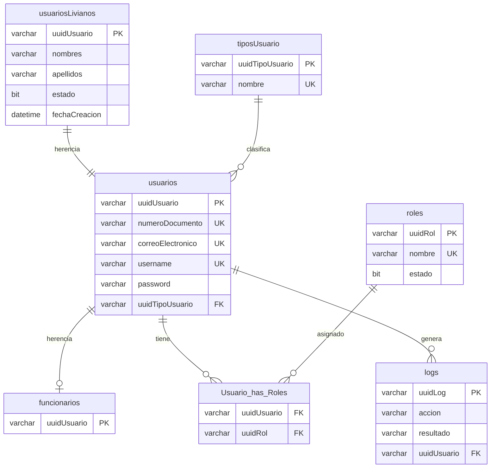
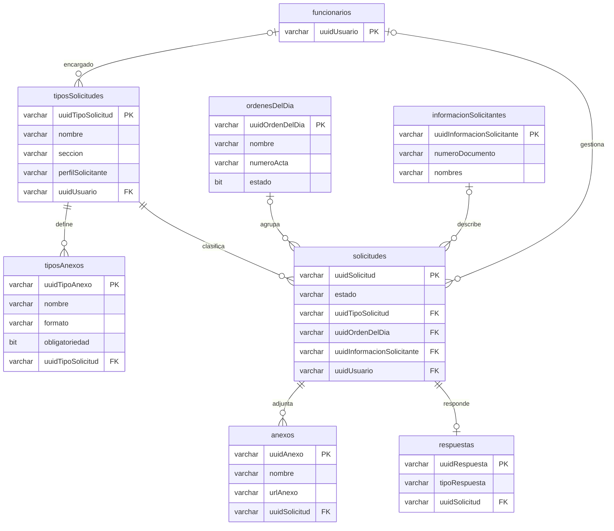
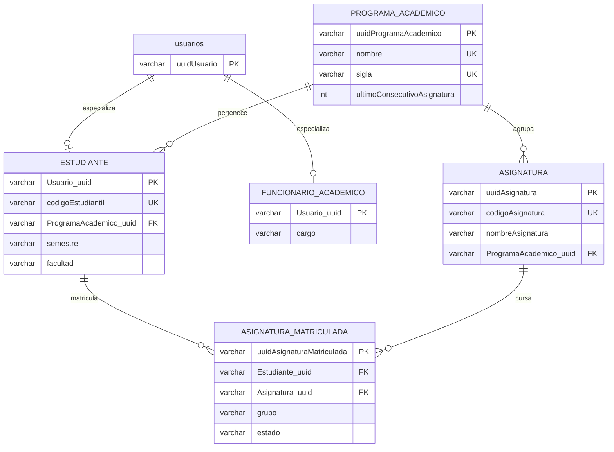
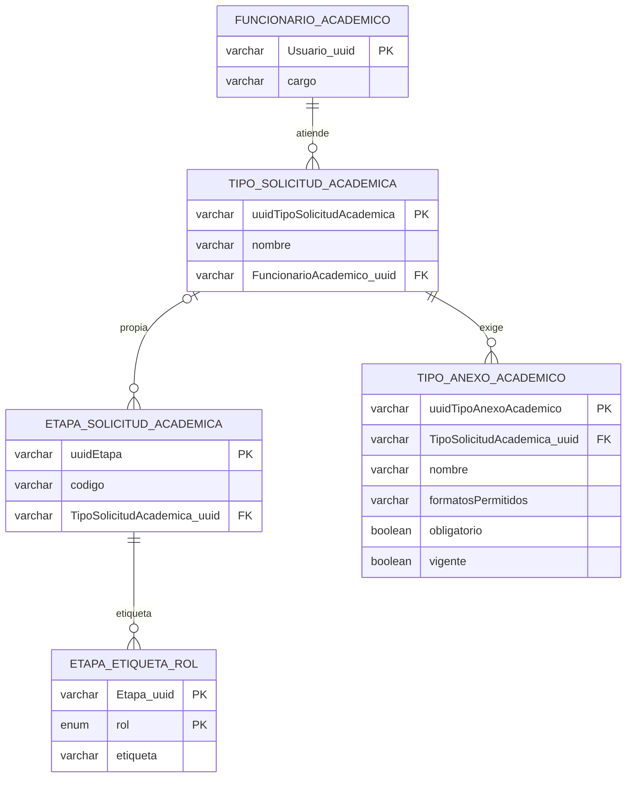
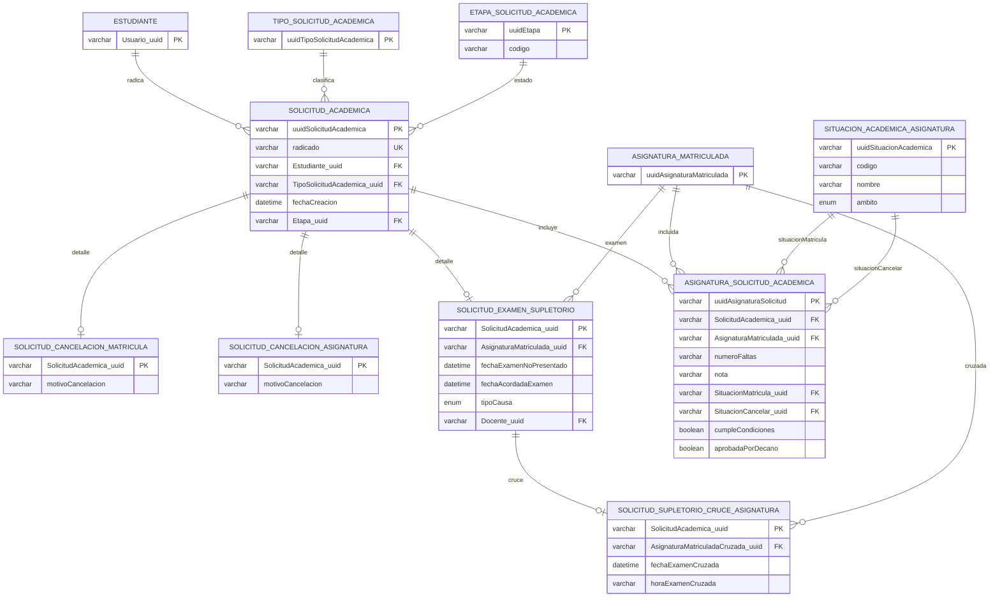
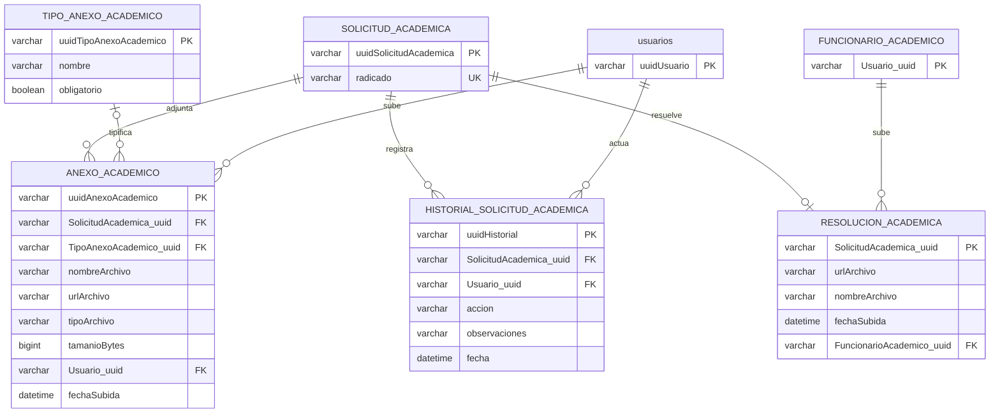

# 05. Base de datos

Análisis de solo lectura. Docker no estaba corriendo, así que no se consultó la base real (`SHOW TABLES`, `DESCRIBE`). El esquema se deduce de las entidades JPA, de `docs/database/*` y de `data.sql` y los seeds. Todo lo que dependa de la base viva queda marcado NO VERIFICADO.

Actualizado el 2026-10-21 (T12.37): dos tablas nuevas (`NOTIFICACION_DOCENTE`, T12.28, y `NOTIFICACION_RESOLUCION`, T12.32), columnas nuevas (`SOLICITUD_EXAMEN_SUPLETORIO.Docente_uuid`, `TIPO_ANEXO_ACADEMICO.vigente`, `SITUACION_ACADEMICA_ASIGNATURA.ambito`), datos sembrados y siglas. Fuente: entidades JPA y `docs/database/diccionario-datos-extension.md`; según el `CLAUDE.md` raíz las 21 tablas coinciden con la base real, lo que esta actualización no volvió a comprobar.

Marcas: [BASE] es el prototipo de Julián Camacho; [EXTENSIÓN] es lo agregado en este trabajo de grado.

Rutas abreviadas:
- ENT = `backend/solicitudes/src/main/java/com/unicauca/cfiet/solicitudes/infraestructura/output/persistencia/entidades/`
- DOC = `docs/database/`
- RES = `backend/solicitudes/src/main/resources/`

## 1. Resumen y conteo

| Concepto | Valor | Evidencia |
|---|---|---|
| Clases `@Entity` | 34 | búsqueda de `@Entity` en `backend/`, todas en ENT (32 en el corte del 2026-10-14) |
| Entidades [BASE] | 13 | sección 3 |
| Entidades [EXTENSIÓN] | 21 | sección 4 |
| Tabla de unión sin entidad [BASE] | 1 (`Usuario_has_Roles`) | `UsuarioEntidad.roles` con `@JoinTable` |
| Tablas físicas [BASE] | 14 (13 + la de unión) | deducido |
| Tablas físicas [EXTENSIÓN] | 21 | `DOC/diccionario-datos-extension.md` y `CLAUDE.md` raíz; `NOTIFICACION_DOCENTE` y `NOTIFICACION_RESOLUCION` se agregaron después del corte |
| Total tablas físicas | 35 | 14 + 21 |
| `@Embeddable` (no es tabla) | 1: `EtapaEtiquetaRolIdEntidad` | ENT |
| Configuración de esquema | `ddl-auto=update`, `spring.sql.init.mode=never`, `PhysicalNamingStrategyStandardImpl` | `RES/application.properties` |

Resolución 19 contra 18 (al corte del 2026-10-14; hoy son 21, ver 4.20 y 4.21): eran 19 tablas de extensión. Evidencia:
1. `DOC/script_bd_extension.sql` define 19 `CREATE TABLE` (PROGRAMA_ACADEMICO, ESTUDIANTE, FUNCIONARIO_ACADEMICO, ASIGNATURA, ASIGNATURA_MATRICULADA, TIPO_SOLICITUD_ACADEMICA, ETAPA_SOLICITUD_ACADEMICA, ETAPA_ETIQUETA_ROL, SOLICITUD_ACADEMICA, SOLICITUD_CANCELACION_MATRICULA, SOLICITUD_CANCELACION_ASIGNATURA, SOLICITUD_EXAMEN_SUPLETORIO, SOLICITUD_SUPLETORIO_CRUCE_ASIGNATURA, SITUACION_ACADEMICA_ASIGNATURA, ASIGNATURA_SOLICITUD_ACADEMICA, TIPO_ANEXO_ACADEMICO, ANEXO_ACADEMICO, RESOLUCION_ACADEMICA, HISTORIAL_SOLICITUD_ACADEMICA). Su pie dice "Son 19 tablas nuevas".
2. ENT contiene 19 entidades de extensión, una por tabla.
3. `DOC/diccionario-datos-extension.md` documenta 19 secciones `##` de tabla.
4. El "18" es histórico: `change.md` (línea 787) y `docs/informe-discrepancias-documentacion.md` (líneas 57 y 78) hablan de 18 tablas porque eran las existentes antes de agregar `PROGRAMA_ACADEMICO` (con `migracion_programas_asignaturas.sql`). Quien da 18 usa un conteo anterior a esa tabla.

## 2. Convenciones del esquema

- Nombres físicos: sin conversión a snake_case. Las tablas [BASE] quedan en camelCase del nombre declarado en `@Table` (`usuarios`, `tiposUsuario`, `solicitudes`); las [EXTENSIÓN] en MAYÚSCULAS con guion bajo (`ESTUDIANTE`, `SOLICITUD_ACADEMICA`) porque así están declaradas en `@Table`. Las columnas conservan el nombre del atributo Java (`RES/application.properties`, `PhysicalNamingStrategyStandardImpl`).
- Claves primarias: todas son `String` UUID. En [BASE] `varchar(150)`; en [EXTENSIÓN] `varchar(100)`.
- Tipos que Hibernate deriva para MySQL (deducción; NO VERIFICADO contra la base): `String` sin longitud `varchar(255)`; `Boolean` en [BASE] `bit(1)`; `LocalDateTime` en [BASE] `datetime(6)`. En [EXTENSIÓN] los tipos están fijados con `columnDefinition` o `length` y coinciden con el DDL de referencia.
- Acciones referenciales: ninguna FK declara `ON DELETE` ni `ON UPDATE`, ni en las entidades ni en `script_bd_extension.sql`. MySQL InnoDB aplica el valor por defecto (`RESTRICT`/`NO ACTION`). Las cascadas son solo de JPA (aplicación), no de base de datos.
- Índices: no hay `@Index` ni `CREATE INDEX` en el código. Existen solo los índices implícitos de InnoDB para PK, UNIQUE y FK. Los nombres de FK e índices únicos [BASE] los genera Hibernate (NO VERIFICADO el nombre exacto).
- `spring.sql.init.mode=never`: ni `data.sql` ni los seeds se ejecutan solos (`RES/application.properties`, `backend/CLAUDE.md` líneas 28 a 46).
- `backend/docker-compose.yml` define `MYSQL_DATABASE: cfiet_database` pero `DB_URL` apunta al esquema `cfiet` con `createDatabaseIfNotExist=true`; los comandos de la documentación usan la base `cfiet`.

## 3. Tablas [BASE] (Julián)

El esquema [BASE] no trae DDL en el repositorio: lo crea Hibernate desde las entidades. La única fuente de datos [BASE] versionada es `RES/data.sql`. Columnas y tipos de esta sección se deducen de las entidades.

### 3.1 usuariosLivianos [BASE]
Entidad `UsuarioLivianoEntidad` (ENT), `@Table(name="usuariosLivianos")`, `@Inheritance(JOINED)`; raíz de la jerarquía.

| Columna | Tipo | Nulo | Notas |
|---|---|---|---|
| uuidUsuario | varchar(150) | No | PK |
| nombres | varchar(1000) | No | |
| apellidos | varchar(1000) | No | |
| estado | bit(1) | No | |
| fechaCreacion | datetime(6) | No | `updatable=false`, asignada en `@PrePersist`. `data.sql` hace `ALTER ... MODIFY fechaCreacion DATETIME NOT NULL DEFAULT CURRENT_TIMESTAMP` |

### 3.2 usuarios [BASE]
Entidad `UsuarioEntidad extends UsuarioLivianoEntidad`, implementa `UserDetails`. Herencia JOINED: PK = FK a `usuariosLivianos.uuidUsuario`.

| Columna | Tipo | Nulo | Notas |
|---|---|---|---|
| uuidUsuario | varchar(150) | No | PK y FK a usuariosLivianos |
| tipoDocumento | varchar(1000) | No | |
| numeroDocumento | varchar(255) | No | UNIQUE |
| telefono | varchar(1000) | No | |
| correoElectronico | varchar(255) | No | UNIQUE |
| username | varchar(255) | No | UNIQUE |
| password | varchar(1000) | No | hash BCrypt (ver `data.sql`) |
| uuidTipoUsuario | varchar(150) | No | FK a tiposUsuario (`@ManyToOne objTipoUsuario`, EAGER por defecto) |

Relaciones: `roles` `@ManyToMany(EAGER)` con `@JoinTable("Usuario_has_Roles")`; `logs` `@OneToMany(LAZY, mappedBy="objUsuarioLog")`.

### 3.3 funcionarios [BASE]
Entidad `FuncionarioEntidad extends UsuarioEntidad`, `@Table("funcionarios")`. Herencia JOINED: PK `uuidUsuario` que es FK a `usuarios`; no declara columnas propias. No es el Funcionario Académico de la extensión (ver `FUNCIONARIO_ACADEMICO`). Referenciada por `solicitudes.uuidUsuario` y `tiposSolicitudes.uuidUsuario`.

### 3.4 tiposUsuario [BASE]
Entidad `TipoUsuarioEntidad`. `uuidTipoUsuario varchar(150)` PK; `nombre varchar(255)` NOT NULL UNIQUE. Relación inversa `usuarios` `@OneToMany(LAZY, mappedBy="objTipoUsuario")`.

### 3.5 roles [BASE]
Entidad `RolEntidad`. `uuidRol varchar(150)` PK; `nombre varchar(255)` NOT NULL UNIQUE; `descripcion varchar(1500)` NULL; `estado bit(1)` NOT NULL.

### 3.6 Usuario_has_Roles [BASE] (tabla de unión, sin entidad)
Definida en `UsuarioEntidad.roles` con `@JoinTable(name="Usuario_has_Roles", joinColumns=uuidUsuario, inverseJoinColumns=uuidRol)`. Columnas `uuidUsuario varchar(150)` (FK a usuarios) y `uuidRol varchar(150)` (FK a roles). Al ser una `List`, Hibernate no genera clave primaria (comportamiento conocido de Hibernate; NO VERIFICADO en la base).

### 3.7 logs [BASE]
Entidad `LogEntidad`. `uuidLog varchar(150)` PK; `accion varchar(1000)`, `fecha varchar(1000)` (texto, no fecha), `resultado varchar(1000)`, todas NOT NULL; `uuidUsuario varchar(150)` NOT NULL FK a usuarios (`objUsuarioLog`); `fechaCreacion datetime(6)` NOT NULL (`updatable=false`, `@PrePersist`).

### 3.8 tiposSolicitudes [BASE]
Entidad `TipoSolicitudEntidad`. `uuidTipoSolicitud varchar(150)` PK; `nombre varchar(1000)` NOT NULL; `descripcion varchar(1500)` NULL; `seccion varchar(1000)` NOT NULL; `perfilSolicitante varchar(1000)` NOT NULL; `uuidUsuario varchar(150)` NULL FK a funcionarios (`objFuncionarioEncargado`); `fechaCreacion datetime(6)` NOT NULL (`@PrePersist`). Relación `anexos` `@OneToMany(LAZY, mappedBy="objTipoSolicitud", cascade=ALL, orphanRemoval=true)` hacia `tiposAnexos`.

### 3.9 tiposAnexos [BASE]
Entidad `TipoAnexoEntidad`. `uuidTipoAnexo varchar(150)` PK; `nombre varchar(1000)` NOT NULL; `descripcion varchar(1500)` NULL; `formato varchar(1000)` NOT NULL; `obligatoriedad bit(1)` NOT NULL; `uuidTipoSolicitud varchar(150)` NOT NULL FK a tiposSolicitudes.

### 3.10 ordenesDelDia [BASE]
Entidad `OrdenDelDiaEntidad`. `uuidOrdenDelDia varchar(150)` PK; `nombre varchar(1000)` NOT NULL; `descripcion varchar(1500)` NULL; `ciudad`, `fecha`, `horaInicio`, `horaFin`, `lugarReunion` `varchar(1000)` NULL (fechas y horas como texto); `numeroActa varchar(1000)` NOT NULL; `fechaCreacion datetime(6)` NOT NULL (`@PrePersist`); `estado bit(1)` NOT NULL (`boolean` primitivo).

### 3.11 informacionSolicitantes [BASE]
Entidad `InformacionSolicitanteEntidad`. `uuidInformacionSolicitante varchar(150)` PK; `tipoDocumento`, `numeroDocumento`, `nombres`, `apellidos`, `telefono`, `correoElectronico`, todas `varchar(1000)` NOT NULL. Lado inverso `@OneToOne(mappedBy="informacionSolicitante") solicitud`; la FK vive en `solicitudes`.

### 3.12 solicitudes [BASE]
Entidad `SolicitudEntidad`. Es la solicitud de Consejo de Facultad de Julián, distinta de `SOLICITUD_ACADEMICA`.

| Columna | Tipo | Nulo | Notas |
|---|---|---|---|
| uuidSolicitud | varchar(150) | No | PK |
| consecutivo | varchar(1000) | Sí | |
| nombre | varchar(1000) | Sí | |
| descripcion | varchar(1500) | Sí | |
| estado | varchar(1000) | No | texto libre |
| uuidTipoSolicitud | varchar(150) | No | FK a tiposSolicitudes |
| uuidOrdenDelDia | varchar(150) | Sí | FK a ordenesDelDia |
| uuidInformacionSolicitante | varchar(150) | Sí | FK a informacionSolicitantes, `cascade=ALL` |
| uuidUsuario | varchar(150) | Sí | FK a funcionarios (`objFuncionario`) |
| fechaCreacion | datetime(6) | No | `updatable=false`, `@PrePersist` |

Relaciones: `anexos` `@OneToMany(LAZY, cascade=ALL, orphanRemoval=true)`; `respuesta` `@OneToOne(mappedBy="solicitud", LAZY)`.

### 3.13 anexos [BASE]
Entidad `AnexoEntidad`. `uuidAnexo varchar(150)` PK; `nombre varchar(1000)` NOT NULL; `urlAnexo varchar(3000)` NOT NULL; `uuidSolicitud varchar(150)` NOT NULL FK a solicitudes.

### 3.14 respuestas [BASE]
Entidad `RespuestaEntidad`. `uuidRespuesta varchar(150)` PK; `tipoRespuesta varchar(1000)` NOT NULL; `consecutivoFiet varchar(1000)` NOT NULL; `respuestaConsejo varchar(5000)` NOT NULL; `indicaciones varchar(5000)` NULL; `uuidSolicitud varchar(150)` NOT NULL UNIQUE FK a solicitudes (`@OneToOne`, 1 a 0..1); `urlRespuesta varchar(3000)` NULL; `fechaCreacion datetime(6)` NOT NULL.

## 4. Tablas [EXTENSIÓN]

Fuente primaria: `DOC/script_bd_extension.sql` (DDL de referencia, no se ejecuta; las crea Hibernate). Tipos y nulabilidad coinciden entre ese script y las entidades en las 19 tablas del corte (comparado columna por columna); las dos tablas y las columnas posteriores se tomaron de las entidades y del diccionario sin repetir esa comparación. Todas son `ENGINE=InnoDB DEFAULT CHARSET=utf8mb4` en el script. Las FK no declaran acción referencial.

### 4.1 PROGRAMA_ACADEMICO [EXTENSIÓN]
Entidad `ProgramaAcademicoEntidad`.

| Columna | Tipo | Nulo | Default | Notas |
|---|---|---|---|---|
| uuidProgramaAcademico | varchar(100) | No | | PK |
| nombre | varchar(100) | No | | UNIQUE `uk_programa_nombre` |
| sigla | varchar(10) | No | | UNIQUE `uk_programa_sigla` |
| ultimoConsecutivoAsignatura | int | No | 0 | contador del código (`PIS-294`; las creadas antes de T12.34 conservan la sigla anterior, como `ISI-001`) |

### 4.2 ESTUDIANTE [EXTENSIÓN]
Entidad `EstudianteEntidad implements Persistable<String>`.

| Columna | Tipo | Nulo | Notas |
|---|---|---|---|
| Usuario_uuid | varchar(100) | No | PK y FK `fk_estudiante_usuario` a usuarios.uuidUsuario (`@MapsId`) |
| codigoEstudiantil | varchar(45) | No | UNIQUE `uk_estudiante_codigo` |
| ProgramaAcademico_uuid | varchar(100) | No | FK `fk_estudiante_programa` |
| semestre | varchar(10) | No | |
| facultad | varchar(100) | No | siempre `FIET` (comentario del script) |

Relación: `asignaturasMatriculadas` `@OneToMany(mappedBy="estudiante", cascade=ALL, fetch=EAGER)`.

### 4.3 FUNCIONARIO_ACADEMICO [EXTENSIÓN]
Entidad `FuncionarioAcademicoEntidad`. `Usuario_uuid varchar(100)` PK y FK `fk_funcionarioacademico_usuario` a usuarios (`@MapsId`); `cargo varchar(100)` NOT NULL. El Decano no tiene fila aquí (nota en el script).

### 4.4 ASIGNATURA [EXTENSIÓN]
Entidad `AsignaturaEntidad`. `uuidAsignatura varchar(100)` PK; `codigoAsignatura varchar(45)` NOT NULL UNIQUE `uk_asignatura_codigo`; `nombreAsignatura varchar(150)` NOT NULL; `ProgramaAcademico_uuid varchar(100)` NOT NULL FK `fk_asignatura_programa`. La unicidad del nombre por programa la valida el backend, no hay índice (comentario del script).

### 4.5 ASIGNATURA_MATRICULADA [EXTENSIÓN]
Entidad `AsignaturaMatriculadaEntidad`. `uuidAsignaturaMatriculada varchar(100)` PK; `Estudiante_uuid` NOT NULL FK `fk_asigmat_estudiante`; `Asignatura_uuid` NOT NULL FK `fk_asigmat_asignatura`; `grupo varchar(20)` NOT NULL; `estado varchar(20)` NOT NULL DEFAULT `'activa'`. Valores válidos de `estado` (en código, no en la base): `activa`, `cancelada`, `aprobada`, `perdida` (`EstadoAsignaturaMatriculadaConstantes.ESTADOS_VALIDOS`, en `backend/solicitudes/src/main/java/com/unicauca/cfiet/solicitudes/dominio/helper/constantes/`).

### 4.6 TIPO_SOLICITUD_ACADEMICA [EXTENSIÓN]
Entidad `TipoSolicitudAcademicaEntidad`. `uuidTipoSolicitudAcademica` PK; `nombre varchar(100)` NOT NULL; `descripcion varchar(255)` NULL; `FuncionarioAcademico_uuid` NOT NULL FK `fk_tiposolicitud_funcionario` a FUNCIONARIO_ACADEMICO.

### 4.7 ETAPA_SOLICITUD_ACADEMICA [EXTENSIÓN]
Entidad `EtapaSolicitudAcademicaEntidad`. `uuidEtapa` PK; `codigo varchar(60)` NOT NULL; `TipoSolicitudAcademica_uuid` NULL FK `fk_etapa_tiposolicitud`. NULL indica etapa común a los tres procesos (según el seed); con valor, etapa propia de un tipo. No hay UNIQUE sobre `codigo`.

### 4.8 ETAPA_ETIQUETA_ROL [EXTENSIÓN]
Entidad `EtapaEtiquetaRolEntidad` con `@EmbeddedId EtapaEtiquetaRolIdEntidad`. PK compuesta (`Etapa_uuid varchar(100)`, `rol`); `rol` `enum('ESTUDIANTE','FUNCIONARIO','DECANO')` NOT NULL (`RolEtiquetaEtapa`, en `backend/solicitudes/src/main/java/com/unicauca/cfiet/solicitudes/dominio/modelos/`, mapeado con `@Enumerated(STRING)`); `etiqueta varchar(60)` NOT NULL; FK `fk_etiqueta_etapa` (`@MapsId("etapaUuid")`).

### 4.9 SOLICITUD_ACADEMICA [EXTENSIÓN]
Entidad `SolicitudAcademicaEntidad`. Tabla raíz de los tres procesos.

| Columna | Tipo | Nulo | Default | Notas |
|---|---|---|---|---|
| uuidSolicitudAcademica | varchar(100) | No | | PK |
| radicado | varchar(20) | No | | UNIQUE `uk_solacad_radicado`; formato AAAA-CM-0001, AAAA-CA-0001, AAAA-ES-0001 |
| Estudiante_uuid | varchar(100) | No | | FK `fk_solacad_estudiante` |
| TipoSolicitudAcademica_uuid | varchar(100) | No | | FK `fk_solacad_tiposolicitud` |
| fechaCreacion | datetime | No | CURRENT_TIMESTAMP | |
| Etapa_uuid | varchar(100) | No | | FK `fk_solacad_etapa` (etapa actual) |

### 4.10 SOLICITUD_CANCELACION_MATRICULA [EXTENSIÓN]
Entidad `SolicitudCancelacionMatriculaEntidad`. `SolicitudAcademica_uuid` PK y FK `fk_solcm_solacad` (`@MapsId`, 1 a 1); `motivoCancelacion varchar(255)` NOT NULL.

### 4.11 SOLICITUD_CANCELACION_ASIGNATURA [EXTENSIÓN]
Entidad `SolicitudCancelacionAsignaturaEntidad`. PK/FK `fk_solca_solacad`; `motivoCancelacion varchar(255)` NOT NULL.

### 4.12 SOLICITUD_EXAMEN_SUPLETORIO [EXTENSIÓN]
Entidad `SolicitudExamenSupletorioEntidad`. `SolicitudAcademica_uuid` PK/FK `fk_solsup_solacad`; `AsignaturaMatriculada_uuid` NOT NULL FK `fk_solsup_asigmat`; `fechaExamenNoPresentado datetime` NOT NULL; `fechaAcordadaExamen datetime` NULL, en desuso desde T12.28 (P52: no se pide ni se escribe; se conserva por los datos anteriores); `tipoCausa enum('cruce','otra')` NOT NULL (en la entidad es `String` con `columnDefinition`); `Docente_uuid varchar(100)` NULL, FK `fk_solsup_docente` a usuarios, desde T12.28: el profesor con rol Docente que el Funcionario elige al aprobar el comprobante (P53).

### 4.13 SOLICITUD_SUPLETORIO_CRUCE_ASIGNATURA [EXTENSIÓN]
Entidad `SolicitudSupletorioCruceAsignaturaEntidad`. `SolicitudAcademica_uuid` PK y FK `fk_solcruce_solsup` a SOLICITUD_EXAMEN_SUPLETORIO; `AsignaturaMatriculadaCruzada_uuid` NOT NULL FK `fk_solcruce_asigmat`; `fechaExamenCruzada datetime` NOT NULL; `horaExamenCruzada varchar(10)` NOT NULL. La regla "existe solo si `tipoCausa='cruce'`" es de negocio; no hay CHECK (NO VERIFICADA en código de servicio en este documento).

### 4.14 SITUACION_ACADEMICA_ASIGNATURA [EXTENSIÓN]
Entidad `SituacionAcademicaAsignaturaEntidad`. `uuidSituacionAcademica` PK; `codigo varchar(10)` NOT NULL; `nombre varchar(100)` NOT NULL; desde T12.34 `ambito enum('CANCELACION','MATRICULA')` NULL (enum `AmbitoSituacionAcademica`). Catálogo del formato PA-GA-4.2-FOR-9 con dos listas cerradas (P60): situación de la asignatura (`MATRICULA`): R1 Cursada por primera vez, R1R Recursada por primera vez, R2 Cursada por segunda vez, R3 Cursada por tercera vez; situación al cancelar (`CANCELACION`): C1 No vista, C2 Perdida. R0 No cursada queda retirada (`ambito` nulo), sin borrarse. El backend rechaza con código 6 un valor fuera de la lista del campo.

### 4.15 ASIGNATURA_SOLICITUD_ACADEMICA [EXTENSIÓN]
Entidad `AsignaturaSolicitudAcademicaEntidad`.

| Columna | Tipo | Nulo | Notas |
|---|---|---|---|
| uuidAsignaturaSolicitud | varchar(100) | No | PK |
| SolicitudAcademica_uuid | varchar(100) | No | FK `fk_asigsol_solacad` |
| AsignaturaMatriculada_uuid | varchar(100) | No | FK `fk_asigsol_asigmat` |
| numeroFaltas | varchar(20) | Sí | opcional desde T12.28 (P50); texto; si es numérico, entero >= 0 |
| nota | varchar(20) | Sí | opcional desde T12.28 (P50); texto; si es numérico, 0.0 a 5.0 |
| SituacionMatricula_uuid | varchar(100) | Sí | FK `fk_asigsol_situmatricula` a SITUACION_ACADEMICA_ASIGNATURA; opcional (P50), solo de la lista `MATRICULA` (P60); la registra el Funcionario al remitir |
| SituacionCancelar_uuid | varchar(100) | Sí | FK `fk_asigsol_situcancelar` a la misma tabla; opcional (P50), solo de la lista `CANCELACION` (P60); la registra solo el Funcionario, nunca el Decano (P51) |
| cumpleCondiciones | tinyint(1) | Sí | solo Cancelación de Asignatura |
| observacionEvaluacion | varchar(255) | Sí | |
| aprobadaPorDecano | tinyint(1) | Sí | decisión por asignatura (P14) |
| observacionDecision | varchar(255) | Sí | |

### 4.16 TIPO_ANEXO_ACADEMICO [EXTENSIÓN]
Entidad `TipoAnexoAcademicoEntidad`. `uuidTipoAnexoAcademico` PK; `TipoSolicitudAcademica_uuid` NOT NULL FK `fk_tipoanexo_tiposolicitud`; `nombre varchar(150)` NOT NULL; `formatosPermitidos varchar(60)` NOT NULL (lista separada por comas: `pdf`, `pdf,jpg,png`); `obligatorio tinyint(1)` NOT NULL DEFAULT 1; desde T12.31 `vigente tinyint(1)` NOT NULL DEFAULT 1 (0 = retirado: no se ofrece, no se exige ni se puede subir, pero los anexos ya radicados se conservan). Quedaron con `vigente = 0` los seis anexos anteriores de Cancelación de Matrícula (P55) y, desde T12.33, el "Documento adicional de la respuesta" de Cancelación de Asignatura (P59).

### 4.17 ANEXO_ACADEMICO [EXTENSIÓN]
Entidad `AnexoAcademicoEntidad`. `uuidAnexoAcademico` PK; `SolicitudAcademica_uuid` NOT NULL FK `fk_anexo_solacad`; `TipoAnexoAcademico_uuid` NULL FK `fk_anexo_tipoanexo`; `nombreArchivo varchar(255)`, `urlArchivo varchar(400)`, `tipoArchivo varchar(100)` NOT NULL; `tamanioBytes bigint` NOT NULL; `Usuario_uuid` NOT NULL FK `fk_anexo_usuario` a usuarios; `fechaSubida datetime` NOT NULL DEFAULT CURRENT_TIMESTAMP.

### 4.18 RESOLUCION_ACADEMICA [EXTENSIÓN]
Entidad `ResolucionAcademicaEntidad`. `SolicitudAcademica_uuid` PK y FK `fk_resolucion_solacad` (`@MapsId`, 1 a 0..1 con la solicitud); `urlArchivo varchar(400)`, `nombreArchivo varchar(255)` NOT NULL; `fechaSubida datetime` NOT NULL DEFAULT CURRENT_TIMESTAMP; `FuncionarioAcademico_uuid` NOT NULL FK `fk_resolucion_funcionario`. Guarda una sola Resolución por solicitud: en Cancelación de Asignatura, la sin firmar por el estudiante hasta que el Funcionario la reemplaza por la firmada (P59).

### 4.19 HISTORIAL_SOLICITUD_ACADEMICA [EXTENSIÓN]
Entidad `HistorialSolicitudAcademicaEntidad`. `uuidHistorial` PK; `SolicitudAcademica_uuid` NOT NULL FK `fk_historial_solacad`; `Usuario_uuid` NOT NULL FK `fk_historial_usuario` a usuarios; `accion varchar(150)` NOT NULL; `observaciones varchar(500)` NULL; `fecha datetime` NOT NULL DEFAULT CURRENT_TIMESTAMP.

### 4.20 NOTIFICACION_DOCENTE [EXTENSIÓN]
Entidad `NotificacionDocenteEntidad`, desde T12.28 (P53). Una fila por cada Examen Supletorio cuyo pago aprueba el Funcionario, para avisar al profesor elegido; solo la ve ese docente. `idNotificacion bigint` PK AUTO_INCREMENT; `uuidNotificacion varchar(100)` NOT NULL UNIQUE `uk_notifdoc_uuid` (el identificador que usa la API); `SolicitudAcademica_uuid` NOT NULL FK `fk_notifdoc_solacad`; `Docente_uuid` NOT NULL FK `fk_notifdoc_usuario` a usuarios; `titulo varchar(255)` NOT NULL; `fechaCreacion datetime` NOT NULL; `fechaLectura datetime` NULL (primera vez que el docente la abrió).

### 4.21 NOTIFICACION_RESOLUCION [EXTENSIÓN]
Entidad `NotificacionResolucionEntidad implements Persistable<String>`, desde T12.32 (P58). Comunicación programada de la Resolución en Cancelación de Asignatura cuando la solicitud pasó por el Decano; 1 a 0..1 con SOLICITUD_ACADEMICA, creada al enviar la respuesta final. Uso detallado en [correo-electronico.md](correo-electronico.md).

| Columna | Tipo | Nulo | Notas |
|---|---|---|---|
| SolicitudAcademica_uuid | varchar(100) | No | PK y FK `fk_notifres_solacad` |
| fechaProgramada | datetime | No | fecha y hora de la comunicación, hora de Colombia |
| estado | enum('ENVIADA','EN_PROCESO','FALLIDA','PROGRAMADA') | No | `EstadoNotificacionResolucion`, `@Enumerated(STRING)` |
| firmada | bit(1) | No | default 0; 1 si el estudiante firmó en la Decanatura antes de la fecha |
| numeroResolucion | varchar(20) | No | el sufijo `/178` sale de propiedades y no se guarda |
| anioResolucion | int | No | 2000 a 2100 (validado en código) |
| decision | varchar(60) | No | "aprueba la", "rechaza la", "aprueba parcialmente la" u otro texto |
| mensajeInicial | varchar(2000) | Sí | mensaje inmediato enviado al estudiante; desde T12.38 siempre se envía (P63) |
| textoComunicacion | varchar(4000) | Sí | T12.38 (P63): texto editable de la comunicación al estudiante con `{numero}`, `{anio}`, `{nombre}` y `{decision}`; nulo en filas anteriores, que usan la plantilla fija |
| textoDarca | varchar(4000) | Sí | T12.38 (P63): texto editable del correo a DARCA con `{fecha}`; al registrar la firma se guarda el que revisa el Funcionario |
| fechaEnvioEstudiante | datetime | Sí | marca del correo al estudiante |
| fechaEnvioDarca | datetime | Sí | marca del correo a DARCA |
| intentos | int | No | default 0; en 3 sin éxito queda FALLIDA |
| ultimoError | varchar(1000) | Sí | último error, visible para el Funcionario |
| fechaReclamo | datetime | Sí | última vez que la tarea la reclamó |
| fechaEnvio | datetime | Sí | cuando quedó ENVIADA |
| fechaLiberacion | datetime | Sí | primera vez que la tarea la reclamó o momento en que se guardó la firma; desde T12.38 el Estudiante ve la solicitud "En trámite" solo mientras sea nula y `fechaProgramada` siga en el futuro (P63) |
| fechaCreacion | datetime | No | cuando el Funcionario envió la respuesta |

## 5. Mapeo JPA: relaciones, direccionalidad, fetch y cascade

Defecto de JPA: `@ManyToOne` y `@OneToOne` son EAGER; `@OneToMany` y `@ManyToMany` son LAZY (salvo lo declarado).

| Entidad | Atributo | Tipo | Dirección | Fetch | Cascade |
|---|---|---|---|---|---|
| UsuarioEntidad | objTipoUsuario | ManyToOne | bidireccional (inverso en TipoUsuario.usuarios) | EAGER (defecto) | no |
| UsuarioEntidad | roles | ManyToMany (dueño) | unidireccional | EAGER | no |
| UsuarioEntidad | logs | OneToMany mappedBy objUsuarioLog | bidireccional | LAZY | no |
| TipoUsuarioEntidad | usuarios | OneToMany | bidireccional | LAZY | no |
| LogEntidad | objUsuarioLog | ManyToOne | bidireccional | EAGER | no |
| TipoSolicitudEntidad | anexos | OneToMany mappedBy objTipoSolicitud | bidireccional | LAZY | ALL, orphanRemoval |
| TipoSolicitudEntidad | objFuncionarioEncargado | ManyToOne a FuncionarioEntidad | unidireccional | EAGER | no |
| TipoAnexoEntidad | objTipoSolicitud | ManyToOne | bidireccional | EAGER | no |
| SolicitudEntidad | objTipoSolicitud, objOrdenDelDia, objFuncionario | ManyToOne | unidireccional | EAGER | no |
| SolicitudEntidad | anexos | OneToMany mappedBy objSolicitud | bidireccional | LAZY | ALL, orphanRemoval |
| SolicitudEntidad | informacionSolicitante | OneToOne (dueño) | bidireccional | EAGER | ALL |
| SolicitudEntidad | respuesta | OneToOne mappedBy solicitud | bidireccional | LAZY | no |
| RespuestaEntidad | solicitud | OneToOne (dueño, unique) | bidireccional | EAGER | no |
| AnexoEntidad | objSolicitud | ManyToOne | bidireccional | EAGER | no |
| InformacionSolicitanteEntidad | solicitud | OneToOne mappedBy | bidireccional | EAGER | no |
| EstudianteEntidad | usuario | OneToOne con `@MapsId` | unidireccional | EAGER | no |
| EstudianteEntidad | programaAcademico | ManyToOne | unidireccional | EAGER | no |
| EstudianteEntidad | asignaturasMatriculadas | OneToMany mappedBy estudiante | bidireccional | EAGER | ALL |
| AsignaturaMatriculadaEntidad | estudiante | ManyToOne | bidireccional (con la colección de Estudiante) | EAGER | no |
| AsignaturaMatriculadaEntidad | asignatura | ManyToOne | unidireccional | EAGER | no |
| AsignaturaEntidad | programaAcademico | ManyToOne | unidireccional | EAGER | no |
| FuncionarioAcademicoEntidad | usuario | OneToOne `@MapsId` | unidireccional | EAGER | no |
| TipoSolicitudAcademicaEntidad | funcionarioAcademico | ManyToOne | unidireccional | EAGER | no |
| EtapaSolicitudAcademicaEntidad | tipoSolicitudAcademica | ManyToOne (opcional) | unidireccional | EAGER | no |
| EtapaEtiquetaRolEntidad | etapa | ManyToOne `@MapsId("etapaUuid")` | unidireccional | EAGER | no |
| SolicitudAcademicaEntidad | estudiante, tipoSolicitudAcademica, etapa | ManyToOne | unidireccional | EAGER | no |
| SolicitudCancelacionMatriculaEntidad, SolicitudCancelacionAsignaturaEntidad, SolicitudExamenSupletorioEntidad, ResolucionAcademicaEntidad | solicitudAcademica | OneToOne `@MapsId` | unidireccional | EAGER | no |
| SolicitudExamenSupletorioEntidad | asignaturaMatriculada | ManyToOne | unidireccional | EAGER | no |
| SolicitudSupletorioCruceAsignaturaEntidad | solicitudExamenSupletorio | OneToOne `@MapsId` | unidireccional | EAGER | no |
| SolicitudSupletorioCruceAsignaturaEntidad | asignaturaMatriculadaCruzada | ManyToOne | unidireccional | EAGER | no |
| AsignaturaSolicitudAcademicaEntidad | solicitudAcademica, asignaturaMatriculada, situacionMatricula, situacionCancelar | ManyToOne | unidireccional | EAGER | no |
| TipoAnexoAcademicoEntidad | tipoSolicitudAcademica | ManyToOne | unidireccional | EAGER | no |
| AnexoAcademicoEntidad | solicitudAcademica, tipoAnexoAcademico, usuario | ManyToOne | unidireccional | EAGER | no |
| ResolucionAcademicaEntidad | funcionarioAcademico | ManyToOne | unidireccional | EAGER | no |
| HistorialSolicitudAcademicaEntidad | solicitudAcademica, usuario | ManyToOne | unidireccional | EAGER | no |

Observaciones:
- Siete entidades de extensión implementan `Persistable<String>` con un campo `@Transient nuevo`: Estudiante, FuncionarioAcademico, ResolucionAcademica, SolicitudCancelacionAsignatura, SolicitudCancelacionMatricula, SolicitudExamenSupletorio y SolicitudSupletorioCruceAsignatura. Tienen PK asignada con `@MapsId`; con `Persistable` Spring Data decide `persist` en lugar de `merge` (propósito deducido; NO VERIFICADO en los adaptadores).
- Las entidades [BASE] asignan `fechaCreacion` en `@PrePersist`; las de [EXTENSIÓN] usan `@ColumnDefault("CURRENT_TIMESTAMP")` y `datetime`.
- Dependencias de la extensión hacia la base: solo hacia `usuarios` (`ESTUDIANTE`, `FUNCIONARIO_ACADEMICO`, `ANEXO_ACADEMICO.Usuario_uuid`, `HISTORIAL_SOLICITUD_ACADEMICA.Usuario_uuid` y, desde T12.28, `SOLICITUD_EXAMEN_SUPLETORIO.Docente_uuid` y `NOTIFICACION_DOCENTE.Docente_uuid`). Las relaciones JPA de las dos tablas nuevas no se agregaron a la tabla de arriba. Ninguna tabla [BASE] referencia tablas [EXTENSIÓN].

## 6. Enums y catálogos

| Catálogo | Dónde vive | Valores |
|---|---|---|
| rol de etiqueta | `ETAPA_ETIQUETA_ROL.rol`, enum de base | ESTUDIANTE, FUNCIONARIO, DECANO |
| tipoCausa | `SOLICITUD_EXAMEN_SUPLETORIO.tipoCausa`, enum de base | cruce, otra |
| estado de asignatura matriculada | `ASIGNATURA_MATRICULADA.estado`, varchar validado en código | activa (default), cancelada, aprobada, perdida |
| etapas | `ETAPA_SOLICITUD_ACADEMICA`, filas | RADICADA, EN_REVISION_DECANO, APROBADA_POR_DECANO, RECHAZADA_POR_DECANO, APROBADA, RECHAZADA (tipo NULL); PENDIENTE_PAGO, EN_VERIFICACION_PAGO (tipo Examen Supletorio) |
| situación académica | `SITUACION_ACADEMICA_ASIGNATURA`, filas, con `ambito` | MATRICULA: R1 Cursada por primera vez, R1R Recursada por primera vez, R2 Cursada por segunda vez, R3 Cursada por tercera vez; CANCELACION: C1 No vista, C2 Perdida; retirada: R0 No cursada (desde T12.34, P60) |
| ámbito de la situación | `SITUACION_ACADEMICA_ASIGNATURA.ambito`, enum de base | MATRICULA, CANCELACION (nulo = retirada) |
| estado de la notificación de la Resolución | `NOTIFICACION_RESOLUCION.estado`, enum de base | PROGRAMADA, EN_PROCESO, ENVIADA, FALLIDA |
| programas | `PROGRAMA_ACADEMICO`, filas | PIET, PIS, PIAI, TTM, PIAC (desde T12.34, P61; antes IET, ISI, IAI, TTE, IAC) |
| tipos de solicitud | `TIPO_SOLICITUD_ACADEMICA`, filas | Cancelación de Matrícula, Cancelación de Asignatura, Examen Supletorio |
| estado de solicitud [BASE] | `solicitudes.estado`, texto libre | sin catálogo en la base |

## 7. Cardinalidades

- usuariosLivianos 1 a 1 usuarios (herencia JOINED); usuarios 1 a 0..1 funcionarios; usuarios 1 a 0..1 ESTUDIANTE; usuarios 1 a 0..1 FUNCIONARIO_ACADEMICO.
- tiposUsuario 1 a N usuarios; usuarios N a M roles (vía Usuario_has_Roles); usuarios 1 a N logs.
- tiposSolicitudes 1 a N tiposAnexos; tiposSolicitudes 1 a N solicitudes; funcionarios 0..1 a N tiposSolicitudes y solicitudes; ordenesDelDia 0..1 a N solicitudes; solicitudes 1 a N anexos; solicitudes 1 a 0..1 respuestas.
- informacionSolicitantes con solicitudes: declarado `@OneToOne` en JPA, pero la FK `solicitudes.uuidInformacionSolicitante` no tiene UNIQUE en el mapeo, así que a nivel de base queda 0..1 a N (NO VERIFICADO en la base; Hibernate suele añadir UNIQUE a `@OneToOne`, por lo que la deducción es incierta).
- PROGRAMA_ACADEMICO 1 a N ESTUDIANTE y 1 a N ASIGNATURA; ESTUDIANTE 1 a N ASIGNATURA_MATRICULADA; ASIGNATURA 1 a N ASIGNATURA_MATRICULADA.
- FUNCIONARIO_ACADEMICO 1 a N TIPO_SOLICITUD_ACADEMICA; FUNCIONARIO_ACADEMICO 1 a N RESOLUCION_ACADEMICA.
- TIPO_SOLICITUD_ACADEMICA 0..1 a N ETAPA_SOLICITUD_ACADEMICA (NULL = común); 1 a N TIPO_ANEXO_ACADEMICO; 1 a N SOLICITUD_ACADEMICA.
- ETAPA_SOLICITUD_ACADEMICA 1 a N ETAPA_ETIQUETA_ROL (hasta 3 por etapa, una por rol); 1 a N SOLICITUD_ACADEMICA.
- ESTUDIANTE 1 a N SOLICITUD_ACADEMICA.
- SOLICITUD_ACADEMICA 1 a 0..1 SOLICITUD_CANCELACION_MATRICULA, SOLICITUD_CANCELACION_ASIGNATURA, SOLICITUD_EXAMEN_SUPLETORIO y RESOLUCION_ACADEMICA; 1 a N ASIGNATURA_SOLICITUD_ACADEMICA, ANEXO_ACADEMICO y HISTORIAL_SOLICITUD_ACADEMICA.
- SOLICITUD_ACADEMICA 1 a 0..1 NOTIFICACION_RESOLUCION y 1 a N NOTIFICACION_DOCENTE (en la práctica una por supletorio aprobado); usuarios (docente) 1 a N NOTIFICACION_DOCENTE y 0..1 a N SOLICITUD_EXAMEN_SUPLETORIO (`Docente_uuid`).
- SOLICITUD_EXAMEN_SUPLETORIO 1 a 0..1 SOLICITUD_SUPLETORIO_CRUCE_ASIGNATURA; ASIGNATURA_MATRICULADA 1 a N SOLICITUD_EXAMEN_SUPLETORIO, 1 a N SOLICITUD_SUPLETORIO_CRUCE_ASIGNATURA y 1 a N ASIGNATURA_SOLICITUD_ACADEMICA.
- SITUACION_ACADEMICA_ASIGNATURA 1 a N ASIGNATURA_SOLICITUD_ACADEMICA, por dos columnas (situación de matrícula y situación a cancelar).
- TIPO_ANEXO_ACADEMICO 0..1 a N ANEXO_ACADEMICO (FK nullable).
- usuarios 1 a N ANEXO_ACADEMICO y 1 a N HISTORIAL_SOLICITUD_ACADEMICA.

## 8. Scripts de creación y semilla

| Archivo | Qué hace | Se ejecuta |
|---|---|---|
| Entidades JPA (`ddl-auto=update`) | Crea y altera todas las tablas, base y extensión, al arrancar el backend | automático |
| `RES/data.sql` (46 líneas) [BASE + EXTENSIÓN] | Roles, tipos de usuario, usuario root; al final agrega los roles `Estudiante` y `Funcionario Académico` y el tipo `Estudiante` | a mano, una vez (`INSERT` sin `IGNORE`) |
| `DOC/seed-roles-extension.sql` [EXTENSIÓN] | Los 2 roles y el tipo nuevos con `INSERT IGNORE`, para bases que ya tenían el `data.sql` de Julián | a mano |
| `DOC/seed-procesos-academicos.sql` (78 líneas) [EXTENSIÓN] | Programas, tipos de solicitud, etapas, etiquetas, tipos de anexo, situaciones; exige `SET @funcionario_uuid` | a mano; idempotente (`INSERT IGNORE`, UUID fijos) |
| `DOC/script_bd_extension.sql` | DDL de referencia de las 21 tablas (356 líneas y 19 tablas al corte; T12.28 agregó la sección 13 y T12.32 la 14) | no se ejecuta |
| `DOC/migracion_programas_asignaturas.sql` (112 líneas) | Migra bases anteriores a PROGRAMA_ACADEMICO: asigna programa ISI y renumera códigos de asignatura | a mano, backend detenido |
| `DOC/migracion_situaciones_siglas.sql` (T12.34) | Agrega `ambito`, inserta R1R, C1 y C2, retira R0, deja en NULL las situaciones guardadas que no coinciden con su lista y cambia las siglas de los programas con `UPDATE` | a mano |
| `DOC/migracion_cargo_situaciones_notas.sql` (50 líneas) | Renombra `dependencia` a `cargo`, fija `facultad='FIET'`, ajusta `numeroFaltas` y `nota` a varchar(20), corrige nombres de situaciones y etiquetas | a mano |

Orden de arranque con base vacía (`backend/CLAUDE.md`, "Orden de arranque con una base nueva"): levantar backend; correr `data.sql`; crear el Funcionario Académico por API; correr `seed-procesos-academicos.sql`. Los scripts `backend/pruebas/*.ps1` asumen el seed cargado (`comun.ps1` línea 180, `t5_asignacion.ps1` línea 46).

### 8.1 Datos precargados

`data.sql` [BASE]:
- 9 roles: Secretario General, Funcionario, Secretaria Decanatura FIET, Coordinador Pregrado, Coordinador Posgrados, Jefe de Departamento, Solicitante Publico, Decano, Docente.
- 7 tipos de usuario: Empleado FIET - Secretario General, Empleado FIET - Funcionario, Empleado FIET - Secretaria Decanatura FIET, Coordinador, Jefe de Departamento, Docente, Maxima autoridad FIET - Decano.
- `ALTER TABLE usuariosLivianos MODIFY fechaCreacion ... DEFAULT CURRENT_TIMESTAMP`.
- 1 usuario root: `uuid-root-0001`, username `rootfiet`, correo `root@unicauca.edu.co`, tipo Secretario General, rol Secretario General, contraseña con hash BCrypt.

`data.sql` [EXTENSIÓN]: roles `Estudiante` (`b77e970f-9c82-4c4b-9570-fe79840245a7`) y `Funcionario Académico` (`996f4a2d-e051-4367-a702-a3e6a0a91873`); tipo de usuario `Estudiante` (`5725e5e5-aa04-494c-b347-be14f619fd97`). Con ellos `data.sql` suma 11 roles y 8 tipos de usuario.

`seed-procesos-academicos.sql` [EXTENSIÓN], al 2026-10-21 según `backend/CLAUDE.md` ("Orden de arranque con una base nueva") y `change.md`: 5 programas (PIET, PIS, PIAI, TTM, PIAC, consecutivo 0); 3 tipos de solicitud; 8 etapas (6 con tipo NULL, 2 de Examen Supletorio); 23 etiquetas por rol; 15 tipos de anexo: los 11 del corte (los 6 de Cancelación de Matrícula quedan con `vigente = 0` desde T12.31), 3 "Documento adicional de la respuesta" (uno por proceso, P54; el de Cancelación de Asignatura con `vigente = 0` desde T12.33) y "Paz y salvos (un solo PDF con todos los paz y salvos)" (P55); 7 situaciones (cuatro de la asignatura, dos al cancelar y R0 retirada, T12.34). El seed no se volvió a leer línea por línea en esta actualización.

Observaciones:
- Cancelación de Asignatura no tiene anexos que pida al radicar (solo el soporte libre); su única fila en TIPO_ANEXO_ACADEMICO es el documento adicional retirado. Sus condiciones académicas se registran en `ASIGNATURA_SOLICITUD_ACADEMICA.cumpleCondiciones` (inferencia a partir del DDL y del seed).
- El Decano y el Secretario General no se siembran como usuarios, salvo `rootfiet`; los demás usuarios se crean por API.
- `migracion_cargo_situaciones_notas.sql` fija la etiqueta FUNCIONARIO de APROBADA_POR_DECANO en 'Aprobada por el Decano' y la de RECHAZADA_POR_DECANO en 'Rechazada por el Decano', mientras el seed deja 'Pendiente Notificar' para esas mismas etapas. El resultado depende de cuál se corra de último; NO VERIFICADO el estado de la base real.

## 9. Tablas Julián frente a extensión

| Aspecto | [BASE] | [EXTENSIÓN] |
|---|---|---|
| Entidades | 13 | 21 |
| Tablas físicas | 14 | 21 |
| Nombre de tabla | camelCase (`tiposUsuario`) | MAYÚSCULAS_CON_GUION (`ESTUDIANTE`) |
| PK | `varchar(150)` | `varchar(100)` |
| Texto | `varchar(1000)` casi siempre | longitudes ajustadas (10 a 500) |
| Booleanos | `bit(1)` (derivado) | `tinyint(1)` explícito |
| Fecha | `datetime(6)` con `@PrePersist` | `datetime` con default `CURRENT_TIMESTAMP` |
| FK con nombre | generado por Hibernate | nombre explícito (`fk_*`) |
| DDL versionado | no | sí, documentación en `script_bd_extension.sql` |
| Subclases | JOINED (`usuarios`, `funcionarios`) | `@MapsId` 1 a 1 |

Tablas [BASE] reutilizadas por la extensión: `usuarios` (FK desde 6 tablas), `roles`, `Usuario_has_Roles`, `tiposUsuario` (vía `usuarios`). Tablas [BASE] sin relación con la extensión: `solicitudes`, `anexos`, `respuestas`, `informacionSolicitantes`, `ordenesDelDia`, `tiposSolicitudes`, `tiposAnexos`, `logs`, `funcionarios` (evidencia: ningún `@JoinColumn` de las 21 entidades de extensión apunta a ellas).

## 10. Diagramas ER

### 10.1 Completo

Actualizado el 2026-10-21 con `NOTIFICACION_DOCENTE`, `NOTIFICACION_RESOLUCION` y las columnas `Docente_uuid`, `ambito` y `vigente`. Los diagramas por módulo 10.2 a 10.7 llevan las columnas nuevas donde ya aparecía la tabla, pero no las dos tablas nuevas.

```mermaid
erDiagram
    usuariosLivianos {
        varchar uuidUsuario PK
        varchar nombres
        varchar apellidos
        bit estado
        datetime fechaCreacion
    }
    usuarios {
        varchar uuidUsuario PK
        varchar tipoDocumento
        varchar numeroDocumento UK
        varchar telefono
        varchar correoElectronico UK
        varchar username UK
        varchar password
        varchar uuidTipoUsuario FK
    }
    funcionarios {
        varchar uuidUsuario PK
    }
    tiposUsuario {
        varchar uuidTipoUsuario PK
        varchar nombre UK
    }
    roles {
        varchar uuidRol PK
        varchar nombre UK
        varchar descripcion
        bit estado
    }
    Usuario_has_Roles {
        varchar uuidUsuario FK
        varchar uuidRol FK
    }
    logs {
        varchar uuidLog PK
        varchar accion
        varchar fecha
        varchar resultado
        varchar uuidUsuario FK
        datetime fechaCreacion
    }
    tiposSolicitudes {
        varchar uuidTipoSolicitud PK
        varchar nombre
        varchar descripcion
        varchar seccion
        varchar perfilSolicitante
        varchar uuidUsuario FK
        datetime fechaCreacion
    }
    tiposAnexos {
        varchar uuidTipoAnexo PK
        varchar nombre
        varchar descripcion
        varchar formato
        bit obligatoriedad
        varchar uuidTipoSolicitud FK
    }
    ordenesDelDia {
        varchar uuidOrdenDelDia PK
        varchar nombre
        varchar numeroActa
        bit estado
        datetime fechaCreacion
    }
    informacionSolicitantes {
        varchar uuidInformacionSolicitante PK
        varchar numeroDocumento
        varchar nombres
        varchar apellidos
        varchar correoElectronico
    }
    solicitudes {
        varchar uuidSolicitud PK
        varchar consecutivo
        varchar estado
        varchar uuidTipoSolicitud FK
        varchar uuidOrdenDelDia FK
        varchar uuidInformacionSolicitante FK
        varchar uuidUsuario FK
        datetime fechaCreacion
    }
    anexos {
        varchar uuidAnexo PK
        varchar nombre
        varchar urlAnexo
        varchar uuidSolicitud FK
    }
    respuestas {
        varchar uuidRespuesta PK
        varchar tipoRespuesta
        varchar consecutivoFiet
        varchar respuestaConsejo
        varchar uuidSolicitud FK
        datetime fechaCreacion
    }
    PROGRAMA_ACADEMICO {
        varchar uuidProgramaAcademico PK
        varchar nombre UK
        varchar sigla UK
        int ultimoConsecutivoAsignatura
    }
    ESTUDIANTE {
        varchar Usuario_uuid PK
        varchar codigoEstudiantil UK
        varchar ProgramaAcademico_uuid FK
        varchar semestre
        varchar facultad
    }
    FUNCIONARIO_ACADEMICO {
        varchar Usuario_uuid PK
        varchar cargo
    }
    ASIGNATURA {
        varchar uuidAsignatura PK
        varchar codigoAsignatura UK
        varchar nombreAsignatura
        varchar ProgramaAcademico_uuid FK
    }
    ASIGNATURA_MATRICULADA {
        varchar uuidAsignaturaMatriculada PK
        varchar Estudiante_uuid FK
        varchar Asignatura_uuid FK
        varchar grupo
        varchar estado
    }
    TIPO_SOLICITUD_ACADEMICA {
        varchar uuidTipoSolicitudAcademica PK
        varchar nombre
        varchar descripcion
        varchar FuncionarioAcademico_uuid FK
    }
    ETAPA_SOLICITUD_ACADEMICA {
        varchar uuidEtapa PK
        varchar codigo
        varchar TipoSolicitudAcademica_uuid FK
    }
    ETAPA_ETIQUETA_ROL {
        varchar Etapa_uuid PK
        enum rol PK
        varchar etiqueta
    }
    SOLICITUD_ACADEMICA {
        varchar uuidSolicitudAcademica PK
        varchar radicado UK
        varchar Estudiante_uuid FK
        varchar TipoSolicitudAcademica_uuid FK
        datetime fechaCreacion
        varchar Etapa_uuid FK
    }
    SOLICITUD_CANCELACION_MATRICULA {
        varchar SolicitudAcademica_uuid PK
        varchar motivoCancelacion
    }
    SOLICITUD_CANCELACION_ASIGNATURA {
        varchar SolicitudAcademica_uuid PK
        varchar motivoCancelacion
    }
    SOLICITUD_EXAMEN_SUPLETORIO {
        varchar SolicitudAcademica_uuid PK
        varchar AsignaturaMatriculada_uuid FK
        datetime fechaExamenNoPresentado
        datetime fechaAcordadaExamen
        enum tipoCausa
        varchar Docente_uuid FK
    }
    SOLICITUD_SUPLETORIO_CRUCE_ASIGNATURA {
        varchar SolicitudAcademica_uuid PK
        varchar AsignaturaMatriculadaCruzada_uuid FK
        datetime fechaExamenCruzada
        varchar horaExamenCruzada
    }
    SITUACION_ACADEMICA_ASIGNATURA {
        varchar uuidSituacionAcademica PK
        varchar codigo
        varchar nombre
        enum ambito
    }
    ASIGNATURA_SOLICITUD_ACADEMICA {
        varchar uuidAsignaturaSolicitud PK
        varchar SolicitudAcademica_uuid FK
        varchar AsignaturaMatriculada_uuid FK
        varchar numeroFaltas
        varchar nota
        varchar SituacionMatricula_uuid FK
        varchar SituacionCancelar_uuid FK
        boolean cumpleCondiciones
        varchar observacionEvaluacion
        boolean aprobadaPorDecano
        varchar observacionDecision
    }
    TIPO_ANEXO_ACADEMICO {
        varchar uuidTipoAnexoAcademico PK
        varchar TipoSolicitudAcademica_uuid FK
        varchar nombre
        varchar formatosPermitidos
        boolean obligatorio
        boolean vigente
    }
    ANEXO_ACADEMICO {
        varchar uuidAnexoAcademico PK
        varchar SolicitudAcademica_uuid FK
        varchar TipoAnexoAcademico_uuid FK
        varchar nombreArchivo
        varchar urlArchivo
        varchar tipoArchivo
        bigint tamanioBytes
        varchar Usuario_uuid FK
        datetime fechaSubida
    }
    RESOLUCION_ACADEMICA {
        varchar SolicitudAcademica_uuid PK
        varchar urlArchivo
        varchar nombreArchivo
        datetime fechaSubida
        varchar FuncionarioAcademico_uuid FK
    }
    HISTORIAL_SOLICITUD_ACADEMICA {
        varchar uuidHistorial PK
        varchar SolicitudAcademica_uuid FK
        varchar Usuario_uuid FK
        varchar accion
        varchar observaciones
        datetime fecha
    }
    usuariosLivianos ||--|| usuarios : herencia
    usuarios ||--o| funcionarios : herencia
    tiposUsuario ||--o{ usuarios : clasifica
    usuarios ||--o{ Usuario_has_Roles : tiene
    roles ||--o{ Usuario_has_Roles : asignado
    usuarios ||--o{ logs : genera
    funcionarios |o--o{ tiposSolicitudes : encargado
    tiposSolicitudes ||--o{ tiposAnexos : define
    tiposSolicitudes ||--o{ solicitudes : clasifica
    ordenesDelDia |o--o{ solicitudes : agrupa
    informacionSolicitantes |o--o{ solicitudes : describe
    funcionarios |o--o{ solicitudes : gestiona
    solicitudes ||--o{ anexos : adjunta
    solicitudes ||--o| respuestas : responde
    usuarios ||--o| ESTUDIANTE : especializa
    usuarios ||--o| FUNCIONARIO_ACADEMICO : especializa
    PROGRAMA_ACADEMICO ||--o{ ESTUDIANTE : pertenece
    PROGRAMA_ACADEMICO ||--o{ ASIGNATURA : agrupa
    ESTUDIANTE ||--o{ ASIGNATURA_MATRICULADA : matricula
    ASIGNATURA ||--o{ ASIGNATURA_MATRICULADA : cursa
    FUNCIONARIO_ACADEMICO ||--o{ TIPO_SOLICITUD_ACADEMICA : atiende
    FUNCIONARIO_ACADEMICO ||--o{ RESOLUCION_ACADEMICA : sube
    TIPO_SOLICITUD_ACADEMICA |o--o{ ETAPA_SOLICITUD_ACADEMICA : propia
    TIPO_SOLICITUD_ACADEMICA ||--o{ TIPO_ANEXO_ACADEMICO : exige
    TIPO_SOLICITUD_ACADEMICA ||--o{ SOLICITUD_ACADEMICA : clasifica
    ETAPA_SOLICITUD_ACADEMICA ||--o{ ETAPA_ETIQUETA_ROL : etiqueta
    ETAPA_SOLICITUD_ACADEMICA ||--o{ SOLICITUD_ACADEMICA : estado
    ESTUDIANTE ||--o{ SOLICITUD_ACADEMICA : radica
    SOLICITUD_ACADEMICA ||--o| SOLICITUD_CANCELACION_MATRICULA : detalle
    SOLICITUD_ACADEMICA ||--o| SOLICITUD_CANCELACION_ASIGNATURA : detalle
    SOLICITUD_ACADEMICA ||--o| SOLICITUD_EXAMEN_SUPLETORIO : detalle
    SOLICITUD_ACADEMICA ||--o| RESOLUCION_ACADEMICA : resuelve
    SOLICITUD_ACADEMICA ||--o{ ASIGNATURA_SOLICITUD_ACADEMICA : incluye
    SOLICITUD_ACADEMICA ||--o{ ANEXO_ACADEMICO : adjunta
    SOLICITUD_ACADEMICA ||--o{ HISTORIAL_SOLICITUD_ACADEMICA : registra
    ASIGNATURA_MATRICULADA ||--o{ SOLICITUD_EXAMEN_SUPLETORIO : examen
    SOLICITUD_EXAMEN_SUPLETORIO ||--o| SOLICITUD_SUPLETORIO_CRUCE_ASIGNATURA : cruce
    ASIGNATURA_MATRICULADA ||--o{ SOLICITUD_SUPLETORIO_CRUCE_ASIGNATURA : cruzada
    ASIGNATURA_MATRICULADA ||--o{ ASIGNATURA_SOLICITUD_ACADEMICA : incluida
    SITUACION_ACADEMICA_ASIGNATURA ||--o{ ASIGNATURA_SOLICITUD_ACADEMICA : situacionMatricula
    SITUACION_ACADEMICA_ASIGNATURA ||--o{ ASIGNATURA_SOLICITUD_ACADEMICA : situacionCancelar
    TIPO_ANEXO_ACADEMICO |o--o{ ANEXO_ACADEMICO : tipifica
    usuarios ||--o{ ANEXO_ACADEMICO : sube
    usuarios ||--o{ HISTORIAL_SOLICITUD_ACADEMICA : actua
    NOTIFICACION_DOCENTE {
        bigint idNotificacion PK
        varchar uuidNotificacion UK
        varchar SolicitudAcademica_uuid FK
        varchar Docente_uuid FK
        varchar titulo
        datetime fechaCreacion
        datetime fechaLectura
    }
    NOTIFICACION_RESOLUCION {
        varchar SolicitudAcademica_uuid PK
        datetime fechaProgramada
        enum estado
        boolean firmada
        varchar numeroResolucion
        int anioResolucion
        varchar decision
        varchar mensajeInicial
        datetime fechaEnvioEstudiante
        datetime fechaEnvioDarca
        int intentos
        varchar ultimoError
        datetime fechaReclamo
        datetime fechaEnvio
        datetime fechaLiberacion
        datetime fechaCreacion
    }
    SOLICITUD_ACADEMICA ||--o| NOTIFICACION_RESOLUCION : comunica
    SOLICITUD_ACADEMICA ||--o{ NOTIFICACION_DOCENTE : notifica
    usuarios ||--o{ NOTIFICACION_DOCENTE : recibe
    usuarios |o--o{ SOLICITUD_EXAMEN_SUPLETORIO : atiende
```

### 10.2 Módulo usuarios, roles y tipos [BASE]

### 10.3 Módulo solicitudes de Consejo de Facultad [BASE]

### 10.4 Módulo programas, estudiantes y matrícula [EXTENSIÓN]

### 10.5 Módulo catálogo de tipos y máquina de etapas [EXTENSIÓN]

### 10.6 Módulo solicitudes académicas [EXTENSIÓN]

### 10.7 Módulo anexos, resolución e historial [EXTENSIÓN]

## 11. Discrepancias y puntos NO VERIFICADO

1. 19 contra 18 tablas: resuelto al corte, eran 19 (sección 1); hoy son 21 con `NOTIFICACION_DOCENTE` y `NOTIFICACION_RESOLUCION`. El 18 es un conteo histórico previo a PROGRAMA_ACADEMICO.
2. `CLAUDE.md` raíz afirma que las 21 tablas "coinciden con la base real (`SHOW TABLES` y `DESCRIBE`)"; no se pudo verificar porque Docker no corría en el análisis ni se consultó la base en la actualización. Sí se verificó la coincidencia entre las 19 entidades y el DDL de referencia: tipos, nulos, defaults, UNIQUE y nombres de FK.
3. Las 14 tablas [BASE] no tienen DDL ni diccionario; se dedujeron de las entidades. Longitudes por defecto (`varchar(255)`), `bit(1)`, `datetime(6)`, nombres de FK y de índices únicos: NO VERIFICADO.
4. `Usuario_has_Roles`: sin entidad ni PK declarada; el DDL exacto generado es NO VERIFICADO.
5. PK `varchar(150)` en [BASE] y `varchar(100)` en [EXTENSIÓN]: las FK de la extensión hacia `usuarios` usan `columnDefinition="varchar(100)"` contra una PK `varchar(150)`. Funciona en MySQL si los tipos son compatibles; la documentación afirma que sí, NO VERIFICADO en la base viva.
6. Los `UPDATE` de etiquetas de `migracion_cargo_situaciones_notas.sql` y del final de `seed-procesos-academicos.sql` dan valores distintos para el rol FUNCIONARIO (sección 8.1).
7. Reglas sin respaldo en la base (solo en código o documentación): valores de `ASIGNATURA_MATRICULADA.estado`, cruce solo con `tipoCausa='cruce'`, unicidad de nombre de asignatura por programa, `facultad='FIET'`. No hay CHECK ni UNIQUE para ellas.
8. Sin `ON DELETE` en ninguna FK (las FK de las dos tablas nuevas tampoco lo declaran en `script_bd_extension.sql`): el borrado en cascada depende solo de JPA (`Estudiante.asignaturasMatriculadas`, `Solicitud.anexos`, `TipoSolicitud.anexos`).
9. Nombre de base: `docker-compose.yml` define `MYSQL_DATABASE: cfiet_database` y la URL usa `cfiet`; la documentación opera sobre `cfiet`.
10. `SolicitudEntidad.informacionSolicitante` es `@OneToOne` con FK en `solicitudes`; si Hibernate genera o no UNIQUE sobre esa columna es NO VERIFICADO.
