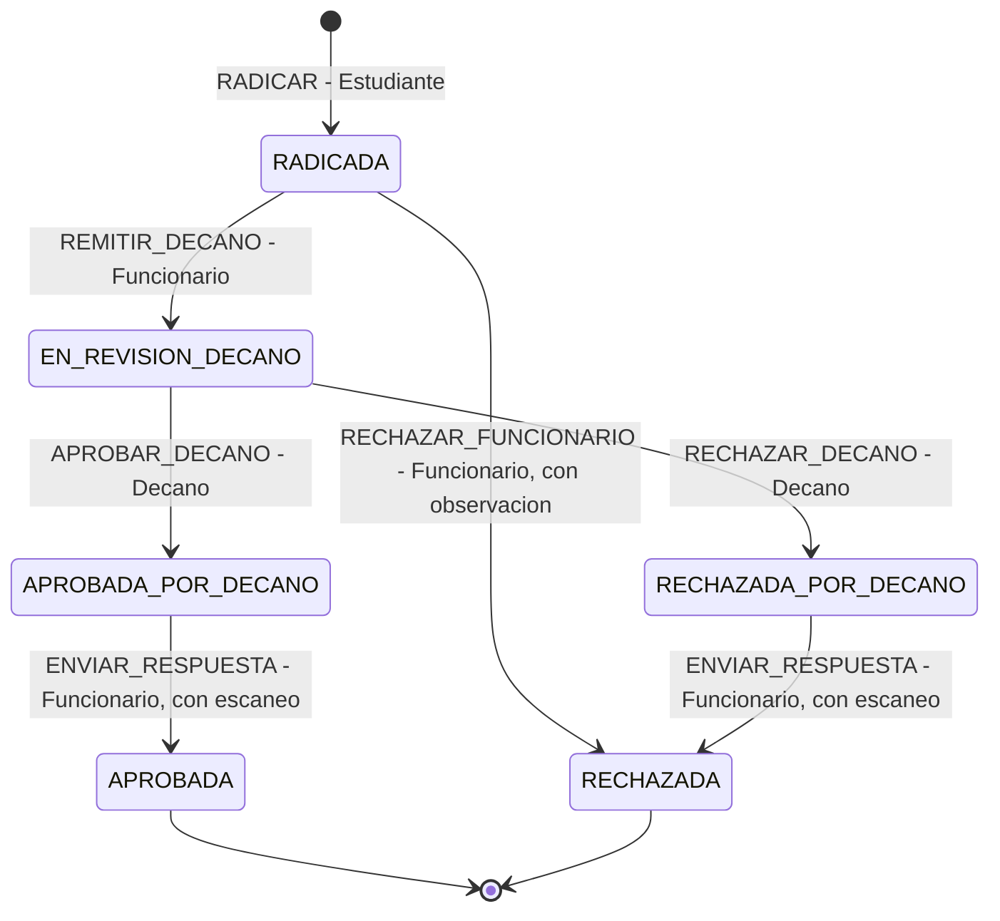
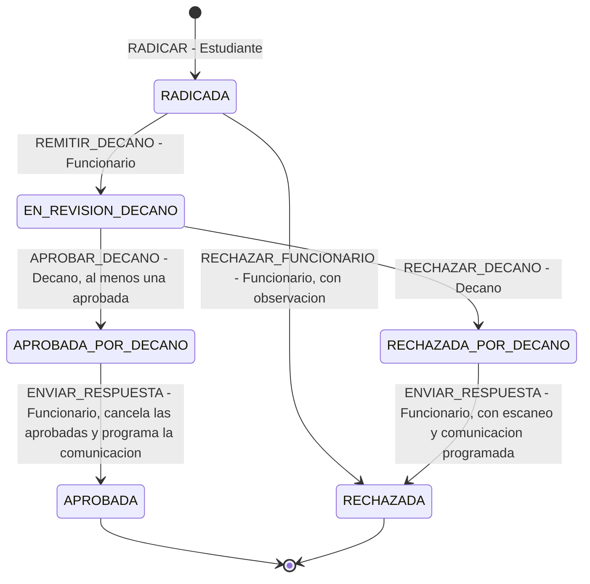
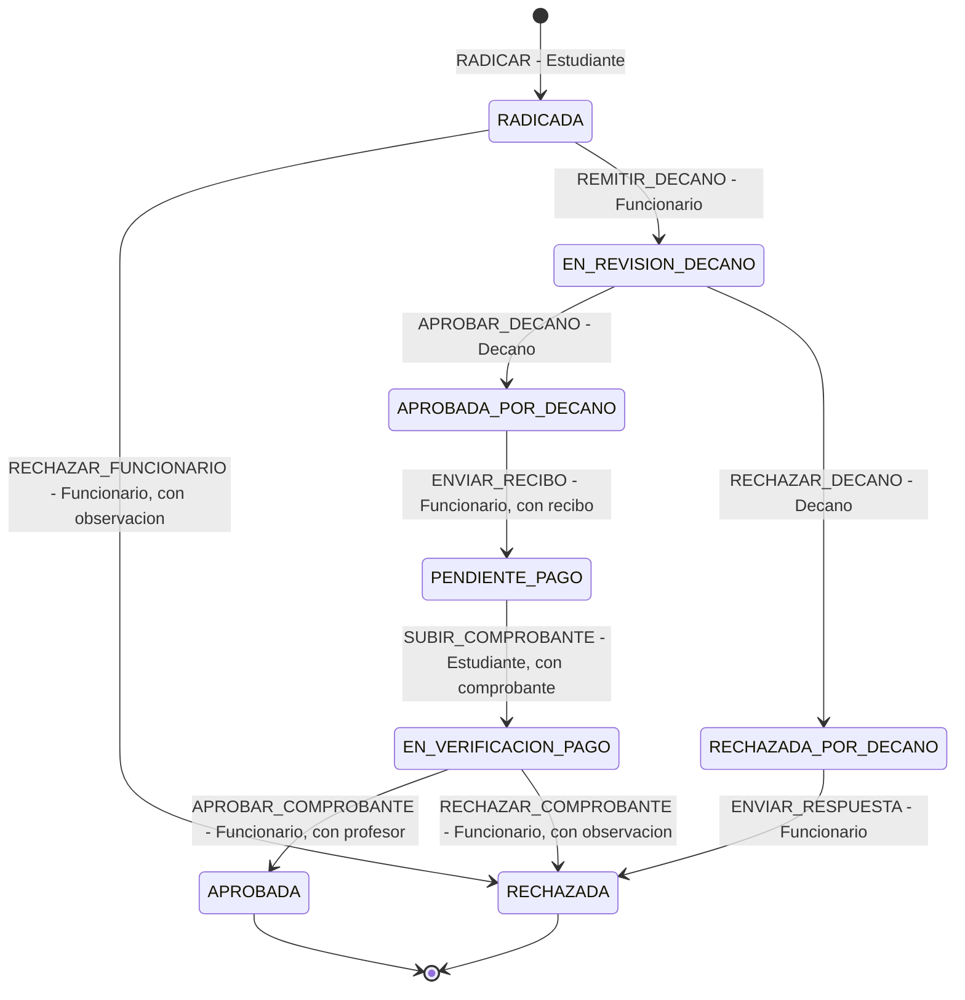
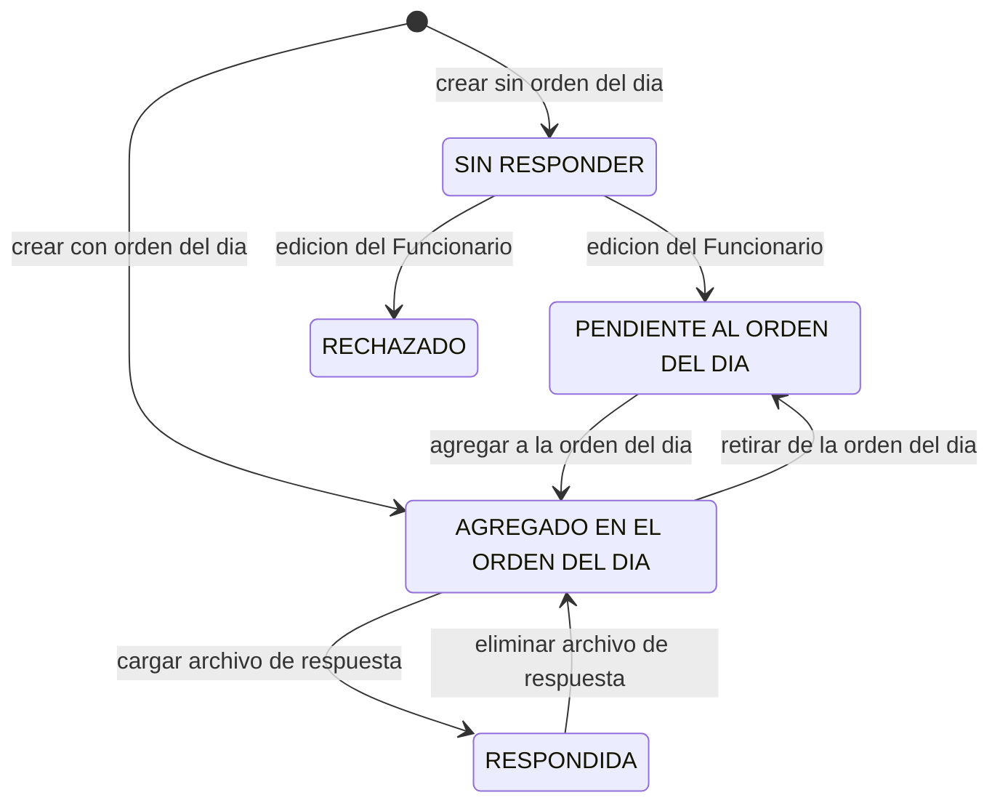
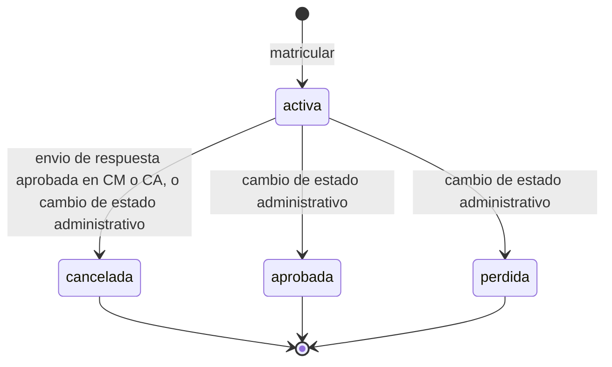

# 09. Flujos de extremo a extremo y máquinas de estado

Análisis de solo lectura. Estado analizado: árbol de trabajo de la rama `main` con cambios sin confirmar (entre ellos los del Examen Supletorio, decisión P49). No se ejecutó ni compiló nada: todo lo que dice "verificado" es lectura estática del código o de los documentos 02 a 08. Lo que no se pudo comprobar así se marca NO VERIFICADO.

Actualizado el 2026-10-21 (T12.37) con los cambios de T12.28 a T12.35: rechazo directo sin Resolución, datos de la Facultad opcionales y situaciones de listas cerradas, el Decano de Matrícula sin situaciones, PDF único de paz y salvos, profesor y notificación del supletorio, correos de la respuesta final, comunicación programada de la Resolución en Cancelación de Asignatura con visibilidad diferida, remisión al Decano aunque ninguna asignatura cumpla y decisión del Decano con un solo botón. El correo se describe aparte en [correo-electronico.md](correo-electronico.md).

## 0. Convenciones

- Marca de origen: [BASE] es el prototipo de Julián Camacho (commit inicial `d3a48cc`); [EXTENSIÓN] es el trabajo de grado. El criterio es el de los documentos 02, 04 y 07.
- Rutas de código. Backend: `backend/solicitudes/src/main/java/com/unicauca/cfiet/solicitudes/`, abreviado `bk/`; dentro de él, `infraestructura/input/controlador<X>/controlador/` contiene los `*RestController`, `dominio/casosdeuso/` los `*CUImplAdaptador`, `dominio/servicios/` las reglas de dominio y `infraestructura/output/persistencia/gateway/` los `*GatewayImplAdaptador`. Frontend: `frontend/src/app/`, abreviado `fe/`; los servicios HTTP están en `fe/core/services/`.
- Cadena que recorre toda petición (documento 02 y `backend/CLAUDE.md`): componente Angular, servicio Angular, `authInterceptor` (agrega `Authorization: Bearer`), `*RestController`, puerto `*CUIntPuerto`, `*CUImplAdaptador`, puerto `*GatewayIntPuerto`, `*GatewayImplAdaptador`, repositorio JPA, tabla.
- Prefijo de todas las rutas HTTP: `/api/unicauca/fiet/consejo` (`environment.apiUrl` en el frontend; `url.application` en el backend). En las tablas se omite.
- Columnas de las tablas de secuencia: `#`, pantalla o componente, servicio Angular y método, endpoint, controlador y caso de uso, gateway(s), tablas. En tablas, "E" significa que escribe y "L" que solo lee. Los nombres en minúscula o camelCase son tablas de Julián; los de MAYÚSCULA con guion bajo son de la extensión (estrategia `PhysicalNamingStrategyStandardImpl`, `backend/CLAUDE.md`).
- Dos mecanismos de historial que no hay que confundir (documento 04, sección 12): la tabla `logs` (auditoría de Julián, la escribe `LogCUIntPuerto`) y `HISTORIAL_SOLICITUD_ACADEMICA` (historial funcional de la extensión, solo lo escribe `SolicitudAcademicaCUImplAdaptador`).
- Errores: las excepciones propias salen como HTTP 500 con `codigoError` (1 a 8); la validación de DTO sale 400; `AuthenticationException` y `AccessDeniedException` salen 403 (documento 04, sección 0). En las tablas, "E3", "E4", etc. son esos códigos.

## 1. Flujos del prototipo de Julián [BASE]

### 1.1 Inicio de sesión

Pantalla `LoginComponent` (`fe/core/auth/pages/login-component`) con `LoginFormComponent` (`fe/shared/login-form-component`). Ruta `login`, sin guard.

| # | Pantalla / componente | Servicio Angular | Endpoint | Controlador y caso de uso | Gateway | Tablas |
|---|---|---|---|---|---|---|
| 1 | `LoginFormComponent.onSubmit` (bandera `enviando`) | `AuthService.login` (`auth-service.ts`) | `POST /sesiones` (única ruta `permitAll` para todos los métodos, `ConfiguracionSeguridad` línea 49) | `SesionRestController.auth` (sin `@Transactional`), `SesionCUImplAdaptador.login` | `SesionGatewayIntPuerto.login` implementado por `SesionGatewayImplAdaptador`: `UsuarioRepositorio.findByUsername`, `AuthenticationManager.authenticate` (`DaoAuthenticationProvider` con `BCryptPasswordEncoder`, `UserDetailsService` de `ConfiguracionAplicacion`) y `JwtServicio.getToken` | L: `usuarios`, `usuariosLivianos`, `Usuario_has_Roles` (carga `EAGER`), `roles` |
| 2 | (mismo caso de uso) | | | `SesionCUImplAdaptador.login`: si el token es nulo, E5; usuario inactivo, E8 `NO_ACCESO`; algún rol inactivo, E8 `ROL_NO_HABILITADO` | `SesionGatewayIntPuerto.getUsuario` | L: `usuarios` y relacionadas |
| 3 | (mismo caso de uso) | | | `LogCUIntPuerto.crearLogSesion("Inicio de sesión", ...)` | `LogGatewayIntPuerto.crearLog` (`LogGatewayImplAdaptador`, `LogRepositorio.save`) | E: `logs` |
| 4 | `AuthService.login`, operador `tap` | | | Respuesta `UsuarioTokenizadoDTORespuesta` (uuid y token) | | `localStorage`: `currentUser` y `authToken` |
| 5 | `AuthService.login`, operador `switchMap` | `UsuariosService.getUsuario` | `GET /usuarios/{uuid}` (regla `GET usuarios/**` solo autenticado) | `UsuarioRestController.getUsuario`, `UsuarioCUImplAdaptador.getUsuario` | `UsuarioGatewayIntPuerto.getUsuario` (`UsuarioGatewayImplAdapter`) | L: `usuarios`, `usuariosLivianos`, `Usuario_has_Roles`, `roles`, `tiposUsuario` |
| 6 | `LoginFormComponent.onSubmit`, `next` | `rutaDeInicio` (`fe/core/utils/rutas-por-rol.ts`) | | Navega a la ruta del primer rol que coincida: Secretario General, Funcionario, Secretaria Decanatura FIET, Decano, Funcionario Académico, Estudiante, `ROLES_FIET`; sin coincidencia, toast "El usuario no tiene un rol con vistas definidas en el sistema." | | |

Peticiones posteriores: `authInterceptor` agrega el `Bearer`; `JwtFiltroAutenticacion.doFilterInternal` valida el token y carga el `UserDetails`; el token es HS256 y vence a las 24 horas (`JwtServicio.getToken`). `RoleGuard` repite `GET /usuarios/{uuid}` en cada navegación a ruta protegida (documento 07, sección 4). Un 401 en cualquier petición distinta de `POST sesiones` cierra la sesión (`SesionVencidaService`) [EXTENSIÓN].

Observación: una contraseña errónea no llega a E5. `AuthenticationManager.authenticate` lanza una `AuthenticationException` dentro del gateway, que el manejador responde como 403; E5 solo ocurre si el username no existe (el gateway devuelve nulo). El 403 es lectura de código; NO VERIFICADO en ejecución.

### 1.2 Crear una solicitud del Consejo con anexos

Pantalla `usuario-fiet/solicitudes` (`UsuarioFietSolicitudesPrivadasContentComponent`) con el diálogo de pasos `EnviarSolicitudUsuarioFietComponent` (`fe/core/usuario fiet/components/...`). Roles de la ruta: los cinco roles FIET (documento 08, sección 9).

| # | Pantalla / componente | Servicio Angular | Endpoint | Controlador y caso de uso | Gateway | Tablas |
|---|---|---|---|---|---|---|
| 1 | Al abrir el diálogo, selección del tipo (Paso 1) | `TipoSolicitudService.getTiposSolicitudPorPerfil` | `GET /tipos/solicitudes/perfil?perfil=` (`permitAll`) | `TiposSolicitudRestController.getTiposPorPerfil`, `TipoSolicitudCUImplAdaptador.getTiposSolicitudesPorPerfil` | `TipoSolicitudGatewayIntPuerto` | L: `tiposSolicitudes`, `tiposAnexos` |
| 2 | Selección de orden del día | `SolicitudesService.getOrdenesDelDiaPorEstado(true)` | `GET /solicitudes/orden-del-dia/estado?estado=true` | `SolicitudesRestController.getOrdenesDelDiaPorEstado`, `OrdenDelDiaCUImplAdaptador.getOrdenesDelDiaPorEstado` | `OrdenDelDiaGatewayIntPuerto` | L: `ordenesDelDia` |
| 3 | Paso 2 (Tipos de Anexos), `enviarSolicitud()`: valida obligatoriedad en cliente y ordena archivos | `SolicitudesService.enviarSolicitud` (`FormData`: parte `solicitud` como `Blob` JSON, partes `archivos`) | `POST /solicitudes` (multipart) | `SolicitudesRestController.enviarSolicitud` (`@Transactional`); primero `ValidadorAnexosService.validarYAsignarArchivos` (E6 directo) | | |
| 4 | | | | `SolicitudCUImplAdaptador.crearSolicitud` -> `checkSolicitud`: tipo existe (E3); cada anexo obligatorio presente y con archivo (E6); extensión igual al formato del tipo (E6); orden del día existe si viene (E3) y estado `AGREGADO EN EL ORDEN DEL DÍA`, si no `SIN RESPONDER`; funcionario encargado tomado del tipo; solicitante copiado del usuario del token | `TipoSolicitudGatewayIntPuerto.getTipoSolicitud`, `OrdenDelDiaGatewayIntPuerto.getOrdenDelDia`, `SesionGatewayIntPuerto.getUsuario`, `IJwtServicio.getUsername` | L: `tiposSolicitudes`, `tiposAnexos`, `ordenesDelDia`, `funcionarios`, `usuarios` |
| 5 | | | | Genera uuid de la solicitud, de la información del solicitante y de cada anexo; guarda cada archivo con `AlmacenadorArchivos.guardarArchivo` en `${app.uploads.base-path}/anexos/<uuidSolicitud>/`; un `IOException` se envuelve en `RuntimeException` plano | | Disco |
| 6 | | | | `LogCUIntPuerto.crearLog("Solicitud Creada", ...)` ANTES de guardar (diferencia base/extensión, documento 04, sección 2, punto 7) | `LogGatewayIntPuerto` | E: `logs` |
| 7 | | | | `SolicitudGatewayIntPuerto.guardarSolicitud` | `SolicitudGatewayImplAdaptador` -> `SolicitudRepositorio.save`; `SolicitudEntidad` tiene `cascade = ALL` hacia `anexos` e `informacionSolicitantes` | E: `solicitudes`, `anexos`, `informacionSolicitantes` |
| 8 | `next`: toast "Solicitud enviada correctamente" y cierre del diálogo | | | | | |

Variante pública: el Funcionario (rol de Julián) puede enviar en nombre de un solicitante público con `SolicitudesService.enviarSolicitudPublica` -> `POST /solicitudes/public` -> `SolicitudesRestController.enviarSolicitudPublica` -> `SolicitudCUImplAdaptador.crearSolicitudPublica` (estado `SIN RESPONDER`, no valida anexos obligatorios). La regla de seguridad `POST solicitudes/public` es `permitAll`, aunque la anotación `@PreAuthorize` dice Secretario General, Funcionario y Decano (documento 03, fila 38).

### 1.3 Revisión del Funcionario (flujo del Consejo)

El Funcionario de Julián (rol `Funcionario`) ve las solicitudes de los tipos que tiene a cargo, las abre y cambia su estado. Pantalla `funcionario/solicitudes` (`FunSolicitudesContentComponent`).

| # | Pantalla / componente | Servicio Angular | Endpoint | Controlador y caso de uso | Gateway | Tablas |
|---|---|---|---|---|---|---|
| 1 | `loadSolicitudes` (con o sin búsqueda) | `SolicitudesService.getSolicitudesPorFuncionario` o `buscarSolicitudesPorNombreYFuncionario` | `GET /solicitudes/funcionario/{uuidFuncionario}` o `GET /solicitudes/fun/buscar/` | `SolicitudesRestController.getSolicitudesPorFuncionario` o `buscarSolicitudesPorNombreYFuncionario`; `SolicitudCUImplAdaptador.getSolicitudesPorFuncionario` o `buscarSolicitudesPorNombreYFuncionario` (E6 paginación, E7 sin resultados) | `SolicitudGatewayIntPuerto` | L: `solicitudes` y relacionadas |
| 2 | Ícono "ver" | `SolicitudesService.getSolicitud` | `GET /solicitudes/{uuid}` | `SolicitudCUImplAdaptador.getSolicitud` (E3) | `SolicitudGatewayIntPuerto.getSolicitud` | L: `solicitudes`, `anexos`, `informacionSolicitantes` |
| 3 | Ícono "editar", diálogo "Actualizar Solicitud": nombre, consecutivo, descripción, estado (`ESTADOS_SOLICITUD`) | `SolicitudesService.actualizarSolicitud` | `PUT /solicitudes/{uuidSolicitud}` | `SolicitudesRestController.actualizarOrdenDelDia` (nombre heredado, `@Transactional`), `SolicitudCUImplAdaptador.actualizarSolicitud`: si llega `uuidFuncionario` distinto, debe existir (E3) y ser `Funcionario` (E6); si `uuidOrdenDelDia` llega vacío la solicitud queda sin orden; `Solicitud.actualizar` copia consecutivo, nombre, descripción y estado sin validar el valor del estado | `SolicitudGatewayIntPuerto`, `UsuarioGatewayIntPuerto`, `OrdenDelDiaGatewayIntPuerto` | E: `solicitudes`, `logs` ("Solicitud modificada") |

Observaciones verificadas: (a) la anotación `@PreAuthorize` de `actualizarOrdenDelDia` dice Secretario General y Decano, pero la regla efectiva `solicitudes/**` es `authenticated()` (`ConfiguracionSeguridad` línea 68), por eso el Funcionario puede llamarla; (b) el Funcionario Académico de la extensión no usa este flujo: su revisión es la de los procesos académicos (sección 2.2); (c) el cambio de estado no tiene máquina en el servidor, ver sección 6.5.

### 1.4 Orden del día: crear, poblar y retirar solicitudes

Pantalla `sec-general/orden-del-dia` (`OrdenDelDiaContentComponent`) y su visualizador `OrdenDelDiaVisualizadorComponent` (`fe/core/secretario-general/components/orden-del-dia-visualizador-component`). Reglas de seguridad: `solicitudes/orden-del-dia/**` solo Secretario General y Decano (línea 57), salvo `GET orden-del-dia/estado` (autenticado, línea 56).

| # | Pantalla / componente | Servicio Angular | Endpoint | Controlador y caso de uso | Gateway | Tablas |
|---|---|---|---|---|---|---|
| 1 | Botón de tarjeta "Crear" (diálogo: nombre, número de acta, descripción, ciudad, fecha, hora inicio, hora fin, lugar) | `SolicitudesService.crearOrdenDelDia` | `POST /solicitudes/orden-del-dia` | `SolicitudesRestController.crearOrdenDelDia` (`@Transactional`), `OrdenDelDiaCUImplAdaptador.crearOrdenDelDia`: uuid nuevo, `estado = true`; log antes de guardar | `OrdenDelDiaGatewayIntPuerto.guardarOrdenDelDia` | E: `ordenesDelDia`, `logs` |
| 2 | Ícono "editar" | `SolicitudesService.actualizarOrdenDelDia` | `PUT /solicitudes/orden-del-dia/{uuid}` | `OrdenDelDiaCUImplAdaptador.actualizarOrdenDelDia` (E3 si no existe) | `OrdenDelDiaGatewayIntPuerto` | E: `ordenesDelDia`, `logs` |
| 3 | Ícono "abrir" (carpeta) abre el visualizador; `cargarSolicitudes` | `SolicitudesService.getSolicitudesPorOrdenDelDia` | `GET /solicitudes/orden-del-dia/{uuid}/solicitudes` | `SolicitudCUImplAdaptador.getSolicitudesPorOrdenDelDia` (E7 si no hay) | `SolicitudGatewayIntPuerto` | L: `solicitudes`, `tiposSolicitudes` |
| 4 | `cargarSolicitudesDisponibles` | `SolicitudesService.getSolicitudesPorEstado('PENDIENTE AL ORDEN DEL DÍA')` | `GET /solicitudes/estado?estado=` | `SolicitudCUImplAdaptador.getSolicitudesPorEstado` (reemplaza `_` por espacio; E7 si no hay) | `SolicitudGatewayIntPuerto` | L: `solicitudes` |
| 5 | `agregarSolicitudSeleccionada` y `registrarSolicitudesEnOrdenDelDia`: agrupa por sección del tipo y envía estado `AGREGADO EN EL ORDEN DEL DÍA` | `SolicitudesService.getSolicitud`, luego `actualizarSolicitud` | `GET /solicitudes/{uuid}` y `PUT /solicitudes/{uuid}` | `SolicitudCUImplAdaptador.actualizarSolicitud` con `uuidOrdenDelDia` (valida que la orden exista, E3) | `SolicitudGatewayIntPuerto`, `OrdenDelDiaGatewayIntPuerto` | E: `solicitudes`, `logs` |
| 6 | `removerSolicitud`: envía estado `PENDIENTE AL ORDEN DEL DÍA` y `uuidOrdenDelDia` vacío | `SolicitudesService.actualizarSolicitud` | `PUT /solicitudes/{uuid}` | igual; con `uuidOrdenDelDia` vacío `actualizarSolicitud` pone `setObjOrdenDelDia(null)` | igual | E: `solicitudes`, `logs` |
| 7 | `descargarAnexos` | `SolicitudesService.descargarAnexosOrdenDelDia` | `GET /solicitudes/anexos/download?uuidOrden&nombreOrden` | `SolicitudesRestController.descargarAnexos`, `SolicitudCUImplAdaptador.generarZipAnexosPorOrdenDelDia`: arma un ZIP con carpeta por sección y solicitud leyendo `${app.uploads.base-path}/anexos/<uuid>/` (E6 si falta carpeta o archivo, E7 si la orden no tiene solicitudes) | `SolicitudGatewayIntPuerto` | L: `solicitudes`, `anexos`; lee disco |

### 1.5 Registro de respuestas

Dos pasos separados, ambos de Julián: registrar el texto de la respuesta del Consejo y cargar el archivo de respuesta (que cambia el estado de la solicitud).

| # | Pantalla / componente | Servicio Angular | Endpoint | Controlador y caso de uso | Gateway | Tablas |
|---|---|---|---|---|---|---|
| 1 | Visualizador de la orden, "Asignar Respuesta" (`abrirFormularioRespuesta`): precarga la respuesta existente | `RespuestasService.getRespuestaPorSolicitud` | `GET /respuestas/solicitud/{uuidSolicitud}` | `RespuestaRestController.getRespuestaPorSolicitud`, `RespuestaCUImplAdaptador.getRespuestaPorSolicitud` (E3 si no hay; el componente ignora el error) | `RespuestaGatewayIntPuerto` | L: `respuestas` |
| 2 | `modificarSolicitud`: tipo (`Oficio` o `Resolución`), consecutivo FIET, respuesta del Consejo, indicaciones | `RespuestasService.registrarRespuesta` | `POST /respuestas/{uuidSolicitud}` (reglas: Secretario General, Decano, Funcionario) | `RespuestaRestController.registrarRespuesta` (`@Transactional`), `RespuestaCUImplAdaptador.registrarRespuesta`: solicitud existe (E3); tipo válido (E4); si no hay respuesta la crea, si hay la modifica; log antes de guardar | `SolicitudGatewayIntPuerto.getSolicitud`, `RespuestaGatewayIntPuerto.solicitudTieneRespuesta` y `guardarRespuesta` | E: `respuestas`, `logs` ("Registrar respuesta de Solicitud" o "Modificar respuesta de Solicitud") |
| 3 | Pantalla `sec-general/respuestas` (`SecRespuestasContentComponent`), editar abre `DialogGestionRespuestaComponent`; `cargarRespuesta` | `RespuestasService.getRespuesta` | `GET /respuestas/{uuid}` | `RespuestaCUImplAdaptador.getRespuesta` (E3) | `RespuestaGatewayIntPuerto` | L: `respuestas` |
| 4 | `onArchivoSeleccionado` (`CargarRespuestaComponent`) | `RespuestasService.responderSolicitud` (`FormData` con `archivo`) | `POST /respuestas/{uuidRespuesta}/archivo` | `RespuestaCUImplAdaptador.responderSolicitud`: solo PDF o DOCX por extensión (E4); borra el archivo anterior, guarda con `AlmacenadorArchivos.guardarArchivoRespuesta` en `${app.uploads.base-path}/respuestas/<uuidRespuesta>/`, fija `urlRespuesta`; IO envuelto en `RuntimeException` plano | `RespuestaGatewayIntPuerto.guardarRespuesta` | E: `respuestas`, `logs` ("Responder Solicitud"); disco |
| 5 | Mismo componente, `actualizarEstadoSolicitud(uuidRespuesta, 'RESPONDIDA')`: lee la respuesta, lee la solicitud y la reenvía con el estado nuevo | `RespuestasService.getRespuesta`, `SolicitudesService.getSolicitud`, `SolicitudesService.actualizarSolicitud` | `GET /respuestas/{uuid}`, `GET /solicitudes/{uuid}`, `PUT /solicitudes/{uuid}` | `SolicitudCUImplAdaptador.actualizarSolicitud` | `SolicitudGatewayIntPuerto` | E: `solicitudes`, `logs` |
| 6 | Quitar archivo: `onArchivoEliminado` | `RespuestasService.eliminarArchivoRespuesta`, luego estado `AGREGADO EN EL ORDEN DEL DÍA` | `PATCH /respuestas/{uuid}/archivo` y `PUT /solicitudes/{uuid}` | `RespuestaCUImplAdaptador.eliminarArchivoRespuesta` (E4 si no hay archivo) | `RespuestaGatewayIntPuerto` | E: `respuestas`, `solicitudes`, `logs` |

Observación: el cambio a `RESPONDIDA` o de vuelta a `AGREGADO EN EL ORDEN DEL DÍA` lo hace el componente Angular encadenando dos llamadas (`switchMap`); el backend no lo hace dentro de `responderSolicitud`. Si la segunda llamada falla, el archivo queda guardado y la solicitud conserva el estado anterior (cada endpoint tiene su propia transacción). NO VERIFICADO en ejecución.

### 1.6 Carga masiva por Excel

Patrón común de Julián, replicado en la extensión (`backend/CLAUDE.md`, sección "Carga masiva por Excel"): `ProcesadorArchivos` lee, `ValidadorPeticionesExcel` valida, el caso de uso escribe, todo dentro de la transacción del controlador. Solo se admite `.xlsx` (Apache POI `XSSFWorkbook`).

#### 1.6.1 Usuarios [BASE]

| # | Pantalla / componente | Servicio Angular | Endpoint | Controlador y caso de uso | Gateway | Tablas |
|---|---|---|---|---|---|---|
| 1 | `sec-general/usuarios`, botón de tarjeta "Cargar archivo" abre `GenericDialogUploadFileComponent` y llama `crearUsuariosDesdeArchivo` | `UsuariosService.crearUsuariosDesdeArchivo` (`FormData`, campo `file`) | `POST /usuarios/cargar/archivo` (Secretario General o Decano) | `UsuarioRestController.crearUsuarios` (`@Transactional`) | | |
| 2 | | | | `ProcesarArchivoUsuariosImpl.procesarArchivo` (bean `archivos-usuarios`): hoja 0, salta la fila 0, corta en la primera fila vacía, resuelve tipo de usuario y rol contra un caché; ante un archivo ilegible captura la excepción y devuelve lo leído hasta ahí | `UsuarioGatewayIntPuerto` (caché de tipos y roles) | L: `tiposUsuario`, `roles` |
| 3 | | | | `ValidadorPeticionesExcel` (bean `validador-usuarios`) sobre las anotaciones del DTO; la primera fila inválida corta con 400 y mapa campo-mensaje, sin número de fila | | |
| 4 | | | | `UsuarioCUImplAdaptador.crearUsuarios`: lista no vacía (E7); por usuario tipo de documento, documento, correo y username únicos (E6, E2), tipo de usuario existente (E3), roles sin duplicar y válidos (E4); cifra la contraseña; `crearInstancia` según el primer rol (solo `FUNCIONARIO` genera subclase); un log por usuario después de guardar | `UsuarioGatewayIntPuerto`, `PasswordEncoderGatewayIntPuerto`, `LogCUIntPuerto` | E: `usuarios`, `usuariosLivianos`, `funcionarios` (solo rol Funcionario), `Usuario_has_Roles`, `logs` |
| 5 | Resultado | | | `DataAccessException` se captura en el controlador y responde 500 con `mensaje` y `error`; `@Transactional` revierte el lote | | |

#### 1.6.2 Estudiantes [EXTENSIÓN] (misma plantilla, otras diferencias)

| # | Pantalla / componente | Servicio Angular | Endpoint | Controlador y caso de uso | Gateway | Tablas |
|---|---|---|---|---|---|---|
| 1 | `decano/administracion-academica` o `sec-general/administracion-academica`, pestaña Estudiantes, botón "Cargar Excel": `CargaExcelAcademicaComponent` recibe la función `cargarExcel` | `EstudianteService.crearEstudiantesDesdeArchivo` | `POST /estudiantes/cargar/archivo` | `EstudianteRestController.crearEstudiantes` (`@Transactional`) | | |
| 2 | | | | `ProcesarArchivoEstudiantesImpl.procesarArchivo` (bean `archivos-estudiantes`): `abrir` falla con E6 `EXCEL_NO_VALIDO`, `validarEncabezado` compara las 13 columnas (E6 `EXCEL_ENCABEZADO_INVALIDO`), una fila por asignatura matriculada | | |
| 3 | | | | `CatalogoAcademicoExcel.resolverProgramasEstudiantes` (nombre de programa a uuid; E6 con fila y columna), validación por fila con fila y columna en cada mensaje, `CatalogoAcademicoExcel.verificarAsignaturasEstudiantes` (código existente y del programa de la fila) | `ProgramaAcademicoCUIntPuerto`, `AsignaturaCUIntPuerto` | L: `PROGRAMA_ACADEMICO`, `ASIGNATURA` |
| 4 | | | | `AgrupadorEstudiantesExcel.agrupar` junta las filas del mismo estudiante; `EstudianteCUImplAdaptador.crearEstudiantes`: lista no vacía (E7), repetidos dentro del lote (código estudiantil, documento, correo, username), luego `registrar` uno a uno; cada uno llama a `UsuarioCUIntPuerto.crearUsuario` con el tipo `ESTUDIANTE` | `EstudianteGatewayIntPuerto.guardarTodos`, `UsuarioCUIntPuerto`, `LogCUIntPuerto` | E: `usuarios`, `usuariosLivianos`, `Usuario_has_Roles`, `ESTUDIANTE`, `ASIGNATURA_MATRICULADA`, `logs` |
| 5 | Resultado | | | La función de `CargaExcelAcademicaComponent` muestra el resultado y el botón pasa a "Cerrar" (D-F22); los errores se listan dentro del diálogo | | |

Los Excel de asignaturas (`POST /asignaturas/cargar/archivo`, `AsignaturaCUImplAdaptador.crearAsignaturas`, que bloquea cada programa con `ProgramaAcademicoGatewayIntPuerto.bloquear` y genera `SIGLA-nnn`) y de funcionarios académicos (`POST /funcionarios-academicos/cargar/archivo`) siguen el mismo esquema [EXTENSIÓN].

### 1.7 Exportación a `.docx` (orden del día)

Tres variantes en el visualizador de la orden, más el ZIP de anexos de la sección 1.4. El exportador es `OrdenDelDiaExportadorImpl` (`bk/infraestructura/output/exportador/`), puerto `OrdenDelDiaExportador`, con Apache POI (`XWPFDocument`) sobre plantillas del classpath.

| # | Pantalla / componente | Servicio Angular | Endpoint | Controlador y caso de uso | Gateway | Tablas |
|---|---|---|---|---|---|---|
| 1 | `exportarOrdenDelDia`: orden simple | `SolicitudesService.exportarOrdenDelDia` (`responseType: 'blob'`) | `GET /solicitudes/exportar?uuidOrden=` | `SolicitudesRestController.exportarOrden`, `OrdenDelDiaCUImplAdaptador.generarOrdenDelDia`: `getOrdenDelDia` (E3), `getSolicitudesPorOrdenDelDia`, `procesarSolicitudes(solicitudes, false)` | `OrdenDelDiaGatewayIntPuerto`, `SolicitudGatewayIntPuerto` | L: `ordenesDelDia`, `solicitudes`, `tiposSolicitudes` |
| 2 | `exportarOrdenDelDiaConRespuestas` | `SolicitudesService.exportarOrdenDelDiaConRespuestas` | `GET /solicitudes/exportar/respuestas` | `OrdenDelDiaCUImplAdaptador.generarOrdenDelDiaConRespuestas`: igual, con `RespuestaGatewayIntPuerto.getRespuestaPorSolicitud` por solicitud y plantilla `templates/orden_del_dia_info.docx` | `OrdenDelDiaGatewayIntPuerto`, `SolicitudGatewayIntPuerto`, `RespuestaGatewayIntPuerto` | L: `ordenesDelDia`, `solicitudes`, `respuestas` |
| 3 | `exportarOrdenDelDiaMerge`: desarrollo de la reunión | `SolicitudesService.exportarOrdenDelDiaMerge` | `GET /solicitudes/exportar/reunion` | `OrdenDelDiaCUImplAdaptador.generarOrdenDelDiaMerge`: `procesarSolicitudesMerge` (nombre, descripción y, en el bloque aparte, respuesta del Consejo); plantilla `templates/orden_del_dia_temas_resueltos.docx` | igual | igual |
| 4 | (los tres) | | | `inicializarDatosOrden` carga ciudad, día, mes, año, horas, lugar y acta; `procesarSolicitudes*` numera por sección (1 asuntos decano, 2 pregrado, 3 posgrados, 4 delegados en decano, 5 y 6 comisiones, 7 informe, 8 varios) y arma los marcadores `{{...}}` | | |
| 5 | (los tres) | | | `OrdenDelDiaExportadorImpl.exportarOrdenDelDia(datos, plantilla)`: reemplaza marcadores en párrafos y tablas y devuelve `byte[]`; `IOException` se envuelve en `RuntimeException` | `ClassPathResource` | Archivo en `backend/solicitudes/src/main/resources/templates/` |
| 6 | Cliente | | | La respuesta es un `Blob`; el componente crea un enlace temporal y descarga `<nombre de la orden normalizado>.docx` (el backend envía `Orden_Del_Dia.docx` en `Content-Disposition`, el nombre final lo fija el cliente) | | |

Observaciones verificadas en el código: (a) las rutas `solicitudes/exportar*` y `solicitudes/anexos/download` caen en la regla `solicitudes/**` autenticado, de modo que cualquier usuario autenticado puede llamarlas aunque la anotación diga Secretario General y Decano (documento 03, filas 48 a 51); (b) `OrdenDelDiaExportadorImpl.reemplazarTexto` hace `return` tras el primer marcador sustituido en un párrafo, lo que supone un marcador por párrafo en la plantilla; la plantilla no se abrió, NO VERIFICADO cuántos marcadores hay por párrafo; (c) las secciones fuera de las ocho constantes se saltan (`default: continue`), esas solicitudes no aparecen en el documento.

## 2. Piezas comunes de los procesos académicos [EXTENSIÓN]

Los tres procesos comparten el motor de etapas (`MaquinaEtapas`), la bandeja, el detalle, el almacenamiento de anexos y de la Resolución. Se describen una vez aquí y los flujos de las secciones 3 a 5 solo indican qué cambia.

### 2.1 Bandeja y detalle

| # | Pantalla / componente | Servicio Angular | Endpoint | Controlador y caso de uso | Gateway | Tablas |
|---|---|---|---|---|---|---|
| 1 | `estudiante/solicitudes`, `funcionario-academico/solicitudes|respuestas`, `decano/solicitudes`: `BandejaSolicitudesAcademicasComponent` (`rol`, `modo`) | `SolicitudAcademicaService.getSolicitudesEstudiante` o `getSolicitudesFuncionario` o `getSolicitudesDecano` | `GET /solicitudes-academicas/estudiante` o `/funcionario` o `/decano` (una regla por rol) | `SolicitudAcademicaRestController.getBandejaEstudiante|Funcionario|Decano` (`@Transactional(readOnly = true)`), `ConsultaSolicitudAcademicaCUImplAdaptador.getBandeja*`: usuario del token con el rol exigido (E1, E3, E4); filtra a las etapas que tienen etiqueta para ese rol; en Funcionario y Decano agrega `decisionDecano` y, para Cancelación de Asignatura final, `resultadosAsignaturas` | `SesionGatewayIntPuerto`, `SolicitudAcademicaGatewayIntPuerto` (`getPorEstudiante`, `getPorFuncionarioAcademico`, `getTodas`, `getUltimaAccion`, `getConAsignaturaNoAprobadaPorDecano`, `getResultadosAsignaturas`), `EtapaEtiquetaRolGatewayIntPuerto` | L: `usuarios`, `SOLICITUD_ACADEMICA`, `TIPO_SOLICITUD_ACADEMICA`, `ETAPA_SOLICITUD_ACADEMICA`, `ETAPA_ETIQUETA_ROL`, `HISTORIAL_SOLICITUD_ACADEMICA`, `ASIGNATURA_SOLICITUD_ACADEMICA` |
| 2 | Clic en "Ver solicitud": `DetalleSolicitudAcademicaComponent.cargar` (`forkJoin`) | `SolicitudAcademicaService.getSolicitud` y `getHistorial` | `GET /solicitudes-academicas/{uuid}` y `GET /solicitudes-academicas/{uuid}/historial` | `SolicitudAcademicaRestController.getDetalle|getHistorial`; `ConsultaSolicitudAcademicaCUImplAdaptador.getDetalle` decide el rol por `acceso()` (dueño con rol Estudiante, o Funcionario asignado al tipo, o Decano), exige etiqueta de la etapa para ese rol y si no responde como inexistente (E3), enmascara `etapaCodigo` para el Estudiante (`etapaVisible`) y trae `accionesDisponibles` de `MaquinaEtapas.accionesDisponibles`; `getHistorial` reconstruye la etapa de cada fila con `MaquinaEtapas.etapaDestino` y oculta al Estudiante las filas `APROBAR_DECANO` y `RECHAZAR_DECANO` | `SolicitudAcademicaGatewayIntPuerto`, `AnexoAcademicoGatewayIntPuerto`, `ResolucionAcademicaGatewayIntPuerto`, `HistorialSolicitudAcademicaGatewayIntPuerto` | L: `SOLICITUD_ACADEMICA`, `ANEXO_ACADEMICO`, `RESOLUCION_ACADEMICA`, `HISTORIAL_SOLICITUD_ACADEMICA`, `ETAPA_ETIQUETA_ROL`, `usuarios` |
| 3 | `COMPONENTES_PROCESO` monta el componente del proceso (`ngComponentOutlet`), que pide su detalle al cambiar `uuidSolicitud` | `CancelacionMatriculaService.getDetalle` o `CancelacionAsignaturaService.getDetalle` o `ExamenSupletorioService.getDetalle` | `GET /cancelaciones-matricula/{uuid}` o `/cancelaciones-asignatura/{uuid}` o `/examenes-supletorios/{uuid}` | `Consulta<Proceso>CUImplAdaptador.getDetalle` sobre `ConsultaSolicitudAcademicaCUIntPuerto.getDetalle` y `resolverActor`; E3 si no hay fila de especialización | `SolicitudCancelacionMatriculaGatewayIntPuerto` o `SolicitudCancelacionAsignaturaGatewayIntPuerto` o `SolicitudExamenSupletorioGatewayIntPuerto` | L: `SOLICITUD_CANCELACION_MATRICULA` o `SOLICITUD_CANCELACION_ASIGNATURA` o `SOLICITUD_EXAMEN_SUPLETORIO` (más `SOLICITUD_SUPLETORIO_CRUCE_ASIGNATURA`), `ASIGNATURA_SOLICITUD_ACADEMICA` |
| 4 | Botones de acción (`accionesVisibles`): salen del arreglo `accionesDisponibles` que entrega el backend, filtrado por `ACCIONES_DEL_PROCESO` | | | `MaquinaEtapas.accionesDisponibles(proceso, etapa, rol)` filtra la tabla `TRANSICIONES` por proceso, etapa de origen y rol | | |
| 5 | Descargar anexo (Visualizar o Descargar) | `SolicitudAcademicaService.descargarAnexo` (`blob`) | `GET /solicitudes-academicas/{uuid}/anexos/{uuidAnexo}` | `ConsultaSolicitudAcademicaCUImplAdaptador.descargarAnexo` (acceso válido y el anexo debe ser de esa solicitud), luego `AnexoAcademicoCUImplAdaptador.obtenerAnexo` | `AnexoAcademicoGatewayIntPuerto`, `AlmacenamientoAnexosIntPuerto` | L: `ANEXO_ACADEMICO`; lee disco |
| 6 | Descargar Resolución (visible si `puedeDescargarResolucion`) | `SolicitudAcademicaService.descargarResolucion` (`blob`) | `GET /solicitudes-academicas/{uuid}/resolucion` | `ResolucionAcademicaCUImplAdaptador.obtenerResolucion`: el Estudiante solo si la solicitud está en etapa final; Funcionario y Decano en cualquier etapa (E4 `RESOLUCION_NO_DISPONIBLE`) | `ResolucionAcademicaGatewayIntPuerto`, `AlmacenamientoAnexosIntPuerto` | L: `RESOLUCION_ACADEMICA`; lee disco |

### 2.2 Secuencia común de una acción de trámite

Es lo que ocurre en cualquier acción de las secciones 3.2 a 5.2 (rechazar, remitir, aprobar, enviar respuesta, recibo, comprobante). Se verificó en `SolicitudAcademicaCUImplAdaptador.cambiarEtapa` y `MaquinaEtapas`.

| # | Capa | Qué hace |
|---|---|---|
| 1 | `*RestController` (`@Transactional`) | Recibe el DTO; el rol nunca llega del cliente |
| 2 | `Tramite<Proceso>CUImplAdaptador.<acción>` | `TramiteSolicitud.actorDe(token, rol)` (usuario del token con el rol fijo de la acción); busca la fila de especialización (E3 si no existe); validaciones propias del proceso antes de escribir |
| 3 | `SolicitudAcademicaCUImplAdaptador.cambiarEtapa` | Solicitud existe (E3); acción no nula; `ValidadorActorSolicitud.validar` (rol real, Estudiante dueño, Funcionario asignado al tipo); observación recortada, máximo 500 (E6) |
| 4 | `MaquinaEtapas.transicionar` | Busca la fila de `TRANSICIONES` por proceso, etapa de origen y acción (E4 `TRANSICION_NO_PERMITIDA`); comprueba el rol (E4 `ROL_TRANSICION_NO_PERMITIDO`); exige observación, escaneo, recibo o comprobante según la fila, leídos de la base (`evidencias`: observación recibida, `ResolucionAcademicaGateway.existePorSolicitud`, anexos "Recibo de pago" y "Comprobante de pago") (E4 `REQUISITO_TRANSICION_FALTANTE`); una etapa final lanza E4 `ETAPA_FINAL_SIN_ACCIONES` |
| 5 | `SolicitudAcademicaGatewayImplAdaptador.actualizarEtapa` (`@Transactional`) | Cambia `SOLICITUD_ACADEMICA.Etapa_uuid` y escribe una fila en `HISTORIAL_SOLICITUD_ACADEMICA` (acción, usuario, observación, fecha); no guarda la etapa en el historial |
| 6 | `cambiarEtapa` solo en `REMITIR_DECANO` | Si había escaneo de la Resolución o documento adicional, se retiran (`eliminarPorSolicitud`, `AnexoAcademicoGateway.eliminar` y `AlmacenamientoAnexosIntPuerto.eliminarTrasConfirmar`; el archivo se borra solo después del commit) |
| 7 | `LogCUIntPuerto.crearLog("Cambiar etapa de solicitud académica", ...)` | Una fila en `logs` con radicado, acción y etapas |
| 7b | `cambiarEtapa`, si la etapa siguiente es `APROBADA` o `RECHAZADA` | Registra el correo al estudiante y prepara el de DARCA (y, en el supletorio, el del profesor); salen después del commit y en segundo plano. En Cancelación de Asignatura con `ENVIAR_RESPUESTA` no salen: los reemplaza la comunicación programada (sección 4.4 y [correo-electronico.md](correo-electronico.md)) |
| 8 | Controlador | Responde el detalle del proceso ya actualizado (`Consulta<Proceso>CU.getDetalle`) |
| 9 | Cliente | `ProcesoComponent.ejecutar(accion)`, luego `recargar()` (vuelve a pedir solicitud e historial) y toast de éxito; la bandera `enviando` evita el doble clic (D-F7) |

Cuando la acción exige un archivo (Resolución en las cancelaciones después del Decano, recibo o comprobante en el supletorio) o lleva el documento adicional opcional (Matrícula y Supletorio), el cliente lo sube antes con una llamada aparte y encadena la acción con `switchMap`:

| Archivo | Servicio Angular | Endpoint | Caso de uso | Regla | Tablas |
|---|---|---|---|---|---|
| Escaneo de la Resolución | `SolicitudAcademicaService.adjuntarResolucion` (`FormData`, parte `archivo`) | `POST /solicitudes-academicas/{uuid}/resolucion` (Funcionario Académico) | `ResolucionAcademicaCUImplAdaptador.adjuntarResolucion`: no es Supletorio (E4), el actor es Funcionario, la etapa es `RADICADA`, `APROBADA_POR_DECANO` o `RECHAZADA_POR_DECANO` (E4), solo `pdf` con firma coherente (E6); reemplaza la fila si existía. Desde T12.31 el frontend solo la pide al enviar la respuesta después del Decano | E: `RESOLUCION_ACADEMICA`, `logs`; disco |
| Documento adicional de la respuesta (opcional, Matrícula y Supletorio) | `SolicitudAcademicaService.adjuntarAnexo` | `POST /solicitudes-academicas/{uuid}/anexos` (Funcionario Académico) | `AnexoAcademicoCUImplAdaptador.adjuntarAnexo`: solo el Funcionario asignado, PDF de hasta 5 MB, en las etapas desde las que puede cerrar; uno nuevo reemplaza al anterior; no se admite en Cancelación de Asignatura (E4 `DOCUMENTO_ADICIONAL_NO_ADMITIDO`) | E: `ANEXO_ACADEMICO`, `logs`; disco |
| Recibo o comprobante de pago | `SolicitudAcademicaService.adjuntarAnexo` (parte `archivo` y `tipoAnexo`) | `POST /solicitudes-academicas/{uuid}/anexos` (Estudiante o Funcionario Académico) | `AnexoAcademicoCUImplAdaptador.adjuntarAnexo`: "Recibo de pago" solo Funcionario en `APROBADA_POR_DECANO`; "Comprobante de pago" solo Estudiante en `PENDIENTE_PAGO`; formato y firma por `ValidadorArchivoAdjunto`; guarda el archivo y luego la ficha, y si la ficha falla borra el archivo | E: `ANEXO_ACADEMICO`, `logs`; disco |

Atomicidad (documento 04, sección 2): subir el archivo y ejecutar la acción son dos transacciones distintas (dos peticiones HTTP). Si el archivo se sube y la acción falla, el archivo queda guardado; el cliente lo recuerda (`resolucionSubida`, `anexoPagoSubido`) para no volver a subirlo en el reintento. Dentro de cada petición, el almacenamiento borra el archivo recién escrito si la transacción se revierte (`AlmacenamientoAnexosImplAdaptador`, `TransactionSynchronizationManager`).

## 3. Cancelación de Matrícula (CM) [EXTENSIÓN]

Tipo de proceso `CANCELACION_MATRICULA` (sigla `CM`, radicado `AAAA-CM-0001`). Desde T12.31 un solo anexo obligatorio: un PDF con todos los paz y salvos, de hasta 10 MB (los seis anexos anteriores quedan con `vigente = 0`, P55). Si pasa por el Decano termina con Resolución física firmada y escaneada; el rechazo directo del Funcionario no lleva Resolución (P56).

### 3.1 Radicación por el Estudiante

| # | Pantalla / componente | Servicio Angular | Endpoint | Controlador y caso de uso | Gateway | Tablas |
|---|---|---|---|---|---|---|
| 1 | `estudiante/catalogo`, tarjeta "Cancelación de Matrícula", "Iniciar solicitud" navega a `estudiante/cancelacion-matricula` | ninguno (contenido estático `TRAMITES_ESTUDIANTE`) | | | | |
| 2 | `EstCancelacionMatriculaContentComponent.cargarFormulario` | `CancelacionMatriculaService.getFormulario` | `GET /cancelaciones-matricula/formulario` | `CancelacionMatriculaRestController.getFormulario`, `ConsultaCancelacionMatriculaCUImplAdaptador.getFormulario`: estudiante del token, tipo del proceso (E3), matrículas `activa`, anexos del tipo | `SesionGatewayIntPuerto`, `EstudianteGatewayIntPuerto`, `TipoSolicitudAcademicaGatewayIntPuerto`, `TipoAnexoAcademicoGatewayIntPuerto` | L: `usuarios`, `ESTUDIANTE`, `ASIGNATURA_MATRICULADA`, `TIPO_SOLICITUD_ACADEMICA`, `TIPO_ANEXO_ACADEMICO` |
| 3 | `radicar()`: valida en cliente, arma `FormData` con `motivo`, una parte por anexo con el uuid del tipo como nombre y partes `soporte` | `CancelacionMatriculaService.radicar` (`armarFormDataRadicacion`) | `POST /cancelaciones-matricula` (multipart) | `CancelacionMatriculaRestController.radicar` (`@Transactional`): `getEstudianteAutenticado` y `CancelacionMatriculaCUImplAdaptador.radicarCancelacionMatricula` | | |
| 4 | | | | Validación en orden: estudiante con rol y fila (E3, E4); al menos una matrícula activa (E4); motivo obligatorio y máximo 255 (E4, E6); tipo existente (E3); anexos del tipo, vigentes (E4 `ANEXO_NO_VIGENTE`) y todos los obligatorios presentes (E4 `ANEXOS_OBLIGATORIOS_FALTANTES`), cada archivo con `ValidadorArchivoAdjunto` (E6; 10 MB para el PDF de paz y salvos) | `EstudianteGatewayIntPuerto`, `UsuarioGatewayIntPuerto`, `TipoSolicitudAcademicaGatewayIntPuerto`, `TipoAnexoAcademicoGatewayIntPuerto` | L: `usuarios`, `ESTUDIANTE`, `ASIGNATURA_MATRICULADA`, `TIPO_ANEXO_ACADEMICO` |
| 5 | | | | `SolicitudAcademicaCUImplAdaptador.crearSolicitud`: sin otra solicitud del mismo tipo fuera de `APROBADA` y `RECHAZADA` (E4 `SOLICITUD_EN_CURSO`); `MaquinaEtapas.siguienteEtapa(CM, null, RADICAR, ESTUDIANTE)` da `RADICADA`; radicado = último del año y tipo más 1 | `SolicitudAcademicaGatewayIntPuerto.crear` (`@Transactional`, `saveAndFlush`; colisión de `uk_solacad_radicado` se convierte en E4 `RADICADO_NO_GENERADO`), `EtapaSolicitudAcademicaGatewayIntPuerto` | E: `SOLICITUD_ACADEMICA`, `HISTORIAL_SOLICITUD_ACADEMICA` (acción `RADICAR`), `logs` ("Radicar solicitud académica") |
| 6 | | | | `SolicitudCancelacionMatriculaGatewayIntPuerto.guardar` y `guardarAsignaturas`: una `ASIGNATURA_SOLICITUD_ACADEMICA` por cada matrícula activa, evaluación vacía | `SolicitudCancelacionMatriculaGatewayImplAdaptador` | E: `SOLICITUD_CANCELACION_MATRICULA`, `ASIGNATURA_SOLICITUD_ACADEMICA` |
| 7 | | | | `AnexoAcademicoCUIntPuerto.adjuntarAnexo` por cada anexo (rol Estudiante, etapa `RADICADA`); log "Radicar cancelación de matrícula" | `AnexoAcademicoGatewayIntPuerto`, `AlmacenamientoAnexosIntPuerto` | E: `ANEXO_ACADEMICO`, `logs`; disco |
| 8 | `next`: toast con el radicado y `irAlDetalle` | | | Responde uuid y radicado | | |

Un radicado de CM genera como mínimo `2 + N` filas de `logs` (N = anexos): "Radicar solicitud académica", un "Adjuntar anexo académico" por anexo y "Radicar cancelación de matrícula". Todo se confirma o se revierte junto (transacción del controlador).

### 3.2 Revisión del Funcionario Académico

Pantalla `funcionario-academico/solicitudes/:uuid` con `CancelacionMatriculaProcesoComponent` (`rol = FUNCIONARIO`). Antes, la bandeja y el detalle de la sección 2.1.

| # | Acción (botón) | Servicio Angular | Endpoint | Caso de uso (`TramiteCancelacionMatriculaCUImplAdaptador`) | Tablas escritas |
|---|---|---|---|---|---|
| 1 | Rechazar solicitud (`RECHAZAR_FUNCIONARIO`): observación obligatoria, sin Resolución desde T12.31 (P56), documento adicional opcional | `SolicitudAcademicaService.adjuntarAnexo` (si hay documento adicional), luego `CancelacionMatriculaService.rechazarPorFuncionario` | `POST /solicitudes-academicas/{uuid}/anexos` (opcional), luego `POST /cancelaciones-matricula/{uuid}/funcionario/rechazar` | `rechazarPorFuncionario`: `cambiarEtapa` exige observación; `RADICADA` a `RECHAZADA`; correo al estudiante (sin Resolución, invita a entrar a la aplicación) y a DARCA (PDF del radicado y documento adicional) | `SOLICITUD_ACADEMICA`, `HISTORIAL_SOLICITUD_ACADEMICA`, `logs` |
| 2 | Remitir al Decano (`REMITIR_DECANO`): la tabla pasa a modo editable (faltas, nota, situación de la asignatura y situación al cancelar, todas opcionales desde T12.28; las situaciones de listas cerradas desde T12.34) | `CatalogoAcademicoService.getSituaciones` (antes de abrir), luego `CancelacionMatriculaService.remitirADecano` | `GET /catalogos-academicos/situaciones`, luego `POST /cancelaciones-matricula/{uuid}/funcionario/remitir` | `remitirADecano`: `solicitudValidada` antes de escribir; `TramiteCancelacion.cobertura` (una evaluación por asignatura, sin ajenas, repetidas ni faltantes); por asignatura faltas (texto máximo 20, entero >= 0 si es numérico), nota (máximo 20, 0.0 a 5.0 con un decimal si es numérica), situación de la asignatura y situación al cancelar, opcionales y de su lista (E6 `SITUACION_NO_PERMITIDA`); `RADICADA` a `EN_REVISION_DECANO`; retira el escaneo de la Resolución si existía | `ASIGNATURA_SOLICITUD_ACADEMICA`, `SOLICITUD_ACADEMICA`, `HISTORIAL_SOLICITUD_ACADEMICA`, `RESOLUCION_ACADEMICA` (borra), `logs` ("Cambiar etapa..." y "Evaluar asignaturas de cancelación de matrícula") |

### 3.3 Decisión del Decano

Pantalla `decano/solicitudes/:uuid` con el mismo componente (`rol = DECANO`).

| # | Acción (botón) | Servicio Angular | Endpoint | Caso de uso | Tablas escritas |
|---|---|---|---|---|---|
| 1 | Aprobar (`APROBAR_DECANO`): desde T12.35 elige "Aprobar" en `DecisionDecanoComponent` y pulsa "Enviar decisión"; observación opcional. Desde T12.28 no registra situaciones (P51) | `CancelacionMatriculaService.aprobarPorDecano` (`{observacion}`) | `POST /cancelaciones-matricula/{uuid}/decano/aprobar` | `aprobarPorDecano`: `EN_REVISION_DECANO` a `APROBADA_POR_DECANO` | `SOLICITUD_ACADEMICA`, `HISTORIAL_SOLICITUD_ACADEMICA`, `logs` |
| 2 | Rechazar (`RECHAZAR_DECANO`): elige "Rechazar" y pulsa "Enviar decisión"; observación opcional | `CancelacionMatriculaService.rechazarPorDecano` | `POST /cancelaciones-matricula/{uuid}/decano/rechazar` | `rechazarPorDecano`: `EN_REVISION_DECANO` a `RECHAZADA_POR_DECANO`; no toca las situaciones | `SOLICITUD_ACADEMICA`, `HISTORIAL_SOLICITUD_ACADEMICA`, `logs` |

### 3.4 Cierre: respuesta al Estudiante

| # | Acción | Servicio Angular | Endpoint | Caso de uso | Tablas escritas |
|---|---|---|---|---|---|
| 1 | Enviar respuesta (`ENVIAR_RESPUESTA`) por el Funcionario Académico: escaneo de la Resolución firmada (obligatorio si no existe), observación opcional (máximo 500) y documento adicional opcional. Correo al estudiante con la Resolución y el documento adicional, y a DARCA con el PDF del radicado, la Resolución y el documento adicional | `SolicitudAcademicaService.adjuntarResolucion` (si hay archivo nuevo) y `adjuntarAnexo` (si hay documento adicional), luego `CancelacionMatriculaService.enviarRespuesta` | `POST /solicitudes-academicas/{uuid}/resolucion`, luego `POST /cancelaciones-matricula/{uuid}/funcionario/responder` | `enviarRespuesta`: `APROBADA_POR_DECANO` a `APROBADA` o `RECHAZADA_POR_DECANO` a `RECHAZADA`, ambas con escaneo; solo en `APROBADA`, `TramiteCancelacion.cancelarActivas` pasa a `cancelada` las matrículas de la solicitud que sigan `activa` (log "Cancelar asignaturas matriculadas") | `RESOLUCION_ACADEMICA`, `SOLICITUD_ACADEMICA`, `HISTORIAL_SOLICITUD_ACADEMICA`, `ASIGNATURA_MATRICULADA` (solo aprobada), `logs` |
| 2 | El Estudiante ve el resultado y descarga la Resolución | `SolicitudAcademicaService.descargarResolucion` | `GET /solicitudes-academicas/{uuid}/resolucion` | `ResolucionAcademicaCUImplAdaptador.obtenerResolucion` (solo en etapa final) | lectura |

El Estudiante no tiene botones de acción en CM: `accionesDisponibles` de su rol viene vacío en todas las etapas de este proceso porque ninguna fila de `TRANSICIONES` de CM tiene rol Estudiante salvo `RADICAR` (origen nulo). En CM no se oculta al Estudiante `numeroFaltas`, `nota` ni `situacionMatricula`, solo `situacionCancelar` hasta la etapa final (documento 04, D6; NO VERIFICADO si el DTO de respuesta los filtra).

## 4. Cancelación de Asignatura (CA) [EXTENSIÓN]

Tipo `CANCELACION_ASIGNATURA` (sigla `CA`). Sin anexos obligatorios; aprobación parcial por asignatura (decisión P14). Si pasa por el Decano termina con Resolución escaneada, que se comunica al estudiante en una fecha programada (P58, P59); el rechazo directo no lleva Resolución. No admite documento adicional desde T12.33.

### 4.1 Radicación por el Estudiante

| # | Pantalla / componente | Servicio Angular | Endpoint | Controlador y caso de uso | Gateway | Tablas |
|---|---|---|---|---|---|---|
| 1 | `estudiante/cancelacion-asignatura`: `EstCancelacionAsignaturaContentComponent` carga el formulario | `CancelacionAsignaturaService.getFormulario` | `GET /cancelaciones-asignatura/formulario` | `CancelacionAsignaturaRestController.getFormulario`, `ConsultaCancelacionAsignaturaCUImplAdaptador.getFormulario`: asignaturas activas y un único soporte libre opcional (`pdf,jpg,jpeg,png`, 5 MB) tomado de `AnexoAcademicoConstantes`, sin consultar catálogo de anexos | `SesionGatewayIntPuerto`, `EstudianteGatewayIntPuerto` | L: `usuarios`, `ESTUDIANTE`, `ASIGNATURA_MATRICULADA` |
| 2 | `radicar()`: `{motivo, asignaturas, soportes}` | `CancelacionAsignaturaService.radicar` | `POST /cancelaciones-asignatura` (multipart: `motivo`, un campo `asignaturas` por uuid elegido, partes `soporte`) | `CancelacionAsignaturaRestController.radicar` (`@Transactional`), `CancelacionAsignaturaCUImplAdaptador.radicarCancelacionAsignatura` | | |
| 3 | | | | Validación en orden: estudiante con rol y fila; motivo obligatorio y máximo 255; lista de asignaturas no vacía (E4 `SIN_ASIGNATURAS_ELEGIDAS`), cada uuid es una matrícula propia (E4 `ASIGNATURA_NO_MATRICULADA`, mismo mensaje para ajena e inexistente), sin repetir (E4) y `activa` (E4 `ASIGNATURA_NO_ACTIVA`); tipo del proceso existente; solo soportes libres (E4 `SOLO_SOPORTES_LIBRES`) y archivos válidos (E6) | `EstudianteGatewayIntPuerto`, `UsuarioGatewayIntPuerto`, `TipoSolicitudAcademicaGatewayIntPuerto` | L: `usuarios`, `ESTUDIANTE`, `ASIGNATURA_MATRICULADA` |
| 4 | | | | `SolicitudAcademicaCUImplAdaptador.crearSolicitud` (igual que 3.1, pasos 5) | `SolicitudAcademicaGatewayIntPuerto.crear` | E: `SOLICITUD_ACADEMICA`, `HISTORIAL_SOLICITUD_ACADEMICA`, `logs` |
| 5 | | | | `SolicitudCancelacionAsignaturaGatewayIntPuerto.guardar` (motivo) y `SolicitudCancelacionMatriculaGatewayIntPuerto.guardarAsignaturas` (gateway de esa tabla, compartido); `adjuntarAnexo` con tipo nulo por cada soporte; log "Radicar cancelación de asignatura" | `SolicitudCancelacionAsignaturaGatewayImplAdaptador`, `SolicitudCancelacionMatriculaGatewayImplAdaptador`, `AnexoAcademicoGatewayIntPuerto` | E: `SOLICITUD_CANCELACION_ASIGNATURA`, `ASIGNATURA_SOLICITUD_ACADEMICA`, `ANEXO_ACADEMICO`, `logs`; disco |

### 4.2 Revisión del Funcionario Académico

| # | Acción (botón) | Servicio Angular | Endpoint | Caso de uso (`TramiteCancelacionAsignaturaCUImplAdaptador`) | Tablas escritas |
|---|---|---|---|---|---|
| 1 | Rechazar solicitud (`RECHAZAR_FUNCIONARIO`) con observación, sin Resolución (P56) | `CancelacionAsignaturaService.rechazarPorFuncionario` | `POST /cancelaciones-asignatura/{uuid}/funcionario/rechazar` | `rechazarPorFuncionario`: `RADICADA` a `RECHAZADA` (rechaza la solicitud completa); correos inmediatos al estudiante y a DARCA, sin Resolución ni documento adicional | como CM |
| 2 | Remitir al Decano (`REMITIR_DECANO`): por fila faltas, nota, situación de la asignatura y situación al cancelar (opcionales, listas cerradas), "Cumple condiciones", observación de la evaluación (opcional, máximo 255) | `CatalogoAcademicoService.getSituaciones`, `CancelacionAsignaturaService.remitirADecano` | `GET /catalogos-academicos/situaciones`, `POST /cancelaciones-asignatura/{uuid}/funcionario/remitir` | `remitirADecano`: `cobertura`; `cumpleCondiciones` obligatorio (E4 `DATO_ASIGNATURA_FALTANTE`); si cumple y la nota es numérica menor a 3.0, E4 `NOTA_INSUFICIENTE_CUMPLE`; desde T12.35 se puede remitir aunque ninguna cumpla (P62; se retiró `NINGUNA_ASIGNATURA_CUMPLE`); `RADICADA` a `EN_REVISION_DECANO` | `ASIGNATURA_SOLICITUD_ACADEMICA`, `SOLICITUD_ACADEMICA`, `HISTORIAL_SOLICITUD_ACADEMICA`, `RESOLUCION_ACADEMICA` (borra), `logs` ("Evaluar asignaturas de cancelación de asignatura") |

### 4.3 Decisión del Decano (aprobación parcial)

| # | Acción (botón) | Servicio Angular | Endpoint | Caso de uso | Tablas escritas |
|---|---|---|---|---|---|
| 1 | Desde T12.35 (P62) hay un solo botón, "Enviar decisión": el Decano elige Aprobar o Rechazar en cada asignatura (sin valor inicial) y el botón se habilita cuando todas tienen decisión. Antes había "Aceptar tal como está" (`aceptarEvaluacion = true`), que el backend todavía acepta pero el frontend ya no envía | `CancelacionAsignaturaService.aprobarPorDecano` con `decisiones` | `POST /cancelaciones-asignatura/{uuid}/decano/aprobar` | `aprobarPorDecano`: cada asignatura queda con la decisión elegida; `EN_REVISION_DECANO` a `APROBADA_POR_DECANO` | `ASIGNATURA_SOLICITUD_ACADEMICA`, `SOLICITUD_ACADEMICA`, `HISTORIAL_SOLICITUD_ACADEMICA`, `logs` ("Registrar decisión del Decano por asignatura") |
| 2 | (misma acción, reglas del backend) | igual con `decisiones` | igual | exactamente una de las dos formas (E4 `FORMA_APROBACION_DECANO`); `cobertura`; cada `aprobada` no nulo; al menos una aprobada (E4 `NINGUNA_ASIGNATURA_APROBADA`); las rechazadas pierden la situación al cancelar | igual |
| 3 | Rechazar la solicitud completa (`RECHAZAR_DECANO`): "Enviar decisión" usa este endpoint cuando todas las asignaturas quedaron en Rechazar | `CancelacionAsignaturaService.rechazarPorDecano` | `POST /cancelaciones-asignatura/{uuid}/decano/rechazar` | `EN_REVISION_DECANO` a `RECHAZADA_POR_DECANO` | `SOLICITUD_ACADEMICA`, `HISTORIAL_SOLICITUD_ACADEMICA`, `logs` |

### 4.4 Cierre: respuesta al Estudiante

| # | Acción | Servicio Angular | Endpoint | Caso de uso | Tablas escritas |
|---|---|---|---|---|---|
| 1 | Enviar respuesta: la Resolución sin firmar por el estudiante (P59), observación general, `ajustes` opcionales, mensaje inmediato obligatorio desde T12.38 y programación obligatoria de la comunicación (fecha y hora futuras, número, año y decisión) con los textos editables del estudiante y de DARCA (P63) | `getPlantillaNotificacion` al abrir el diálogo; `adjuntarResolucion`, `CancelacionAsignaturaService.enviarRespuesta` | `GET .../funcionario/notificacion/plantilla`; `POST /solicitudes-academicas/{uuid}/resolucion`, `POST /cancelaciones-asignatura/{uuid}/funcionario/responder` | `enviarRespuesta`: desde `RECHAZADA_POR_DECANO` no se aceptan ajustes (E4 `AJUSTES_SOLICITUD_RECHAZADA`); desde `APROBADA_POR_DECANO` `aplicarAjustes` (E4 `SITUACION_CANCELAR_RECHAZADA`; desde T12.28 ya no exige ajuste ni situación al cancelar, P50); valida la comunicación antes de escribir y la programa después (fila de `NOTIFICACION_RESOLUCION`); si el Decano rechazó la solicitud o alguna asignatura, la observación es obligatoria (E4 `OBSERVACION_RESPUESTA_REQUERIDA`); `APROBADA_POR_DECANO` a `APROBADA` o `RECHAZADA_POR_DECANO` a `RECHAZADA`, ambas con escaneo; en `APROBADA` solo se pasan a `cancelada` las asignaturas con `aprobadaPorDecano = true` que sigan `activa`. No salen los correos inmediatos con la Resolución | `RESOLUCION_ACADEMICA`, `ASIGNATURA_SOLICITUD_ACADEMICA` (si hay ajustes), `SOLICITUD_ACADEMICA`, `HISTORIAL_SOLICITUD_ACADEMICA`, `ASIGNATURA_MATRICULADA`, `NOTIFICACION_RESOLUCION`, `logs` |
| 2 | Comunicación programada: una tarea `@Scheduled` reclama la programación vencida, envía al estudiante la comunicación con el PDF del radicado y la Resolución vigente, y a DARCA el PDF del radicado, la Resolución y la constancia de la comunicación (si el estudiante firmó en la Decanatura antes de la fecha, no se le envía nada y DARCA recibe dos PDF con la Resolución firmada) | ninguno (servidor) | ninguno | `TareaNotificacionResolucion.procesar` -> `NotificacionResolucionCUImplAdaptador.procesarPendientes`; hasta 3 intentos, luego FALLIDA | `NOTIFICACION_RESOLUCION` |
| 3 | Panel "Notificación de la Resolución" del Funcionario: reprogramar, registrar la firma (reemplaza la Resolución por la firmada, se puede repetir hasta la fecha) y reintentar si quedó FALLIDA | `CancelacionAsignaturaService.reprogramarNotificacion`, `registrarFirma`, `reintentarNotificacion` | `PUT .../funcionario/notificacion`, `POST .../notificacion/firma`, `POST .../notificacion/reintentar` | `NotificacionResolucionCUImplAdaptador` con `UPDATE` condicionales (PROGRAMADA y antes de la fecha) | `NOTIFICACION_RESOLUCION`, `RESOLUCION_ACADEMICA` (firma), `logs` |

Visibilidad: el Estudiante ve solo uuid, asignatura matriculada y, en etapa final, `aprobadaPorDecano`, `observacionDecision` y `situacionCancelar` (esta última solo en las aprobadas) (`ConsultaCancelacionAsignaturaCUImplAdaptador.vistaEstudiante`). Visibilidad diferida (P58): si la solicitud pasó por el Decano, desde que el Funcionario responde hasta que se guarda la firma o llega la fecha programada (P63, desde T12.38), el Estudiante la ve "En trámite" (`etapaCodigo` `EN_REVISION_DECANO`), sin resultado por asignatura, sin Resolución ni su descarga y sin las filas de decisión y respuesta del historial; después no se vuelve a ocultar. En la bandeja Respuestas del Funcionario, una CA final puede ocupar hasta dos filas (aprobadas y rechazadas) según `resultadosAsignaturas`.

## 5. Examen Supletorio (ES) [EXTENSIÓN]

Tipo `EXAMEN_SUPLETORIO` (sigla `ES`). Sin Resolución. Plazo de 3 días hábiles. Tras la aprobación del Decano hay una fase de pago con dos etapas exclusivas del proceso: `PENDIENTE_PAGO` y `EN_VERIFICACION_PAGO`.

### 5.1 Radicación por el Estudiante

| # | Pantalla / componente | Servicio Angular | Endpoint | Controlador y caso de uso | Gateway | Tablas |
|---|---|---|---|---|---|---|
| 1 | `estudiante/examen-supletorio`: `EstExamenSupletorioContentComponent` carga el formulario | `ExamenSupletorioService.getFormulario` | `GET /examenes-supletorios/formulario` | `ExamenSupletorioRestController.getFormulario`, `ConsultaExamenSupletorioCUImplAdaptador.getFormulario`: asignaturas activas, causas `cruce` y `otra`, anexos de radicación (los tres de `CAUSAS_POR_ANEXO`, en el orden de `ORDEN_ANEXOS`), `plazoDiasHabiles = 3` | `SesionGatewayIntPuerto`, `EstudianteGatewayIntPuerto`, `TipoSolicitudAcademicaGatewayIntPuerto`, `TipoAnexoAcademicoGatewayIntPuerto` | L: `usuarios`, `ESTUDIANTE`, `ASIGNATURA_MATRICULADA`, `TIPO_SOLICITUD_ACADEMICA`, `TIPO_ANEXO_ACADEMICO` |
| 2 | `radicar()`: asignatura, fecha del examen no presentado, causa, y con cruce asignatura cruzada, fecha y hora | `ExamenSupletorioService.radicar` | `POST /examenes-supletorios` (multipart; fechas `AAAA-MM-DD`) | `ExamenSupletorioRestController.radicar` (`@Transactional`), `ExamenSupletorioCUImplAdaptador.radicarExamenSupletorio` | | |
| 3 | | | | Validación en orden: estudiante con rol y fila; tipo existente; sin solicitud en curso (`verificarSinSolicitudEnCurso`, E4); asignatura obligatoria, propia y activa (E4); causa `cruce` u `otra` sin distinguir mayúsculas (E4 `CAUSA_SUPLETORIO_INVALIDA`); `validarPlazo` con el `Clock` de Bogotá: fecha obligatoria, no futura (E4 `FECHA_EXAMEN_FUTURA`) y como máximo 3 días de lunes a viernes posteriores al examen hasta hoy inclusive, sin festivos (E4 `PLAZO_SUPLETORIO_VENCIDO`); con `cruce`, asignatura cruzada distinta, propia y activa, fecha y hora `HH:mm` (E4, E6), con `otra` ningún dato de cruce (E4); anexos: solo con tipo, del proceso, sin recibo ni comprobante, sin el de la otra causa, sin repetidos, con el FOR-23 siempre y el de la causa (E4 `ANEXOS_OBLIGATORIOS_FALTANTES`) | `EstudianteGatewayIntPuerto`, `TipoAnexoAcademicoGatewayIntPuerto` | L: `ASIGNATURA_MATRICULADA`, `TIPO_ANEXO_ACADEMICO` |
| 4 | | | | `SolicitudAcademicaCUImplAdaptador.crearSolicitud`; `SolicitudExamenSupletorioGatewayIntPuerto.guardar` (con cruce si aplica); `adjuntarAnexo` por anexo; log "Radicar examen supletorio" | `SolicitudExamenSupletorioGatewayImplAdaptador`, `AnexoAcademicoGatewayIntPuerto` | E: `SOLICITUD_ACADEMICA`, `HISTORIAL_SOLICITUD_ACADEMICA`, `SOLICITUD_EXAMEN_SUPLETORIO`, `SOLICITUD_SUPLETORIO_CRUCE_ASIGNATURA`, `ANEXO_ACADEMICO`, `logs`; disco |

### 5.2 Trámite del Funcionario Académico, del Decano y del Estudiante

Caso de uso: `TramiteExamenSupletorioCUImplAdaptador`; siete de las nueve operaciones pasan por el método privado `accion(...)` (documento 04, 9.2). Pantalla: `ExamenSupletorioProcesoComponent` según el rol.

| # | Quién y acción | Servicio Angular | Endpoint | Transición y reglas | Tablas escritas |
|---|---|---|---|---|---|
| 1 | Funcionario: Rechazar (`RECHAZAR_FUNCIONARIO`), observación obligatoria, sin escaneo, documento adicional opcional | `ExamenSupletorioService.rechazarPorFuncionario` | `POST /examenes-supletorios/{uuid}/funcionario/rechazar` | `RADICADA` a `RECHAZADA` | `SOLICITUD_ACADEMICA`, `HISTORIAL_SOLICITUD_ACADEMICA`, `logs` |
| 2 | Funcionario: Remitir al Decano (`REMITIR_DECANO`), observación opcional | `ExamenSupletorioService.remitirADecano` | `POST /examenes-supletorios/{uuid}/funcionario/remitir` | `RADICADA` a `EN_REVISION_DECANO`; no exige nada más (P49, el campo `requisitosVerificados` se ignora) | igual |
| 3 | Decano: Aprobar o Rechazar (desde T12.35, radios y un solo botón "Enviar decisión") | `ExamenSupletorioService.aprobarPorDecano` o `rechazarPorDecano` | `POST /examenes-supletorios/{uuid}/decano/aprobar` o `.../decano/rechazar` | `EN_REVISION_DECANO` a `APROBADA_POR_DECANO` o `RECHAZADA_POR_DECANO`; observación opcional | igual |
| 4 | Funcionario: Enviar respuesta tras rechazo del Decano (documento adicional opcional) | `ExamenSupletorioService.enviarRespuesta` | `POST /examenes-supletorios/{uuid}/funcionario/responder` | `RECHAZADA_POR_DECANO` a `RECHAZADA`; sin escaneo | igual |
| 5 | Funcionario: Enviar recibo de pago (`ENVIAR_RECIBO`) | `SolicitudAcademicaService.adjuntarAnexo` (tipo "Recibo de pago"), luego `ExamenSupletorioService.enviarRecibo` | `POST /solicitudes-academicas/{uuid}/anexos`, luego `POST /examenes-supletorios/{uuid}/funcionario/recibo` | `APROBADA_POR_DECANO` a `PENDIENTE_PAGO`; exige el anexo "Recibo de pago" ya cargado | `ANEXO_ACADEMICO`, `SOLICITUD_ACADEMICA`, `HISTORIAL_SOLICITUD_ACADEMICA`, `logs` |
| 6 | Estudiante: Subir comprobante de pago (`SUBIR_COMPROBANTE`) | `SolicitudAcademicaService.adjuntarAnexo` (tipo "Comprobante de pago"), luego `ExamenSupletorioService.subirComprobante` | `POST /solicitudes-academicas/{uuid}/anexos`, luego `POST /examenes-supletorios/{uuid}/estudiante/comprobante` | `PENDIENTE_PAGO` a `EN_VERIFICACION_PAGO`; exige el comprobante cargado; solo el Estudiante dueño | igual |
| 7 | Funcionario: Aprobar comprobante (`APROBAR_COMPROBANTE`): desde T12.28 sin fecha acordada; profesor obligatorio (buscador de usuarios con rol Docente), observación opcional para el estudiante y documento adicional opcional | `ExamenSupletorioService.buscarDocentes`, `aprobarComprobante` (`{observacion, docenteUuid}`) | `GET /examenes-supletorios/docentes`, `POST /examenes-supletorios/{uuid}/funcionario/comprobante/aprobar` | `EN_VERIFICACION_PAGO` a `APROBADA`; sin profesor E4 `DOCENTE_SUPLETORIO_REQUERIDO`; guarda `Docente_uuid`, crea la notificación interna del docente y log "Asignar profesor de examen supletorio"; correos al estudiante, a DARCA y al profesor | además `SOLICITUD_EXAMEN_SUPLETORIO`, `NOTIFICACION_DOCENTE` |
| 7b | Docente: consulta la notificación | `NotificacionDocenteService` | `GET /notificaciones-docente`, `GET .../{uuid}`, `PATCH .../{uuid}/leida` | `NotificacionDocenteCUImplAdaptador`: solo las propias; al abrir se marca leída | `NOTIFICACION_DOCENTE` |
| 8 | Funcionario: Rechazar comprobante (`RECHAZAR_COMPROBANTE`), observación obligatoria, documento adicional opcional | `ExamenSupletorioService.rechazarComprobante` | `POST /examenes-supletorios/{uuid}/funcionario/comprobante/rechazar` | `EN_VERIFICACION_PAGO` a `RECHAZADA`; el Estudiante debe radicar una solicitud nueva (P4) | `SOLICITUD_ACADEMICA`, `HISTORIAL_SOLICITUD_ACADEMICA`, `logs` |

Ninguna acción del supletorio cambia el estado de las asignaturas matriculadas. `REMITIR_DECANO` ejecuta el mismo `cambiarEtapa` genérico que en las cancelaciones y por eso el caso `RESOLUCION_ACADEMICA` aparece como tabla alcanzable en el documento 03 (fila 121), pero el borrado solo ocurre si existe la fila, y el supletorio no sube escaneo (`ResolucionAcademicaCU.adjuntarResolucion` lo rechaza con E4 `RESOLUCION_SOLO_CANCELACIONES`).

La etiqueta del Funcionario en `APROBADA_POR_DECANO` para el supletorio es "Enviar Recibo" (sobrescrita en `ConsultaSolicitudAcademicaCUImplAdaptador.etiquetaDe`); en las cancelaciones queda "Pendiente Notificar" porque `ETAPA_ETIQUETA_ROL` no distingue proceso.

## 6. Máquinas de estado

Fuente única de las transiciones de los tres procesos: la constante `TRANSICIONES` de `MaquinaEtapas` (`bk/dominio/servicios/MaquinaEtapas.java`), 12 filas desde T12.31 (13 al corte: el rechazo directo tenía una fila para las cancelaciones con escaneo y otra para el supletorio), y `RESPONSABLES`, 8 etapas. Las etapas se guardan en `ETAPA_SOLICITUD_ACADEMICA` (6 universales con `TipoSolicitudAcademica_uuid` nulo y 2 propias del supletorio, según el seed). El estado vigente de una solicitud es `SOLICITUD_ACADEMICA.Etapa_uuid`; el historial no guarda la etapa, se reconstruye al leer encadenando `MaquinaEtapas.etapaDestino`.

### 6.1 Tabla maestra de las 12 transiciones

| Procesos | Origen | Acción (`AccionEtapa`) | Destino | Rol | Exige observación | Exige escaneo de Resolución | Exige recibo | Exige comprobante |
|---|---|---|---|---|---|---|---|---|
| CM, CA, ES | (nueva) | `RADICAR` | `RADICADA` | Estudiante | no | no | no | no |
| CM, CA, ES | `RADICADA` | `RECHAZAR_FUNCIONARIO` | `RECHAZADA` | Funcionario | sí | no | no | no |
| CM, CA, ES | `RADICADA` | `REMITIR_DECANO` | `EN_REVISION_DECANO` | Funcionario | no | no | no | no |
| CM, CA, ES | `EN_REVISION_DECANO` | `APROBAR_DECANO` | `APROBADA_POR_DECANO` | Decano | no | no | no | no |
| CM, CA, ES | `EN_REVISION_DECANO` | `RECHAZAR_DECANO` | `RECHAZADA_POR_DECANO` | Decano | no | no | no | no |
| CM, CA | `APROBADA_POR_DECANO` | `ENVIAR_RESPUESTA` | `APROBADA` | Funcionario | no | sí | no | no |
| CM, CA | `RECHAZADA_POR_DECANO` | `ENVIAR_RESPUESTA` | `RECHAZADA` | Funcionario | no | sí | no | no |
| ES | `RECHAZADA_POR_DECANO` | `ENVIAR_RESPUESTA` | `RECHAZADA` | Funcionario | no | no | no | no |
| ES | `APROBADA_POR_DECANO` | `ENVIAR_RECIBO` | `PENDIENTE_PAGO` | Funcionario | no | no | sí | no |
| ES | `PENDIENTE_PAGO` | `SUBIR_COMPROBANTE` | `EN_VERIFICACION_PAGO` | Estudiante | no | no | no | sí |
| ES | `EN_VERIFICACION_PAGO` | `APROBAR_COMPROBANTE` | `APROBADA` | Funcionario | no | no | no | no |
| ES | `EN_VERIFICACION_PAGO` | `RECHAZAR_COMPROBANTE` | `RECHAZADA` | Funcionario | sí | no | no | no |

Responsable de cada etapa (`RESPONSABLES`): `RADICADA` Funcionario; `EN_REVISION_DECANO` Decano; `APROBADA_POR_DECANO` Funcionario; `RECHAZADA_POR_DECANO` Funcionario; `PENDIENTE_PAGO` Estudiante; `EN_VERIFICACION_PAGO` Funcionario; `APROBADA` y `RECHAZADA` Ninguno (finales). Conteo por proceso: CM 7 transiciones (5 compartidas + 2 de cancelación), CA 7, ES 10 (5 compartidas + 5 propias). 5 + 2 + 5 = 12.

Reglas transversales que no están en la tabla: quien actúa debe ser el Estudiante dueño, el Funcionario Académico asignado al tipo en `TIPO_SOLICITUD_ACADEMICA.FuncionarioAcademico_uuid`, o un usuario con rol `Decano` (`ValidadorActorSolicitud`); una solicitud solo puede tener otra del mismo tipo si la anterior está en `APROBADA` o `RECHAZADA`; el Estudiante ve la etapa enmascarada (`APROBADA_POR_DECANO` y `RECHAZADA_POR_DECANO` se muestran como `EN_REVISION_DECANO`).

### 6.2 Cancelación de Matrícula

| Estado origen | Acción | Estado destino | Quién | Condición (`MaquinaEtapas` y caso de uso) |
|---|---|---|---|---|
| (inicio) | `RADICAR` | `RADICADA` | Estudiante | al menos una matrícula activa; motivo de hasta 255; el PDF único de paz y salvos (desde T12.31; antes seis anexos); sin solicitud CM en curso |
| `RADICADA` | `RECHAZAR_FUNCIONARIO` | `RECHAZADA` | Funcionario Académico asignado | observación; sin Resolución desde T12.31 (P56) |
| `RADICADA` | `REMITIR_DECANO` | `EN_REVISION_DECANO` | Funcionario Académico asignado | una evaluación por asignatura; faltas, nota y situaciones opcionales desde T12.28 y de listas cerradas desde T12.34; retira el escaneo previo |
| `EN_REVISION_DECANO` | `APROBAR_DECANO` | `APROBADA_POR_DECANO` | Decano | ninguna (observación opcional); desde T12.28 ya no registra situación al cancelar (P51) |
| `EN_REVISION_DECANO` | `RECHAZAR_DECANO` | `RECHAZADA_POR_DECANO` | Decano | ninguna (observación opcional) |
| `APROBADA_POR_DECANO` | `ENVIAR_RESPUESTA` | `APROBADA` | Funcionario Académico asignado | escaneo de la Resolución; cancela las matrículas activas de la solicitud |
| `RECHAZADA_POR_DECANO` | `ENVIAR_RESPUESTA` | `RECHAZADA` | Funcionario Académico asignado | escaneo de la Resolución |

### 6.3 Cancelación de Asignatura

La máquina de etapas es idéntica a la de CM; cambian las condiciones de los casos de uso.

| Estado origen | Acción | Estado destino | Quién | Condición |
|---|---|---|---|---|
| (inicio) | `RADICAR` | `RADICADA` | Estudiante | al menos una asignatura activa y propia, sin repetir; solo soportes libres; motivo de hasta 255; sin solicitud CA en curso |
| `RADICADA` | `RECHAZAR_FUNCIONARIO` | `RECHAZADA` | Funcionario Académico asignado | observación; sin Resolución desde T12.31 (P56) |
| `RADICADA` | `REMITIR_DECANO` | `EN_REVISION_DECANO` | Funcionario Académico asignado | evaluación de todas las asignaturas con `cumpleCondiciones`; una nota numérica menor a 3.0 no puede cumplir; desde T12.35 puede ser que ninguna cumpla (P62); retira el escaneo previo |
| `EN_REVISION_DECANO` | `APROBAR_DECANO` | `APROBADA_POR_DECANO` | Decano | `aceptarEvaluacion` o `decisiones` por asignatura (una de las dos); al menos una aprobada |
| `EN_REVISION_DECANO` | `RECHAZAR_DECANO` | `RECHAZADA_POR_DECANO` | Decano | ninguna (observación opcional) |
| `APROBADA_POR_DECANO` | `ENVIAR_RESPUESTA` | `APROBADA` | Funcionario Académico asignado | Resolución sin firmar; ajustes opcionales; observación obligatoria si alguna asignatura quedó rechazada; comunicación programada obligatoria; cancela solo las asignaturas con `aprobadaPorDecano = true` |
| `RECHAZADA_POR_DECANO` | `ENVIAR_RESPUESTA` | `RECHAZADA` | Funcionario Académico asignado | Resolución sin firmar; sin ajustes; observación obligatoria; comunicación programada obligatoria |

La comunicación programada tiene su propio ciclo de estados en `NOTIFICACION_RESOLUCION` (PROGRAMADA, EN_PROCESO, ENVIADA, FALLIDA), que no cambia la etapa de la solicitud; se explica con su diagrama en [correo-electronico.md](correo-electronico.md). La aprobación es por asignatura (campo `aprobadaPorDecano` de `ASIGNATURA_SOLICITUD_ACADEMICA`); el estado final de la solicitud completa es `APROBADA` aunque alguna asignatura haya sido rechazada. El estado de cada asignatura se refleja en la bandeja Respuestas mediante `resultadosAsignaturas`, no en una etapa propia.

### 6.4 Examen Supletorio

| Estado origen | Acción | Estado destino | Quién | Condición |
|---|---|---|---|---|
| (inicio) | `RADICAR` | `RADICADA` | Estudiante | plazo de 3 días hábiles desde el examen no presentado; causa `cruce` u `otra` con sus datos y anexos; sin solicitud ES en curso |
| `RADICADA` | `RECHAZAR_FUNCIONARIO` | `RECHAZADA` | Funcionario Académico asignado | observación; sin escaneo |
| `RADICADA` | `REMITIR_DECANO` | `EN_REVISION_DECANO` | Funcionario Académico asignado | ninguna (observación opcional) |
| `EN_REVISION_DECANO` | `APROBAR_DECANO` | `APROBADA_POR_DECANO` | Decano | ninguna (observación opcional) |
| `EN_REVISION_DECANO` | `RECHAZAR_DECANO` | `RECHAZADA_POR_DECANO` | Decano | ninguna (observación opcional) |
| `RECHAZADA_POR_DECANO` | `ENVIAR_RESPUESTA` | `RECHAZADA` | Funcionario Académico asignado | ninguna (mensaje opcional); sin escaneo |
| `APROBADA_POR_DECANO` | `ENVIAR_RECIBO` | `PENDIENTE_PAGO` | Funcionario Académico asignado | anexo "Recibo de pago" cargado |
| `PENDIENTE_PAGO` | `SUBIR_COMPROBANTE` | `EN_VERIFICACION_PAGO` | Estudiante dueño | anexo "Comprobante de pago" cargado |
| `EN_VERIFICACION_PAGO` | `APROBAR_COMPROBANTE` | `APROBADA` | Funcionario Académico asignado | profesor obligatorio con rol Docente y observación opcional (desde T12.28; ya no hay fecha acordada) |
| `EN_VERIFICACION_PAGO` | `RECHAZAR_COMPROBANTE` | `RECHAZADA` | Funcionario Académico asignado | observación obligatoria |

### 6.5 Etiquetas visibles por rol (`ETAPA_ETIQUETA_ROL`, seed)

Fuente: `docs/database/seed-procesos-academicos.sql` (23 filas, incluidas las dos sentencias `UPDATE` finales). No es la fuente de las transiciones, solo de lo que se muestra.

| Etapa | Estudiante | Funcionario | Decano |
|---|---|---|---|
| `RADICADA` | En trámite | Pendiente | sin fila (no la ve) |
| `EN_REVISION_DECANO` | En trámite | En Gestión | Pendiente |
| `APROBADA_POR_DECANO` | En trámite | Pendiente Notificar (en ES, "Enviar Recibo" por `etiquetaDe`) | Respondida |
| `RECHAZADA_POR_DECANO` | En trámite | Pendiente Notificar | Respondida |
| `PENDIENTE_PAGO` (solo ES) | Pendiente de pago | En Gestión | Respondida |
| `EN_VERIFICACION_PAGO` (solo ES) | En verificación de pago | Recibo Pagado | Respondida |
| `APROBADA` | Aprobada | Respondida | Respondida |
| `RECHAZADA` | Rechazada | Respondida | Respondida |

### 6.6 Estado de la solicitud del Consejo [BASE] (sin máquina en el servidor)

A diferencia de los procesos académicos, las solicitudes del Consejo de Julián (`solicitudes.estado`, cadena libre) no tienen tabla de transiciones. El backend solo fija el estado inicial (`SolicitudCUImplAdaptador.crearSolicitud` y `crearSolicitudPublica`: `AGREGADO EN EL ORDEN DEL DÍA` o `SIN RESPONDER`, constantes de `ApplicationConstantes`). Todo cambio posterior ocurre por `PUT /solicitudes/{uuid}`, cuyo DTO solo exige entre 5 y 1000 caracteres, y por tanto acepta cualquier cadena. Las cinco cadenas conocidas y sus cambios son convención del frontend (`fe/core/constantes/constantes.ts`: `ESTADOS_SOLICITUD`, `PENDIENTE_AL_ORDEN_DEL_DIA`, `AGREGADO_EN_EL_ORDEN_DEL_DIA`, `RESPONDIDA`).

| Estado | Cómo se llega | Quién | Mecanismo |
|---|---|---|---|
| `SIN RESPONDER` | Al crear la solicitud sin orden del día; o por edición manual | Backend al crear; Funcionario o Secretario General al editar | `SolicitudCUImplAdaptador.crearSolicitud`; `PUT /solicitudes/{uuid}` |
| `AGREGADO EN EL ORDEN DEL DÍA` | Al crear la solicitud con orden del día; al asignarla en el visualizador; al eliminar el archivo de respuesta | Backend al crear; Secretario General o Decano en la pantalla de orden del día | `crearSolicitud`; `registrarSolicitudesEnOrdenDelDia`; `DialogGestionRespuestaComponent.onArchivoEliminado` |
| `PENDIENTE AL ORDEN DEL DÍA` | Al retirar una solicitud de la orden del día (se envía `uuidOrdenDelDia` vacío); o por edición manual | Secretario General o Decano; Funcionario al editar | `removerSolicitud`; `PUT /solicitudes/{uuid}` |
| `RESPONDIDA` | Al cargar el archivo de respuesta | Secretario General o Decano (pantalla de respuestas) | `DialogGestionRespuestaComponent.onArchivoSeleccionado` |
| `RECHAZADO` | Solo por edición manual desde el selector de estados | Funcionario o Secretario General | `PUT /solicitudes/{uuid}` |

El diagrama muestra solo los cambios que el código de la interfaz produce por una acción nombrada; el selector de estados del formulario "Actualizar Solicitud" permite pasar de cualquier estado a cualquier otro de los cinco. Que "SIN RESPONDER" pase a "PENDIENTE AL ORDEN DEL DÍA" por edición del Funcionario es inferencia: el visualizador solo lista solicitudes en `PENDIENTE AL ORDEN DEL DÍA` y ningún código fija ese estado salvo `removerSolicitud` y la edición manual. NO VERIFICADO si existe un procedimiento operativo documentado fuera del código.

### 6.7 Estado de `ASIGNATURA_MATRICULADA` (afectado por los procesos)

Constantes en `EstadoAsignaturaMatriculadaConstantes`: `activa`, `cancelada`, `aprobada`, `perdida`. El estado inicial es `activa` (`EstudianteCUImplAdaptador.agregarAsignaturaMatriculada` y creación). Solo se permite salir de `activa` (`cambiarEstadoAsignatura`: E6 `CAMBIO_ESTADO_NO_PERMITIDO` si se intenta volver a `activa`).

| Origen | Destino | Quién y mecanismo | Condición |
|---|---|---|---|
| `activa` | `cancelada` | Funcionario Académico, al `enviarRespuesta` que deja la solicitud en `APROBADA` (`TramiteCancelacion.cancelarActivas`, `SolicitudCancelacionMatriculaGatewayIntPuerto.cambiarEstadoAsignaturasMatriculadas`) | CM: todas las de la solicitud que sigan activas; CA: solo las con `aprobadaPorDecano = true` |
| `activa` | `cancelada`, `aprobada` o `perdida` | Secretario General o Decano, `PATCH /estudiantes/{uuid}/asignaturas/{uuidMatricula}/estado` | estado nuevo en el conjunto de cuatro y origen `activa` |

El Examen Supletorio no modifica este estado. Radicar CM, CA o ES solo exige que la matrícula esté `activa`.

## 7. Hallazgos y puntos NO VERIFICADO

Hallazgos nuevos o de contraste, todos con evidencia de código, no de ejecución:

1. Subir un archivo y ejecutar la acción son dos transacciones: Resolución (cancelaciones), documento adicional (Matrícula y Supletorio) y recibo o comprobante (supletorio) se suben con `POST solicitudes-academicas/{uuid}/resolucion|anexos` antes de la acción. Un fallo entre las dos deja el archivo guardado con la solicitud en la etapa anterior. El cliente lo compensa con `resolucionSubida` y `anexoPagoSubido`; el servidor lo permite porque `adjuntarResolucion` reemplaza la fila existente.
2. En Julián, el cambio a `RESPONDIDA` se hace con dos peticiones encadenadas desde Angular (archivo y luego estado); el backend no lo hace de forma atómica (sección 1.5).
3. Al corte, `PUT /solicitudes/{uuid}`, `GET /solicitudes/exportar*` y `GET /solicitudes/anexos/download` estaban abiertos a cualquier autenticado por la regla `solicitudes/**`; T12.21 y T12.23 les pusieron reglas por URL y control de dueño (documento 03, sección 5; `VERIFICACION-SEGURIDAD.md`).
4. Una contraseña errónea en el login termina en la rama de `AuthenticationException` (403), no en E5 (sección 1.1). Lectura de código.
5. La máquina de estados de los procesos académicos vive en una tabla en memoria (`MaquinaEtapas.TRANSICIONES`), no en base de datos; en base solo están las 8 etapas y las etiquetas por rol. Cambiar una transición exige recompilar. El estado del Consejo, por el contrario, no está modelado en ningún lado del servidor (sección 6.6).
6. Documentación desactualizada ya señalada en 04 (D1: remisión del supletorio con "requisitos verificados" en `etapas-por-proceso.md` 3.2, que P49 deja sin efecto) sigue vigente en el árbol de trabajo, junto con D10 a D13 (tabla 3.1, fecha acordada, seis anexos y notificación a DARCA en `etapas-por-proceso.md`).
7. Los correos no forman parte de la transacción: si fallan, la etapa queda cambiada y el error solo va al log de la aplicación; en la comunicación programada el fallo queda en `NOTIFICACION_RESOLUCION.ultimoError` y el Funcionario puede reintentar ([correo-electronico.md](correo-electronico.md)).

NO VERIFICADO en este documento:

- Comportamiento en ejecución de cualquier flujo (no se corrió el backend, el frontend ni las pruebas `backend/pruebas/*.ps1`).
- Nombres exactos de los gateways y repositorios por caso de uso más allá de los citados; las tablas listadas como "L" son la unión estática del documento 03, anexo C, una cota superior.
- Número de marcadores por párrafo en las plantillas `.docx` y contenido de las plantillas (no se abrieron).
- Si `DetalleSolicitudAcademicaComponent` o los DTO de respuesta de CM ocultan `numeroFaltas` y `nota` al Estudiante (documento 04, D6).
- Procedimiento operativo para pasar una solicitud del Consejo a `PENDIENTE AL ORDEN DEL DÍA` (sección 6.6).
