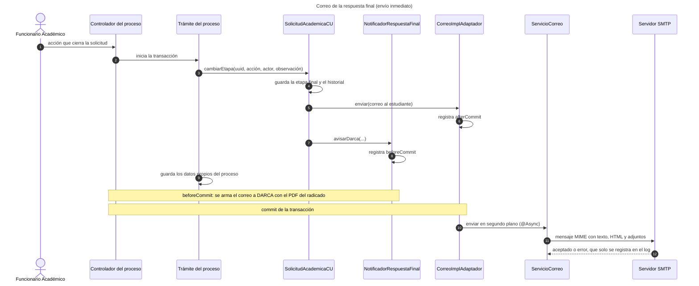
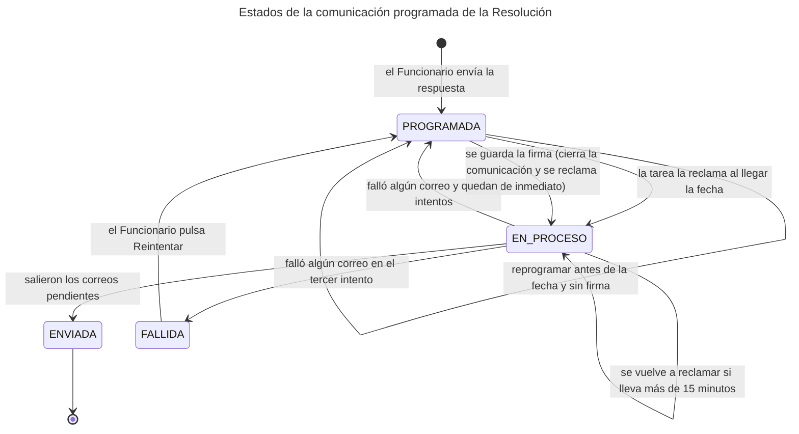
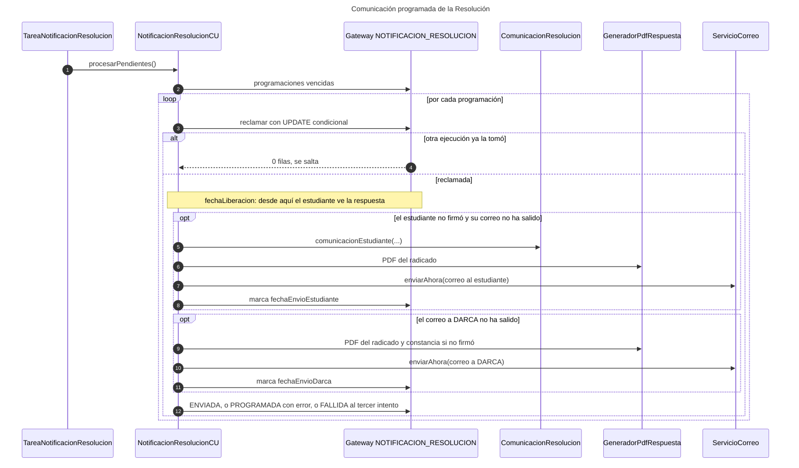

# Correo electrónico

Documento de análisis sobre el envío de correo electrónico en la extensión de los procesos académicos (Cancelación de Matrícula, Cancelación de Asignatura y Examen Supletorio). Se escribió el 2026-10-21 (tarea T12.37) leyendo el código del backend y del frontend, `change.md`, `docs/database/etapas-por-proceso.md` (decisiones P53 a P59), `docs/api/contrato-api-procesos-academicos.md` y `backend/CLAUDE.md`. No se ejecutó nada: las cifras de pruebas son las que registra `change.md`. Actualizado el 2026-10-21 (T12.40) con lo de T12.38 (P63): mensaje inmediato obligatorio, textos editables de la comunicación, firma que cierra la comunicación y avisa a DARCA de inmediato, vista del estudiante tras la firma o la fecha, y borrado de respuestas por rango; y con T12.40: `CORREO_DARCA` sin valor por defecto en los archivos versionados.

Etiquetas: todo lo de este documento es [EXTENSIÓN]. El prototipo de Julián no envía correos: sus respuestas se consultan solo dentro de la aplicación.

Este documento no reproduce contraseñas, claves, la cuenta de correo real ni las direcciones o nombres configurados; solo nombra las propiedades y variables que los contienen.

## 1. Para qué se usa

El correo avisa la respuesta final de una solicitud académica fuera de la aplicación. Hay tres destinatarios:

- El **estudiante**, en el `correoElectronico` de su usuario.
- **DARCA**, en una dirección configurable (`correo.darca.destinatario`). Antes de esta funcionalidad, la notificación a DARCA se hacía fuera de la aplicación.
- El **profesor** del Examen Supletorio (usuario con rol `Docente`), solo cuando se aprueba el comprobante de pago.

Solo hay correo cuando la solicitud termina (etapa `APROBADA` o `RECHAZADA`). Las etapas intermedias (radicar, remitir al Decano, decisión del Decano, recibo y comprobante de pago) no envían correo. La única excepción es el mensaje inmediato de Cancelación de Asignatura (sección 1.2), que sale siempre al enviar la respuesta final después del Decano (P63).

### 1.1 Cancelación de Matrícula y Examen Supletorio, y rechazo directo en Cancelación de Asignatura

Los correos salen en el mismo momento en que el Funcionario Académico cierra la solicitud.

| Proceso y acción que cierra | Estudiante: texto | Estudiante: adjuntos | DARCA: adjuntos | Profesor |
|---|---|---|---|---|
| Cancelación de Matrícula, rechazo directo del Funcionario (`RECHAZAR_FUNCIONARIO`) | Dice que la solicitud fue respondida e invita a entrar a la aplicación | Documento adicional, si lo hay | PDF del radicado y documento adicional, si lo hay | no aplica |
| Cancelación de Matrícula, respuesta final después del Decano (`ENVIAR_RESPUESTA`, aprobada o rechazada) | "Se adjunta la resolución correspondiente a su solicitud." | Resolución escaneada y documento adicional, si lo hay | PDF del radicado, Resolución y documento adicional, si lo hay | no aplica |
| Cancelación de Asignatura, rechazo directo del Funcionario | Igual que en Matrícula | ninguno | PDF del radicado | no aplica |
| Examen Supletorio: rechazo del Funcionario, respuesta tras el rechazo del Decano, aprobación o rechazo del comprobante | Dice que la solicitud ya tiene respuesta e invita a entrar a la aplicación | Documento adicional, si lo hay | PDF del radicado y documento adicional, si lo hay | Solo al aprobar el comprobante: PDF del radicado |

Asuntos, tal como están en el código (`SolicitudAcademicaCUImplAdaptador.ASUNTOS_RESPUESTA` y `NotificadorRespuestaFinal`):

| Destinatario | Asunto |
|---|---|
| Estudiante | "Notificación de Cancelación de matrícula", "Notificación de Cancelación de asignatura" o "Notificación de examen supletorio" |
| DARCA | "DARCA - Notificación de Cancelación de matrícula - Radicado <radicado>" (y equivalentes para los otros dos procesos) |
| Profesor | "Notificación de examen supletorio - Radicado <radicado>" |

El correo al estudiante empieza con la ciudad y la fecha ("Popayán, Cauca, <día> de <mes> de <año>"), el nombre y "Estudiante Facultad de Ingeniería Electrónica y Telecomunicaciones". No dice si la solicitud fue aprobada o rechazada (en Cancelación de Asignatura la decisión puede ser parcial) y no lleva observaciones ni asignaturas (P54). El de DARCA trae una frase de resumen, por ejemplo cuántas asignaturas se aprobaron y cuántas se rechazaron. El del profesor nombra al estudiante, su código, la asignatura y el radicado, y lo invita a entrar a la aplicación.

La Resolución escaneada solo existe en las cancelaciones y solo cuando la solicitud pasó por el Decano: el rechazo directo del Funcionario no la pide y sus correos no la adjuntan aunque se haya subido antes (P56). Examen Supletorio no produce Resolución.

El "Documento adicional de la respuesta" es un PDF opcional de hasta 5 MB que el Funcionario sube en las acciones que cierran la solicitud. Existe en Matrícula y Supletorio; en Cancelación de Asignatura se retiró en T12.33 y ningún correo de ese proceso lo adjunta (P59).

### 1.2 Cancelación de Asignatura después del Decano: comunicación programada

Cuando una Cancelación de Asignatura pasó por el Decano, la respuesta final no se envía en el momento (P58, desde T12.32). Al enviar la respuesta, el Funcionario:

1. Sube la Resolución **sin firmar por el estudiante** (P59).
2. Escribe el **mensaje inmediato** al estudiante, que desde T12.38 sale siempre: ya no hay casilla y el backend lo exige aunque `enviarMensaje` llegue en falso (P63). Sale enseguida, sin adjuntos y sin el resultado, con el asunto "Respuesta a su solicitud de cancelación de asignatura - Radicado <radicado>". El texto parte de una plantilla del backend que le recuerda acercarse a la Decanatura; el Funcionario lo puede editar (máximo 2000 caracteres) y lo ve completo.
3. Programa la **comunicación de la Resolución**, que es obligatoria: fecha y hora futuras en hora de Colombia, número de la Resolución, año y decisión. El sistema propone la decisión según lo que resolvió el Decano ("aprueba la", "niega la" o "aprueba parcialmente la"; antes "rechaza la", P64) y el Funcionario la puede cambiar. En el mismo diálogo ve y edita, tal como saldrán, el texto que recibirá el estudiante (`textoComunicacion`, con las marcas `{numero}`, `{anio}`, `{nombre}` y `{decision}`, que se llenan al enviar y van en negrilla) y el que recibirá DARCA (`textoDarca`, con `{fecha}`). Los dos se guardan en `NOTIFICACION_RESOLUCION` (máximo 4000 cada uno); si no llegan se guardan los de la plantilla, y las filas anteriores a T12.38 usan la plantilla fija (P63).

En la fecha programada, una tarea del servidor envía dos correos independientes:

| Caso | Estudiante | DARCA |
|---|---|---|
| El estudiante no firmó la Resolución en la Decanatura | Asunto "Notificación de Cancelación de asignatura" con la "COMUNICACIÓN ELECTRÓNICA - RESOLUCIÓN No. <prefijo><número> de <año>", que cita la Ley 1437 de 2011; número, año, nombre y decisión en negrilla. Adjuntos: PDF del radicado y la Resolución sin firmar | Tres PDF: el del radicado, la Resolución y la constancia de la comunicación al estudiante (`Comunicacion-Estudiante-<radicado>.pdf`) |
| El estudiante firmó la Resolución en la Decanatura antes de la fecha | No se le envía nada | Dos PDF: el del radicado y la Resolución firmada, con el texto de DARCA revisado al registrar la firma. Sale de inmediato al guardar la firma, sin esperar la fecha (P63) |

Si el estudiante firma antes de la fecha, el Funcionario reemplaza la Resolución sin firmar por la firmada desde el panel "Notificación de la Resolución". Desde T12.38 eso se hace una sola vez y cierra la comunicación: ya no se puede subir otra firmada, reprogramar ni editar (reemplaza la re-subida de P59). No hay firma tardía después de la fecha. El panel muestra cuál Resolución está vigente. Mientras la fecha no llegue y no haya firma, el Funcionario puede reprogramar y corregir el número, el año y la decisión.

### 1.3 Visibilidad diferida para el estudiante

En el caso de la sección 1.2, el estudiante ve su solicitud "En trámite" desde que el Funcionario responde hasta que se guarda la firma o llega la fecha programada (P63, desde T12.38). En ese tiempo el backend no le entrega la respuesta, el resultado por asignatura, la Resolución ni su descarga ni las filas de decisión y respuesta del historial. La retención ya no depende de que la tarea programada reclame la fila: una fila está retenida solo si `fechaLiberacion` es nula y `fechaProgramada` sigue en el futuro (hora de Colombia). Después la respuesta queda visible y no se vuelve a ocultar, aunque un correo falle. Funcionario y Decano ven todo en todo momento.

Las fuentes no explican por escrito el motivo de esta regla. Lo que se desprende de P58 es que la aplicación no adelanta al estudiante un resultado que se le comunica formalmente, con la Resolución, en una fecha elegida por la Decanatura.

## 2. Cómo se implementó

### 2.1 Tecnología

| Pieza | Qué es | Dónde |
|---|---|---|
| Spring Boot Mail (`spring-boot-starter-mail`) | Cliente SMTP de Spring sobre Jakarta Mail; el código usa `JavaMailSender` y `MimeMessageHelper` | `backend/solicitudes/pom.xml`; `infraestructura/output/correo/ServicioCorreo.java` |
| OpenPDF 2.0.5 (`com.github.librepdf:openpdf`) | Generación del PDF del radicado y de la constancia | `pom.xml`; `infraestructura/output/pdf/GeneradorPdfRespuesta.java` |
| `@EnableAsync` y `@Async` | Envío de los correos inmediatos en segundo plano, con el ejecutor por defecto de Spring Boot (no se configuró uno propio) | `ConfiguracionAsincrona`, `ServicioCorreo.enviar` |
| `@EnableScheduling` y `@Scheduled` | Tarea que procesa las comunicaciones programadas | `ConfiguracionProgramada`, `infraestructura/input/programadorNotificaciones/TareaNotificacionResolucion.java` |
| `TransactionSynchronizationManager` | Ejecuta el armado justo antes del commit y el envío justo después | `CorreoImplAdaptador`, `PreparacionCorreoImplAdaptador` |

### 2.2 Encaje en la arquitectura hexagonal

El dominio no conoce Spring Mail ni OpenPDF. Arma los correos con modelos propios y los entrega por puertos de salida:

| Capa | Clases |
|---|---|
| Puertos de salida (`aplicacion/output`) | `CorreoIntPuerto` (`enviar` asíncrono tras el commit y `enviarAhora` síncrono), `PreparacionCorreoIntPuerto` (`antesDeConfirmar`), `GeneradorPdfRespuestaIntPuerto` (`generar`, `generarConstancia`), `NotificacionResolucionGatewayIntPuerto` |
| Dominio | `SolicitudAcademicaCUImplAdaptador.cambiarEtapa` y `avisarRespuesta` (correo al estudiante); servicio `NotificadorRespuestaFinal` (correos a DARCA y al profesor, resumen para el PDF, adjuntos); servicio `ComunicacionResolucion` (textos de la comunicación programada y firma); caso de uso `NotificacionResolucionCUImplAdaptador` (programación, panel y procesamiento); modelos `AdjuntoCorreo`, `CorreoPreparado`, `FragmentoTexto`, `FirmaCorreo`, `ResumenRespuesta`, `ConstanciaComunicacion`, `NotificacionResolucion` |
| Infraestructura | `ServicioCorreo`, `CorreoImplAdaptador`, `PreparacionCorreoImplAdaptador`, `GeneradorPdfRespuesta`, `TareaNotificacionResolucion`, entidad, repositorio, mapper y gateway de `NOTIFICACION_RESOLUCION` |

`NotificadorRespuestaFinal` se registra como `@Bean` en `BeanConfiguracion`, igual que los casos de uso, y recibe ahí el destinatario de DARCA. `ComunicacionResolucion` se crea dentro del `@Bean` del caso de uso de la notificación con la firma y el sufijo leídos de propiedades.

### 2.3 Envío asíncrono después de confirmar la transacción

Los correos inmediatos siguen este orden dentro de la petición HTTP que cierra la solicitud:

1. El controlador abre la transacción (`@Transactional`) y el trámite llama a `cambiarEtapa`.
2. `cambiarEtapa` cambia la etapa y escribe el historial. Si la etapa nueva es final, arma el correo al estudiante y lo pasa a `CorreoIntPuerto.enviar`. `CorreoImplAdaptador` no lo envía todavía: registra una sincronización `afterCommit`.
3. El correo a DARCA y el del profesor se arman con `PreparacionCorreoIntPuerto.antesDeConfirmar`, que los corre en `beforeCommit`. Así leen los datos que el trámite guarda después de `cambiarEtapa`: los ajustes de las asignaturas en Cancelación de Asignatura y el profesor asignado en el supletorio.
4. Si la transacción se confirma, cada correo se entrega a `ServicioCorreo.enviar` (`@Async`), que lo envía en otro hilo. Si la transacción se revierte, no sale ningún correo.
5. Cada correo es independiente. Si uno falla (por ejemplo, el estudiante no tiene correo, falta un archivo o el servidor SMTP lo rechaza), el error queda en el log de la aplicación con el asunto y el destinatario, los demás salen y la respuesta sigue guardada.

Los archivos adjuntos (Resolución, documento adicional) viajan como referencia (`AdjuntoCorreo` con nombre, tipo y ruta) y se leen del disco en el hilo asíncrono. El PDF del radicado viaja en memoria (`AdjuntoCorreo.contenido`) y no se escribe en disco.

### 2.4 PDF del radicado y constancia

`GeneradorPdfRespuesta` arma con OpenPDF un PDF tamaño carta:

- **PDF del radicado** (`Radicado-<radicado>.pdf`), título "Respuesta de solicitud académica": radicado, tipo de solicitud, fecha de respuesta, estudiante, código estudiantil, programa y estado final. En Cancelación de Asignatura, una tabla con la decisión de cada asignatura y la situación al cancelar de las aprobadas ("No aplica" en las rechazadas). En Cancelación de Matrícula, la decisión. En Examen Supletorio, la asignatura, la decisión sobre el comprobante y el profesor asignado. No lleva observaciones ni historial.
- **Constancia** (`Comunicacion-Estudiante-<radicado>.pdf`), título "Constancia de comunicación electrónica al estudiante": radicado, destinatario, asunto, fecha y hora de envío en hora de Colombia y el texto completo del correo al estudiante, con las mismas negrillas. Si el correo al estudiante no salió, el campo de la fecha dice "No se pudo enviar; el envío se reintentará".

### 2.5 Plantillas, formato y firma

- Los textos están en constantes del código: `SolicitudAcademicaCUImplAdaptador` (correo al estudiante), `NotificadorRespuestaFinal` (DARCA y profesor) y `ComunicacionResolucion` (`MENSAJE_INICIAL` y `COMUNICACION_ESTUDIANTE`). No hay motor de plantillas: los valores se insertan con `String.format` o con marcadores `{numero}`, `{anio}`, `{nombre}`, `{decision}`, `{sufijo}` y `{firma}`.
- Todos los correos llevan el remitente visible "Decanatura FIET - Procesos académicos" sobre la dirección de la cuenta configurada, y dos versiones del mismo contenido: texto plano y un HTML simple sin imágenes ni enlaces (P57). `ServicioCorreo.html` convierte los párrafos del texto en HTML y escapa los caracteres especiales, por eso un mensaje escrito por el Funcionario no puede inyectar HTML.
- En la comunicación de la Resolución, `ComunicacionResolucion` divide el texto en fragmentos (`FragmentoTexto`) y marca en negrilla número, año, nombre y decisión, tanto en el HTML como en la constancia PDF.
- La firma de cuatro líneas (nombre, cargo, dependencia y facultad) y el sufijo del número de la Resolución salen de `application.properties` (`correo.firma.*` y `correo.resolucion.sufijo`). Cambiar de firmante no exige tocar código. La facultad va escrita con escapes Unicode porque Spring lee ese archivo en ISO-8859-1 (`backend/CLAUDE.md`).

### 2.6 Cola de correos pendientes (sin conexión a internet)

Desde T12.41 los correos inmediatos ya no se pierden si falla la conexión. `CorreoImplAdaptador.enviar` guarda cada correo en la tabla `CORREO_PENDIENTE` dentro de la misma transacción de la respuesta (si la transacción se revierte, la fila también) y, después del commit, `ColaCorreos.enviarEnSegundoPlano` intenta enviarlo. Si el envío falla, la fila queda `PENDIENTE` y `ColaCorreos.reintentarPendientes` (`@Scheduled`, cada `correo.pendientes.intervalo-ms`, 60 000 por defecto) lo reintenta; cuando vuelve la conexión salen todos. Reclamo con `UPDATE` condicional (`ENVIANDO`), igual que la comunicación de la Resolución, para no duplicar envíos.

- Un fallo de conexión (host desconocido, conexión rechazada o caída, tiempo de espera, TLS, autenticación) lanza `FallaTransitoriaCorreoException` y no cuenta como intento: el correo se reintenta sin límite.
- Un rechazo del servidor (por ejemplo 550) cuenta como intento y a los 5 la fila pasa a `ABANDONADO`.
- Al enviarse, la fila queda `ENVIADO` y se borran los adjuntos guardados. Los adjuntos generados en memoria (PDF del radicado) se guardan dentro de la fila; los de archivo (Resolución, documento adicional) se guardan como referencia y se leen del disco al enviar.
- La comunicación programada de la Resolución usa la misma clasificación: si el fallo es de conexión no suma intentos, así que un corte largo ya no la deja en `FALLIDA`.

## 3. Envío programado de la comunicación de la Resolución

### 3.1 Tabla `NOTIFICACION_RESOLUCION`

Una fila por solicitud (1 a 0..1 con `SOLICITUD_ACADEMICA`), creada en la misma transacción en que el Funcionario envía la respuesta final. La crea Hibernate al arrancar. Columnas principales (detalle en el documento 05, 4.21, y en el diccionario de datos):

| Grupo | Columnas |
|---|---|
| Programación | `fechaProgramada`, `numeroResolucion`, `anioResolucion`, `decision`, `mensajeInicial`, `textoComunicacion`, `textoDarca` (T12.38) |
| Estado | `estado` (`PROGRAMADA`, `EN_PROCESO`, `ENVIADA`, `FALLIDA`), `firmada`, `intentos`, `ultimoError` |
| Marcas de tiempo | `fechaReclamo`, `fechaEnvioEstudiante`, `fechaEnvioDarca`, `fechaEnvio`, `fechaLiberacion`, `fechaCreacion` |

### 3.2 Estados

### 3.3 Tarea programada

`TareaNotificacionResolucion.procesar` corre con `@Scheduled(fixedDelay)`: cada `correo.resolucion.intervalo-ms` (60 000 ms por defecto) después de terminar la ejecución anterior, y la primera vez a los `correo.resolucion.retraso-inicial-ms` (15 000 ms) de arrancar. Al arrancar procesa todo lo que se haya vencido mientras el backend estaba apagado. No usa token ni el contexto de seguridad y no escribe en el log de Julián; solo deja mensajes en el log de la aplicación.

Cada ejecución llama a `NotificacionResolucionCUImplAdaptador.procesarPendientes`:

1. Busca las filas `PROGRAMADA` con la fecha vencida o con la firma registrada (T12.38) y las `EN_PROCESO` reclamadas hace más de 15 minutos.
2. Reclama cada una con un `UPDATE` condicional (`NotificacionResolucionRepositorio.reclamar`) que en la misma sentencia la pasa a `EN_PROCESO`, marca `fechaReclamo` y llena `fechaLiberacion` si estaba vacía. Si el `UPDATE` no cambia ninguna fila, otra ejecución ya la tomó y no se envía nada. Así no se duplican envíos con dos ejecuciones simultáneas ni después de un reinicio.
3. Si el estudiante no firmó y su correo no ha salido, le envía la comunicación con `CorreoIntPuerto.enviarAhora`, que es síncrono y sí devuelve el error, y marca `fechaEnvioEstudiante`.
4. Si el correo a DARCA no ha salido, lo arma con `NotificadorRespuestaFinal.correoDarcaResolucion` (con la constancia si el estudiante no firmó) y marca `fechaEnvioDarca`.
5. Sin errores, la fila queda `ENVIADA`. Con error, vuelve a `PROGRAMADA` con el error en `ultimoError` (hasta 1000 caracteres) y se intenta en la siguiente ejecución; en el tercer intento queda `FALLIDA`. Como cada correo tiene su propia marca, el reintento repite solo el que falló.

El reloj del caso de uso es `Clock.system(ZoneId.of("America/Bogota"))`, de modo que la fecha programada y la de envío se comparan en hora de Colombia.

### 3.4 Resolución sin firmar y firmada

- Al enviar la respuesta, el Funcionario sube la Resolución sin firmar por el estudiante, que se guarda en `RESOLUCION_ACADEMICA` como cualquier escaneo.
- Si el estudiante firma en la Decanatura antes de la fecha, el Funcionario usa "Registrar firma" (`POST .../funcionario/notificacion/firma`, multipart `archivo` y `textoDarca` opcional). Un `UPDATE` condicional marca `firmada`, guarda el texto de DARCA y llena `fechaLiberacion` solo si la fila sigue `PROGRAMADA`, sin firma y antes de la fecha; luego `ResolucionAcademicaCUImplAdaptador.reemplazarResolucionFirmada` reemplaza el archivo en la misma fila. Desde T12.38 no se puede repetir: la firma cierra la comunicación (P63).
- Tras confirmar la transacción, `EjecucionDiferidaIntPuerto.despuesDeConfirmar` corre en segundo plano el procesamiento de esa fila: la reclama aunque la fecha no haya llegado y envía solo el correo a DARCA (PDF del radicado y Resolución firmada), con los mismos 3 intentos; los siguientes los toma la tarea programada y queda el reintento manual. Al estudiante no se le envía la comunicación.
- Sin firma, en la fecha salen los dos correos de la sección 1.2 con la Resolución sin firmar.
- Cuando la respuesta se libera (firma o fecha), el estudiante descarga la Resolución vigente: la firmada si se registró la firma, la sin firmar si no.

### 3.5 Panel del Funcionario

El panel "Notificación de la Resolución" (`NotificacionResolucionComponent`, frontend) muestra el estado, la fecha, el número, el año, la decisión, la Resolución vigente y el último error. Usa cinco endpoints de `cancelaciones-asignatura/{uuid}/funcionario/notificacion` (plantilla, consulta, reprogramar, firma y reintentar), solo para el Funcionario Académico asignado; para cualquier otro usuario la solicitud responde como inexistente.

## 4. Configuración

### 4.1 Propiedades y variables de entorno

| Propiedad (`application.properties`) | Variable de entorno | Para qué |
|---|---|---|
| `spring.mail.host`, `spring.mail.port` | `SPRING_MAIL_HOST`, `SPRING_MAIL_PORT` (Spring las toma por encima del archivo) | Servidor SMTP; en el archivo está el de Gmail en el puerto 587 |
| `spring.mail.properties.mail.smtp.auth`, `...starttls.enable` | | Autenticación y cifrado STARTTLS |
| `spring.mail.properties.mail.smtp.connectiontimeout`, `...timeout`, `...writetimeout` | | Tiempos de espera de 10 s |
| `spring.mail.username` | `MAIL_USER` | Cuenta que envía (vacía por defecto) |
| `spring.mail.password` | `MAIL_PASSWORD` | Contraseña de aplicación de esa cuenta (vacía por defecto) |
| `correo.darca.destinatario` | `CORREO_DARCA` | Destinatario de DARCA. Obligatoria y sin valor por defecto desde T12.40: sale solo de `backend/.env` o de la consola, y el backend no arranca si falta |
| `correo.firma.nombre`, `correo.firma.cargo`, `correo.firma.dependencia`, `correo.firma.facultad` | | Firma de la comunicación de la Resolución y del mensaje inicial |
| `correo.resolucion.prefijo` | | Prefijo del número de la Resolución (`8.4.2-4.10/`), P65 |
| `correo.resolucion.intervalo-ms` | `CORREO_RESOLUCION_INTERVALO_MS` | Intervalo de la tarea programada (60 000 por defecto) |
| `correo.resolucion.retraso-inicial-ms` | `CORREO_RESOLUCION_RETRASO_INICIAL_MS` | Retraso de la primera ejecución (15 000 por defecto) |
| `correo.pendientes.intervalo-ms` | `CORREO_PENDIENTES_INTERVALO_MS` | Intervalo del reintento de correos pendientes (60 000 por defecto) |
| `correo.pendientes.retraso-inicial-ms` | `CORREO_PENDIENTES_RETRASO_INICIAL_MS` | Retraso de la primera ejecución (20 000 por defecto) |

Sin `MAIL_USER` y `MAIL_PASSWORD` el backend arranca igual (también `SolicitudesApplicationTests`); los envíos fallan y solo queda el error en el log.

### 4.2 Desarrollo: cuenta de prueba de Gmail

En desarrollo se usa una cuenta de Gmail de prueba con una contraseña de aplicación, por SMTP con STARTTLS en el puerto 587. Las credenciales nunca están en el repositorio: `docker-compose.yml` las toma del entorno del host o de `backend/.env`, que Docker Compose carga solo. `backend/.env.example` es la plantilla sin valores reales, y `.env` está en los `.gitignore`. Lo definido en la consola (`$env:MAIL_USER=...`) manda sobre el `.env`. Si cambian los valores, basta con `docker compose up`, porque el `.env` no entra en la imagen.

### 4.3 Producción: SMTP institucional

En producción habría que apuntar a un servidor SMTP institucional de la Universidad en lugar de Gmail. Según la configuración actual, lo que cambiaría es:

- `SPRING_MAIL_HOST` y `SPRING_MAIL_PORT` (o `spring.mail.host` y `spring.mail.port`) con los datos del servidor institucional, y las propiedades de autenticación y STARTTLS según lo que ese servidor exija.
- `MAIL_USER` y `MAIL_PASSWORD` con una cuenta institucional del remitente, inyectadas como secretos del entorno de despliegue.
- `CORREO_DARCA` con la dirección real de DARCA (ya no tiene valor por defecto en los archivos versionados).
- La firma (`correo.firma.*`) con los datos del funcionario que firma.

No se probó contra un servidor institucional; sus requisitos (puerto, cifrado, límites de envío y de tamaño) no están en las fuentes.

## 5. Cómo se probó

### 5.1 Pruebas unitarias

`ServicioCorreoTest` (mensaje MIME, remitente visible, texto y HTML, escape del HTML, adjuntos), `NotificadorRespuestaFinalTest` (correos a DARCA y al profesor, adjuntos según el caso), `GeneradorPdfRespuestaTest`, `ComunicacionResolucionTest` (plantillas, negrillas, decisión propuesta), `NotificacionResolucionCUImplAdaptadorTest` (programación, reclamo, reintentos, firma, estados), `TareaNotificacionResolucionTest`, y cambios en `SolicitudAcademicaCUImplAdaptadorTest`, `ConsultaSolicitudAcademicaCUImplAdaptadorTest` y `ResolucionAcademicaCUImplAdaptadorTest` (retención y liberación). Se ejecutan con el resto de la suite (`.\mvnw.cmd test`).

### 5.2 SMTP de prueba local y script de integración

`backend/pruebas/t9_correo_respuesta.ps1` no habla con Gmail. Usa `backend/pruebas/smtp_prueba.py`, un servidor SMTP local escrito en Python que:

- guarda cada mensaje recibido como un JSON (remitente, destinatarios, asunto, texto, HTML y adjuntos; de cada PDF guarda si es un PDF válido y el texto que trae);
- rechaza con un error 550 a cualquier destinatario que contenga `smtp-rechaza`, para probar fallos de envío.

El backend se levanta desde el jar apuntando a ese SMTP con `SPRING_MAIL_HOST` y `SPRING_MAIL_PORT`, con un destinatario de DARCA de prueba (`PRUEBAS_CORREO_DARCA` debe coincidir con `CORREO_DARCA`) y, para la comunicación programada, con un intervalo corto (`CORREO_RESOLUCION_INTERVALO_MS` de 2000). El procedimiento completo está en `backend/CLAUDE.md`, sección de pruebas. `todo.ps1` solo corre `t9` si está definida `PRUEBAS_CORREOS`.

El script cubre, en los tres procesos y en cada acción que cierra la solicitud: la etapa resultante, el correo al estudiante, el de DARCA (asunto, frase, PDF generado y adjuntos) y el del profesor; que las etapas intermedias no envían correo; que un correo rechazado por el servidor no revierte la respuesta ni frena los demás; el rechazo directo sin Resolución; el remitente visible y la versión HTML; y, en Cancelación de Asignatura después del Decano, el mensaje inicial escapado y sin adjuntos, la retención y la liberación para el estudiante, la firma, la reprogramación, el envío programado sin firma (DARCA con tres PDF) y con firma (DARCA con dos PDF), el fallo del correo al estudiante sin frenar a DARCA, el estado FALLIDA tras tres intentos y el reintento manual que repite solo lo que falló.

Resultados registrados en `change.md`: 123 PASS al crearse el script (2026-10-15), 270 al agregar DARCA y el profesor, 358 en T12.31, 423 en T12.32 y 428 en T12.33 y T12.34, siempre sin FAIL y contra el jar en el puerto 8091. T12.35 no corrió `t9`; T12.38 registra 446 PASS. T12.40 no corrió `t9` (solo `t5`, `t6` y `t8` contra el jar con el SMTP local, sin FAIL).

## 6. Decisiones, limitaciones y puntos abiertos

### 6.1 Decisiones tomadas

- El correo nunca revierte la respuesta: la respuesta se guarda y el correo es un aviso adicional (P54).
- Los correos inmediatos salen después del commit y en segundo plano, para no demorar la petición del Funcionario ni enviar avisos de algo que no quedó guardado.
- El correo al estudiante no dice si la solicitud fue aprobada o rechazada y no lleva observaciones (P54); el detalle está en la aplicación y en la Resolución.
- La Resolución solo viaja cuando la solicitud pasó por el Decano (P56).
- En Cancelación de Asignatura después del Decano, la Resolución se comunica en una fecha programada y la respuesta queda oculta para el estudiante hasta esa fecha o hasta que se guarda la firma (P58, P63); el documento adicional se retiró de ese proceso (P59). La firma cierra la comunicación y DARCA recibe la firmada de inmediato (P63).
- El correo a DARCA lleva un PDF generado por el sistema en lugar del detalle en el cuerpo del correo.
- La tarea programada usa `UPDATE` condicionales en la base en lugar de bloqueos en memoria, para que funcione aunque haya dos ejecuciones o el backend se reinicie.
- La liberación de la respuesta ocurre al guardar la firma o al llegar la fecha programada, no cuando el correo sale bien: un fallo de correo no deja al estudiante sin ver su respuesta (P58, P63).
- El borrado de respuestas por rango del Funcionario (P63) nunca toca una solicitud con la comunicación `PROGRAMADA`, `EN_PROCESO` o `FALLIDA`; las `ENVIADA` sí se pueden borrar con su fila de `NOTIFICACION_RESOLUCION`. El borrado no envía correos.

### 6.2 Limitaciones conocidas

- Los correos inmediatos se reintentan desde `CORREO_PENDIENTE` (sección 2.6), pero un correo `ABANDONADO` por rechazo del servidor solo queda en la base y en el log; nadie lo ve en la interfaz.
- El envío asíncrono usa el ejecutor por defecto de Spring Boot; no se configuró su tamaño.
- El tamaño de los adjuntos no se valida contra el límite del servidor de correo; un correo rechazado por tamaño solo queda en el log (P54).
- Si el estudiante no tiene correo registrado, el correo inmediato se omite y se registra; en la comunicación programada cuenta como error y lleva la fila a FALLIDA tras tres intentos.
- La firma y el sufijo están escritos en archivos versionados; el destinatario de DARCA ya no (T12.40).
- No hay aviso dentro de la aplicación para el estudiante cuando se libera la respuesta; se entera por el correo y por la bandeja.

### 6.3 Puntos abiertos

- **Constancia a DARCA si falla el correo al estudiante.** En la comunicación programada, si el correo al estudiante falla y el de DARCA sale, DARCA recibe la constancia con la fecha de envío "No se pudo enviar; el envío se reintentará". Como el correo a DARCA queda marcado como enviado, el reintento solo repite el del estudiante, y DARCA no recibe una constancia del envío que sí ocurra después. Falta decidir si DARCA debe esperar al correo del estudiante, recibir una segunda constancia o enterarse de otra forma.
- El paso de la cuenta de prueba de Gmail al SMTP institucional (sección 4.3) no se ha hecho ni probado.
- Sacar de los archivos versionados los datos de la firma, o documentar que son públicos (el destinatario de DARCA ya salió en T12.40).
- Decidir si los fallos de los correos inmediatos deben quedar visibles para el Funcionario, como ya ocurre con la comunicación programada.
