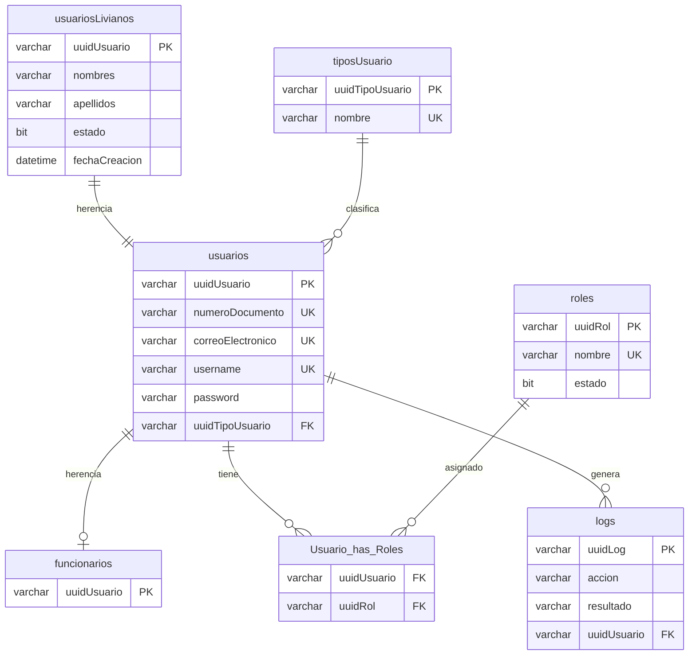
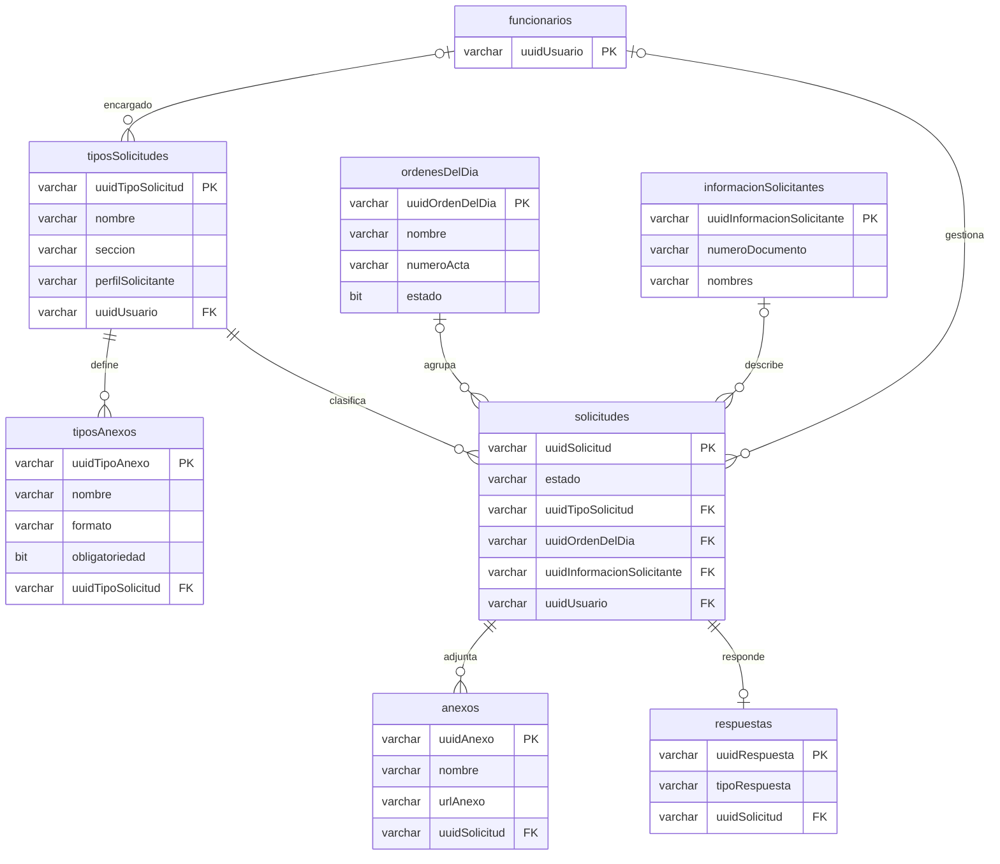
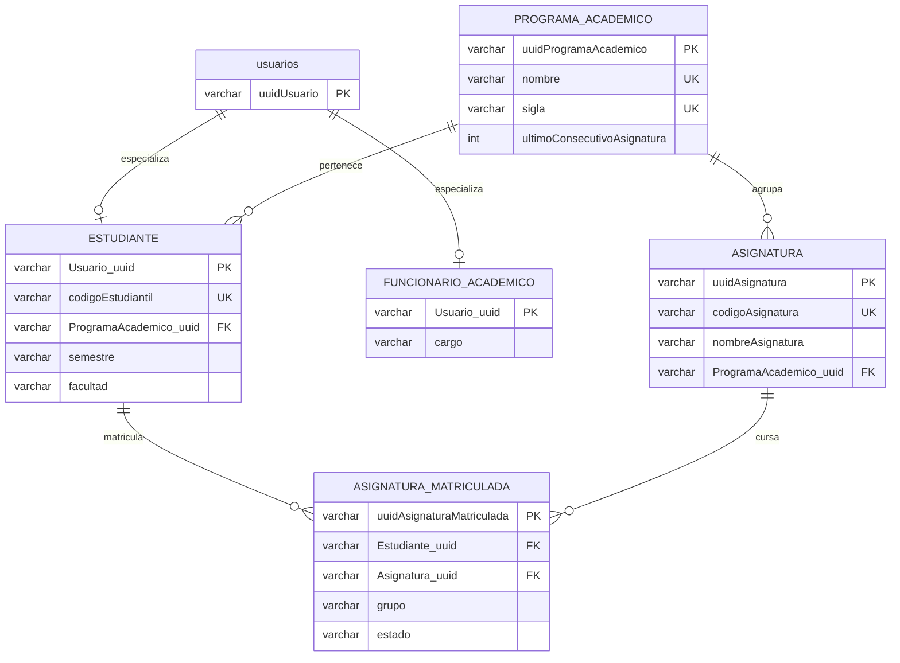
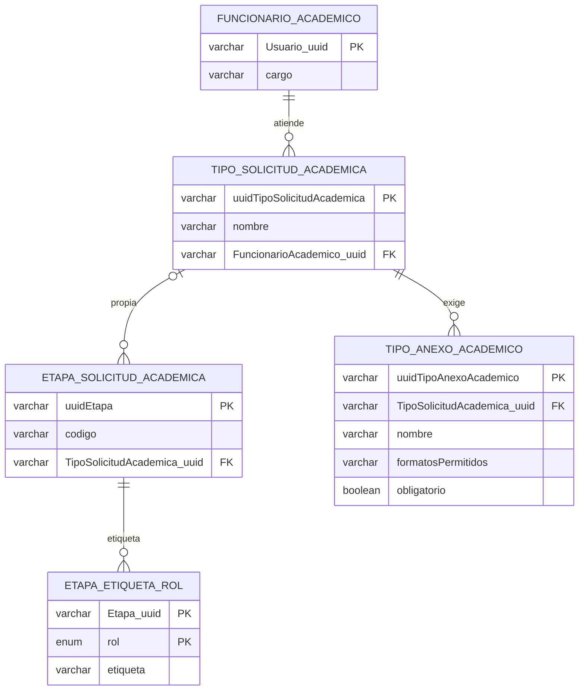
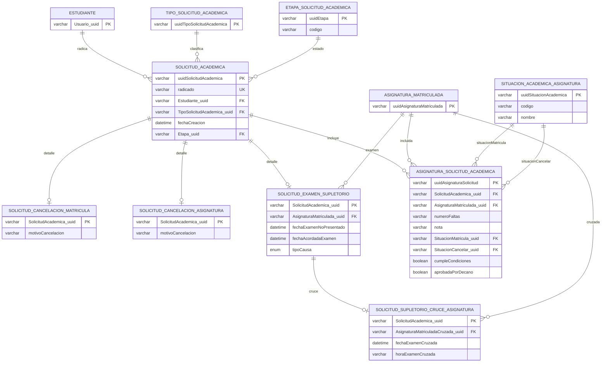
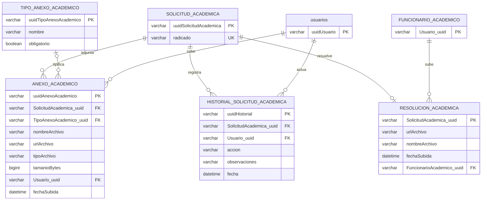

===== 04-backend-casos-de-uso.md =====

# 04. Backend: casos de uso (`*CUImplAdaptador`)

Análisis de solo lectura del módulo `backend/solicitudes`. Estado analizado: árbol de trabajo en la rama `main` con cambios sin confirmar (entre ellos la eliminación de `requisitosVerificados` en la remisión del supletorio, decisión P49, visible en `git status`). Lo que no se pudo comprobar en el código se marca NO VERIFICADO.

## 0. Convenciones del documento

- Ruta base de los casos de uso: `backend/solicitudes/src/main/java/com/unicauca/cfiet/solicitudes/dominio/casosdeuso/`. En adelante, `CU/`.
- Otras rutas base: `dominio/servicios/` (reglas de dominio), `dominio/helper/constantes/`, `aplicacion/output/` (puertos de salida), `infraestructura/configuracion/BeanConfiguracion.java`, `infraestructura/output/manejadorExcepciones/MensajesError.java`.
- Marca de origen: [BASE] es código del prototipo de Julián Camacho; [EXTENSIÓN] es código agregado en este trabajo de grado. El criterio es verificable con git: los 8 casos de uso [BASE] aparecen por primera vez en el commit inicial `d3a48cc` y no tienen más commits (`git log --oneline -- <archivo>` devuelve una sola línea). Los 22 [EXTENSIÓN] nacen en commits posteriores (2026-10-05 a 2026-10-11). El repositorio no conserva el historial original de Julián (el primer commit ya es del trabajo de grado), de modo que "BASE" significa "presente en el commit inicial y nunca modificado", no autoría demostrada por git. NO VERIFICADO: la autoría de Julián sobre cada archivo base (se apoya en `CLAUDE.md` y en los `@author` de Javadoc).
- Cómo cuento las "operaciones": cada método público anotado `@Override` en el `*CUImplAdaptador` (implementación de un método del puerto `*CUIntPuerto`). Los métodos privados no se cuentan.
- Códigos de error: `ExcepcionesFormateadorIntPuerto` (implementado por `infraestructura/output/formateador/ExcepcionesFormateadorImplAdaptador.java`) lanza una excepción propia por tipo. `CodigoError` (`infraestructura/output/manejadorExcepciones/estructura/CodigoError.java`) los numera: 1 genérico (`lanzarErrorGenerico`), 2 entidad existe (`lanzarEntidadExiste`), 3 entidad no existe (`lanzarEntidadNoExiste`), 4 regla de negocio violada (`lanzarReglaNegocioViolada`), 5 credenciales (`lanzarCredencialesErroneas`), 6 mal formato (`lanzarMalFormato`), 7 sin información (`lanzarSinInformacion`), 8 sin acceso (`lanzarSinAcceso`), 9 token expirado. En `RestApiExcepcion` todos los handlers de excepciones propias responden HTTP 500 (solo `AuthenticationException` y `AccessDeniedException` dan 403, y la validación de DTO da 400); el contrato `docs/api/contrato-api-procesos-academicos.md` lo documenta igual (línea 38 y 42). En las tablas de este documento, "E3", "E4", "E6" etc. significan código de error 3, 4, 6.

## 1. Resumen cuantitativo

| Concepto | Valor |
|---|---|
| Casos de uso (`*CUImplAdaptador`) | 30 |
| [BASE] | 8 (62 operaciones) |
| [EXTENSIÓN] | 22 (76 operaciones) |
| Operaciones totales (`@Override`) | 138 |
| Casos de uso que escriben en el log de Julián | 20 de 30: 13 de la extensión y 7 base (ver sección 12) |
| Casos de uso con `@Transactional` propio | 0 (verificado: `grep Transactional dominio/` sin resultados) |
| Métodos `@Bean` de caso de uso en `BeanConfiguracion` | 30 (27 `crear<X>CU` y 3 `create<X>CU` de Julián: `createRolCU`, `createUsuarioCU`, `createSesionCU`) |

Conteo por caso de uso:

| Caso de uso | Origen | Operaciones |
|---|---|---|
| `AnexoAcademicoCUImplAdaptador` | EXTENSIÓN | 4 |
| `AsignacionFuncionarioAcademicoCUImplAdaptador` | EXTENSIÓN | 1 |
| `AsignaturaCUImplAdaptador` | EXTENSIÓN | 7 |
| `CancelacionAsignaturaCUImplAdaptador` | EXTENSIÓN | 1 |
| `CancelacionMatriculaCUImplAdaptador` | EXTENSIÓN | 1 |
| `ConsultaCancelacionAsignaturaCUImplAdaptador` | EXTENSIÓN | 3 |
| `ConsultaCancelacionMatriculaCUImplAdaptador` | EXTENSIÓN | 3 |
| `ConsultaExamenSupletorioCUImplAdaptador` | EXTENSIÓN | 3 |
| `ConsultaSolicitudAcademicaCUImplAdaptador` | EXTENSIÓN | 7 |
| `EstudianteCUImplAdaptador` | EXTENSIÓN | 9 |
| `EtapaSolicitudAcademicaCUImplAdaptador` | EXTENSIÓN | 2 |
| `ExamenSupletorioCUImplAdaptador` | EXTENSIÓN | 1 |
| `FuncionarioAcademicoCUImplAdaptador` | EXTENSIÓN | 6 |
| `ProgramaAcademicoCUImplAdaptador` | EXTENSIÓN | 1 |
| `ResolucionAcademicaCUImplAdaptador` | EXTENSIÓN | 2 |
| `SituacionAcademicaAsignaturaCUImplAdaptador` | EXTENSIÓN | 1 |
| `SolicitudAcademicaCUImplAdaptador` | EXTENSIÓN | 3 |
| `TipoAnexoAcademicoCUImplAdaptador` | EXTENSIÓN | 1 |
| `TipoSolicitudAcademicaCUImplAdaptador` | EXTENSIÓN | 1 |
| `TramiteCancelacionAsignaturaCUImplAdaptador` | EXTENSIÓN | 5 |
| `TramiteCancelacionMatriculaCUImplAdaptador` | EXTENSIÓN | 5 |
| `TramiteExamenSupletorioCUImplAdaptador` | EXTENSIÓN | 9 |
| `LogCUImplAdaptador` | BASE | 5 |
| `OrdenDelDiaCUImplAdaptador` | BASE | 10 |
| `RespuestaCUImplAdaptador` | BASE | 9 |
| `RolCUImplAdaptador` | BASE | 4 |
| `SesionCUImplAdaptador` | BASE | 1 |
| `SolicitudCUImplAdaptador` | BASE | 13 |
| `TipoSolicitudCUImplAdaptador` | BASE | 10 |
| `UsuarioCUImplAdaptador` | BASE | 10 |

## 2. Transaccionalidad (aplica a todos los casos de uso)

1. Ningún `*CUImplAdaptador` lleva `@Transactional` (de hecho no son `@Component`: se instancian con `new` en `BeanConfiguracion`). El límite transaccional lo ponen los controladores.
2. Controladores de la extensión (`infraestructura/input/controlador*/controlador/*RestController.java`): todos sus métodos llevan `@Transactional`, con `readOnly = true` en los GET. Ejemplo verificado: `ExamenSupletorioRestController` (12 anotaciones, incluido `getFormulario` y `getDetalle` con `readOnly = true`), `CancelacionMatriculaRestController` y `CancelacionAsignaturaRestController` (8 cada uno), `SolicitudAcademicaRestController` (9).
3. Controladores [BASE] (`SolicitudesRestController`, `RespuestaRestController`, `RolRestController`, `TiposSolicitudRestController`, `UsuarioRestController`): `@Transactional` solo en métodos de escritura (por ejemplo `crearOrdenDelDia`, `enviarSolicitud`, `registrarRespuesta`, `actualizarRol`), no en lecturas. Es una diferencia de criterio entre base y extensión.
4. Los gateways de la extensión también anotan sus métodos (`SolicitudAcademicaGatewayImplAdaptador.crear` y `actualizarEtapa` con `@Transactional`; lecturas con `readOnly = true`). Como el controlador ya abrió transacción, se unen a ella (propagación por defecto REQUIRED; esta propagación es comportamiento estándar de Spring, no verificada en configuración propia).
5. Archivos: `AlmacenamientoAnexosImplAdaptador` (`infraestructura/output/almacenamiento/`) usa `TransactionSynchronizationManager`: borra el archivo recién escrito si la transacción se revierte (`afterCompletion`) y borra el archivo reemplazado solo tras el commit (`afterCommit`, vía `eliminarTrasConfirmar`). Los casos de uso `AnexoAcademicoCU` y `ResolucionAcademicaCU` dependen de este comportamiento.
6. Consecuencia para los casos de uso: una radicación o acción de trámite ejecuta varios pasos (solicitud, historial, especialización, filas de asignaturas, anexos, logs, archivos) y todo se confirma o se revierte junto. Si falla una escritura de log (por ejemplo `LogCUImplAdaptador.crearLog` lanza E3 o E1), la excepción sube y el controlador revierte todo.
7. Orden "validar, luego escribir": los casos de uso de la extensión validan antes de escribir (verificado en las cuatro radicaciones y en los trámites). Excepción [BASE]: `UsuarioCUImplAdaptador.crearUsuario`, `SolicitudCUImplAdaptador.crearSolicitud`, `RespuestaCUImplAdaptador.registrarRespuesta` y `OrdenDelDiaCUImplAdaptador.crearOrdenDelDia` escriben el log ANTES de guardar la entidad; los de la extensión lo escriben después.

## 3. Servicios de dominio que los casos de uso usan (no son casos de uso)

Todos en `dominio/servicios/`, sin Spring ni JPA, creados con `new` dentro de los casos de uso. [EXTENSIÓN].

| Clase | Qué hace | Excepciones que lanza |
|---|---|---|
| `MaquinaEtapas` | Tabla `TRANSICIONES` (13 transiciones), `RESPONSABLES` (8 etapas). Métodos: `siguienteEtapa`, `transicionar` (además comprueba lo exigido), `accionesDisponibles`, `etapaDestino`, `responsableActual`, `esFinal`. Es `@Bean` (`crearMaquinaEtapas`). | E4: `DATOS_TRANSICION_INCOMPLETOS`, `ETAPA_FINAL_SIN_ACCIONES`, `TRANSICION_NO_PERMITIDA`, `ROL_TRANSICION_NO_PERMITIDO`, `REQUISITO_TRANSICION_FALTANTE`, `ETAPA_NO_VALIDA` |
| `TramiteSolicitud` | `actorDe(token, rol)` (usuario del token con el rol exigido), `solicitudValidada(proceso, uuid, accion, actor)` (existe, actor válido y transición permitida, sin escribir). | E1 `USERNAME_TOKEN`; E3 usuario o solicitud; E4 `ACTOR_SIN_ROL` |
| `TramiteCancelacion` | Lógica común de los dos trámites de cancelación: `cobertura` (todas las asignaturas, sin repetir ni ajenas), `faltasDe`, `notaDe`, `numero`, `situacionDe`, `guardarAsignaturas`, `cancelarActivas`, `textoAcotado`. | E4 `ASIGNATURA_AJENA`, `ASIGNATURA_REPETIDA`, `ASIGNATURAS_SIN_EVALUAR`, `DATO_ASIGNATURA_FALTANTE`; E6 `NUMERO_FALTAS_NO_VALIDO`, `NOTA_NO_VALIDA`, `VALOR_ASIGNATURA_MUY_LARGO`, `OBSERVACION_ASIGNATURA_MUY_LARGA`; E3 situación inexistente |
| `ValidadorActorSolicitud` | `validar` = `validarActorCompleto` + `validarRol` (rol real del usuario en BD) + `validarAlcance` (Estudiante dueño; Funcionario asignado al tipo). | E4 `DATOS_TRANSICION_INCOMPLETOS`, `ACTOR_SIN_ROL`, `SOLICITUD_AJENA`, `TIPO_NO_ASIGNADO_FUNCIONARIO`; E3 usuario |
| `ValidadorArchivoAdjunto` | `validar(archivo, documento, formatos)`: no vacío, máximo 5 MB (`AnexoAcademicoConstantes.TAMANIO_MAXIMO_BYTES`), extensión permitida (jpeg se normaliza a jpg), firma del contenido (pdf, png, jpg). `nombreOriginalSeguro`. | E6: `ARCHIVO_VACIO`, `ARCHIVO_MUY_GRANDE`, `FORMATO_ANEXO_NO_PERMITIDO`, `CONTENIDO_ANEXO_NO_COINCIDE` |
| `DatosPersonales` | Valida y aplica cambios de datos personales en la edición de Estudiante y Funcionario Académico. NO VERIFICADO en detalle (no se leyó el archivo; se infiere por uso en `EstudianteCUImplAdaptador.actualizarEstudiante`). | n/d |
| `ReglasAsignatura` | Normalización de nombre y código, `generarCodigo(sigla, consecutivo)` con formato `%s-%03d`, máximo 150 caracteres. | ninguna (utilitaria) |

Constantes que gobiernan las reglas (`dominio/helper/constantes/`): `EtapaSolicitudAcademicaConstantes` (los 8 códigos de etapa, etiqueta "Enviar Recibo", decisiones `APROBADA`/`RECHAZADA`/`APROBADA_PARCIAL`), `AnexoAcademicoConstantes` (5 MB, `FORMATOS_SOPORTE_LIBRE = "pdf,jpg,jpeg,png"`, nombres de los anexos del supletorio), `EstadoAsignaturaMatriculadaConstantes` (`activa`, `cancelada`, `aprobada`, `perdida`). Modelos de apoyo: `AccionEtapa` (10 acciones), `TipoProcesoAcademico` (nombre y sigla: `CM`, `CA`, `ES`).

## 4. Casos de uso del motor común de solicitudes académicas [EXTENSIÓN]

### 4.1 `SolicitudAcademicaCUImplAdaptador` (3 operaciones)

Puertos de salida inyectados: `SolicitudAcademicaGatewayIntPuerto`, `EstudianteGatewayIntPuerto`, `TipoSolicitudAcademicaGatewayIntPuerto`, `EtapaSolicitudAcademicaGatewayIntPuerto`, `ResolucionAcademicaGatewayIntPuerto`, `AnexoAcademicoGatewayIntPuerto`, `UsuarioGatewayIntPuerto`, `AlmacenamientoAnexosIntPuerto`, `ExcepcionesFormateadorIntPuerto`, más `MaquinaEtapas`, `LogCUIntPuerto` y `Clock` (America/Bogota, definido en `BeanConfiguracion`).

| Operación | Reglas y validaciones (en orden) | Excepciones | Escritura / log |
|---|---|---|---|
| `crearSolicitud(uuidEstudiante, uuidTipo, token)` | Estudiante existe; tipo existe; tipo mapea a `TipoProcesoAcademico` (`porNombre`); no hay otra solicitud del mismo tipo fuera de `APROBADA`/`RECHAZADA` (`verificarSinSolicitudEnCurso`); `MaquinaEtapas.siguienteEtapa(proceso, null, RADICAR, ESTUDIANTE)` da `RADICADA`; la etapa se busca en el catálogo (`getPorTipoIncluyendoUniversales`); radicado `AAAA-CM-0001` = último del año y tipo más 1 (`siguienteRadicado`, sin bloqueo). | E3 estudiante, tipo, etapa; E4 `TIPO_SOLICITUD_SIN_PROCESO`, `SOLICITUD_EN_CURSO`; E4 `RADICADO_NO_GENERADO` lo lanza el gateway ante colisión (NO VERIFICADO aquí; solo documentado en `backend/CLAUDE.md`) | `gateway.crear(solicitud, historial RADICAR)`; log "Radicar solicitud académica" |
| `verificarSinSolicitudEnCurso(uuidEstudiante, tipo)` | Consulta `getRadicadoEnCurso` excluyendo etapas finales. | E4 `SOLICITUD_EN_CURSO` | solo lectura |
| `cambiarEtapa(uuid, accion, actor, observacion, token)` | Solicitud existe; acción no nula; `ValidadorActorSolicitud.validar`; observación recortada, máximo 500; `MaquinaEtapas.transicionar` con la evidencia leída de la BD (`evidencias`: observación, existencia de Resolución, anexos "Recibo de pago" y "Comprobante de pago"); en `REMITIR_DECANO` se retira el escaneo de la Resolución existente. | E3 solicitud, etapa; E4 todas las de `MaquinaEtapas` y `ValidadorActorSolicitud`; E6 `OBSERVACION_MUY_LARGA` | `gateway.actualizarEtapa(solicitud, historial)`; si había escaneo: `resolucionGateway.eliminarPorSolicitud` y `almacenamiento.eliminarTrasConfirmar`; log "Cambiar etapa de solicitud académica" (incluye "se retiró el escaneo" si aplica) |

### 4.2 `AnexoAcademicoCUImplAdaptador` (4 operaciones)

Dependencias: `AnexoAcademicoGatewayIntPuerto`, `SolicitudAcademicaGatewayIntPuerto`, `TipoSolicitudAcademicaGatewayIntPuerto`, `TipoAnexoAcademicoGatewayIntPuerto`, `UsuarioGatewayIntPuerto`, `AlmacenamientoAnexosIntPuerto`, formateador, `LogCUIntPuerto`, `Clock`.

| Operación | Reglas | Excepciones | Escritura / log |
|---|---|---|---|
| `adjuntarAnexo(uuidSolicitud, uuidTipoAnexo, archivo, actor, token)` | Solicitud existe; actor válido; el proceso se deduce del tipo; tipo de anexo: nulo = soporte libre (prohibido en Examen Supletorio), si viene debe existir y pertenecer al tipo de solicitud; quién y cuándo (`validarQuienYCuando`): por defecto Estudiante en `RADICADA`; "Recibo de pago" solo Funcionario en `APROBADA_POR_DECANO`; "Comprobante de pago" solo Estudiante en `PENDIENTE_PAGO`; archivo con `ValidadorArchivoAdjunto`. Guarda el archivo, luego la ficha; si la ficha falla, borra el archivo y relanza. | E3 solicitud, tipo de anexo; E4 `TIPO_SOLICITUD_SIN_PROCESO`, `SOPORTE_LIBRE_NO_PERMITIDO`, `ANEXO_DE_OTRO_TIPO`, `ANEXO_ACTOR_NO_PERMITIDO`, `ANEXO_ETAPA_NO_PERMITIDA`; E6 las del validador; E1 `ERROR_GUARDANDO_ARCHIVO` si el almacenamiento falla | `almacenamiento.guardar`, `anexoGateway.guardar`; log "Adjuntar anexo académico" |
| `obtenerAnexo(uuidAnexo, actor)` | Anexo existe; solicitud existe; actor válido; lee el archivo. | E3 anexo, solicitud, archivo | solo lectura, sin log |
| `getAnexosObligatorios(uuidTipo, causa)` | Tipo existe; delega en `requeridos`. | E3 tipo; E4 `CAUSA_SUPLETORIO_REQUERIDA` (supletorio sin causa) | lectura |
| `verificarAnexosObligatorios(uuidSolicitud, causa)` | Devuelve los tipos obligatorios aún no adjuntados. `requeridos` = tipos con `obligatorio=true`, más, solo en supletorio, "Soporte de la justificación..." si causa `OTRA` o "Formato firmado por el docente de la asignatura con la que se cruza" si causa `CRUCE`. | E3 solicitud; E4 `CAUSA_SUPLETORIO_REQUERIDA` | lectura |

Observación: `verificarAnexosObligatorios` y `getAnexosObligatorios` no son invocados por las radicaciones (cada radicación hace su propia validación de anexos). NO VERIFICADO si algún controlador o prueba los usa; no se buscó.

### 4.3 `ResolucionAcademicaCUImplAdaptador` (2 operaciones)

Dependencias: `ResolucionAcademicaGatewayIntPuerto`, `SolicitudAcademicaGatewayIntPuerto`, `UsuarioGatewayIntPuerto`, `AlmacenamientoAnexosIntPuerto`, formateador, `LogCUIntPuerto`, `Clock`.

| Operación | Reglas | Excepciones | Escritura / log |
|---|---|---|---|
| `adjuntarResolucion(uuidSolicitud, archivo, actor, token)` | Orden de validación: solicitud existe; actor válido; proceso no es Examen Supletorio; el actor es FUNCIONARIO; la solicitud no está en etapa final y su etapa es `RADICADA`, `APROBADA_POR_DECANO` o `RECHAZADA_POR_DECANO`; archivo solo `pdf` y firma coherente. Reemplaza la fila existente (clave = solicitud). | E3 solicitud; E4 `TIPO_SOLICITUD_SIN_PROCESO`, `RESOLUCION_SOLO_CANCELACIONES`, `RESOLUCION_SOLO_FUNCIONARIO`, `RESOLUCION_ETAPA_FINAL`, `RESOLUCION_ETAPA_NO_PERMITIDA`; E6 validador; E1 `ERROR_GUARDANDO_ARCHIVO` | guarda archivo, `gateway.guardar`; si hay anterior, `eliminarTrasConfirmar`; log "Adjuntar Resolución académica" (acción `ADJUNTAR_RESOLUCION` o `REEMPLAZAR_RESOLUCION`) |
| `obtenerResolucion(uuidSolicitud, actor)` | Actor válido; el Estudiante solo la obtiene si la solicitud está en etapa final; Funcionario y Decano, en cualquier etapa; la fila y el archivo deben existir. | E4 `RESOLUCION_NO_DISPONIBLE`; E3 resolución, archivo | lectura, sin log |

### 4.4 `ConsultaSolicitudAcademicaCUImplAdaptador` (7 operaciones)

Dependencias: `SolicitudAcademicaGatewayIntPuerto`, `EtapaEtiquetaRolGatewayIntPuerto`, `AnexoAcademicoGatewayIntPuerto`, `HistorialSolicitudAcademicaGatewayIntPuerto`, `ResolucionAcademicaGatewayIntPuerto`, `SesionGatewayIntPuerto`, `IJwtServicio`, `AnexoAcademicoCUIntPuerto`, `MaquinaEtapas`, formateador. Sin log, sin escritura.

| Operación | Reglas | Excepciones |
|---|---|---|
| `getBandejaEstudiante(token)` | Usuario del token con rol Estudiante; solicitudes propias, filtradas a las etapas con etiqueta para ese rol (`ETAPA_ETIQUETA_ROL`). | E1 `USERNAME_TOKEN`; E3 usuario; E4 `ACTOR_SIN_ROL` |
| `getBandejaFuncionario(token)` | Rol Funcionario Académico; solicitudes de los tipos asignados a él; trae `decisionDecano` (consulta por lote) y `resultadosAsignaturas` (solo cancelaciones de asignatura en `APROBADA`/`RECHAZADA`). | igual |
| `getBandejaDecano(token)` | Rol Decano; `gateway.getTodas()` filtrado por etiqueta del Decano (no ve `RADICADA`); trae `decisionDecano`. | igual |
| `getDetalle(uuid, token)` | `acceso()` decide el rol: dueño con rol Estudiante, si no Funcionario asignado al tipo, si no quien tenga rol Decano; exige etiqueta de la etapa para ese rol, y si no responde como inexistente. Incluye `etapaCodigo` enmascarado para el Estudiante, `numeroDocumento` solo para Funcionario y Decano, anexos, `tieneResolucion`, `puedeDescargarResolucion` y `accionesDisponibles` de `MaquinaEtapas`. | E3 solicitud (también para solicitud ajena, sin etiqueta o sin rol) |
| `getHistorial(uuid, token)` | Reconstruye la etapa de cada fila encadenando `MaquinaEtapas.etapaDestino` desde `RADICAR` (`asignarEtapas`). Para el Estudiante: observación nula en `REMITIR_DECANO` (`OCULTAS_ESTUDIANTE`), filas `APROBAR_DECANO` y `RECHAZAR_DECANO` eliminadas (`FILAS_OCULTAS_ESTUDIANTE`), `etapaCodigo` enmascarado. | E3 |
| `resolverActor(uuid, token)` | Devuelve el `ActorSolicitud` (usuario y rol) deducido por `acceso()`. | E3 |
| `descargarAnexo(uuidSolicitud, uuidAnexo, token)` | Acceso válido; el anexo debe pertenecer a esa solicitud; delega en `AnexoAcademicoCU.obtenerAnexo`. | E3 |

Etiqueta del Funcionario en Examen Supletorio: `etiquetaDe` sustituye la etiqueta de `APROBADA_POR_DECANO` por "Enviar Recibo" solo para ese proceso (la tabla `ETAPA_ETIQUETA_ROL` no distingue proceso).

### 4.5 Catálogos de solo lectura [EXTENSIÓN]

| Caso de uso | Operaciones | Puertos | Reglas y excepciones | Log |
|---|---|---|---|---|
| `TipoSolicitudAcademicaCUImplAdaptador` | `getTiposSolicitudAcademica` | `TipoSolicitudAcademicaGatewayIntPuerto` | ninguna | no |
| `EtapaSolicitudAcademicaCUImplAdaptador` | `getEtapasPorTipo(uuidTipo)`, `getEtiquetasPorRol(rol)` | `EtapaSolicitudAcademicaGatewayIntPuerto`, `EtapaEtiquetaRolGatewayIntPuerto`, `TipoSolicitudAcademicaGatewayIntPuerto`, formateador | tipo debe existir (E3); rol debe ser `ESTUDIANTE`, `FUNCIONARIO` o `DECANO` ignorando mayúsculas (E6 `ROL_ETIQUETA_NO_VALIDO`) | no |
| `TipoAnexoAcademicoCUImplAdaptador` | `getTiposAnexoPorTipo(uuidTipo)` | `TipoAnexoAcademicoGatewayIntPuerto`, `TipoSolicitudAcademicaGatewayIntPuerto`, formateador | tipo debe existir (E3) | no |
| `SituacionAcademicaAsignaturaCUImplAdaptador` | `getSituaciones` | `SituacionAcademicaAsignaturaGatewayIntPuerto` | ninguna | no |
| `ProgramaAcademicoCUImplAdaptador` | `getProgramasAcademicos` | `ProgramaAcademicoGatewayIntPuerto` | ninguna | no |

### 4.6 `AsignacionFuncionarioAcademicoCUImplAdaptador` (1 operación) [EXTENSIÓN]

`asignarFuncionarioAcademico(uuidTipo, uuidFuncionario, token)`. Puertos: `TipoSolicitudAcademicaGatewayIntPuerto`, `FuncionarioAcademicoGatewayIntPuerto`, formateador, `LogCUIntPuerto`. Valida que el tipo y el funcionario existan (E3 en ambos casos) y delega en `tipoSolicitudGateway.asignarFuncionarioAcademico`. Log "Asignar funcionario académico a tipo de solicitud" con el funcionario anterior. No valida que el funcionario esté activo ni que ya atienda otro tipo (NO hay código que lo haga).

## 5. Casos de uso de actores y catálogo académico [EXTENSIÓN]

### 5.1 `EstudianteCUImplAdaptador` (9 operaciones)

Puertos: `UsuarioCUIntPuerto` (caso de uso de Julián reutilizado), `EstudianteGatewayIntPuerto`, `AsignaturaGatewayIntPuerto`, `ProgramaAcademicoGatewayIntPuerto`, `RolGatewayIntPuerto`, `UsuarioGatewayIntPuerto`, `DatosPersonalesGatewayIntPuerto`, `SesionGatewayIntPuerto`, `IJwtServicio`, formateador, `LogCUIntPuerto`.

| Operación | Reglas | Excepciones | Log |
|---|---|---|---|
| `crearEstudiante(estudiante, token)` | `validarEstudiante`: código estudiantil, documento, correo y username únicos; materias sin repetir (código y grupo); programa obligatorio y existente; cada asignatura debe existir y ser del programa del estudiante. Rol `Estudiante` y tipo de usuario `Estudiante` deben existir. `registrar` crea el `Usuario` por `UsuarioCU.crearUsuario`, fuerza facultad "FIET" y matrículas `activa`. | E2 `ATRIBUTO_UNICO_YA_EXISTE`; E6 `VALOR_REPETIDO_PETICION`, `PROGRAMA_ACADEMICO_REQUERIDO`; E3 programa, asignatura (por código), rol, tipo de usuario; E4 `ASIGNATURA_OTRO_PROGRAMA` | "Crear estudiante" (más "Crear Usuario" del caso de uso base) |
| `crearEstudiantes(lista, token)` (Excel) | Lista no vacía; validación individual más repetidos dentro del lote (código estudiantil, documento, correo, username); luego registra uno a uno. | E7 `ARCHIVO_EXCEL_VACIO`; las anteriores | un par de logs por estudiante |
| `getEstudiantesPaginado(pagina, tamanio)` | `pagina >= 0` y `tamanio >= 1`. | E6 `PAGINACION_ERROR` | no |
| `getEstudiantesPorFiltro(nombre, apellido, codigo, pagina, tamanio)` | igual | E6 | no |
| `getEstudiante(uuid)` | existe | E3 | no |
| `getMisAsignaturas(token)` | Usuario del token debe ser Estudiante; devuelve solo matrículas `activa`. | E1 `USERNAME_TOKEN`; E3 | no |
| `actualizarEstudiante(uuid, datos, token)` | Código estudiantil nuevo no repetido en otro estudiante; `DatosPersonales.cambiosValidados`; semestre; facultad se vuelve a fijar a "FIET"; programa y username no se editan. | E2, y las de `DatosPersonales` (NO VERIFICADAS) | "Actualizar estudiante" |
| `agregarAsignaturaMatriculada(uuid, matricula, token)` | Estudiante existe; no puede tener ya activa la misma asignatura y grupo; asignatura debe existir y ser de su programa; estado inicial `activa`. | E3; E6 `ASIGNATURA_YA_MATRICULADA`; E4 `ASIGNATURA_OTRO_PROGRAMA` | "Agregar asignatura matriculada" |
| `cambiarEstadoAsignatura(uuid, uuidMatricula, estado, token)` | Estado nuevo en {activa, cancelada, aprobada, perdida}; solo se permite pasar de `activa` a otro estado (no se vuelve a `activa`). | E6 `ESTADO_ASIGNATURA_NO_VALIDO`, `CAMBIO_ESTADO_NO_PERMITIDO`; E3 | "Cambiar estado asignatura matriculada" |

### 5.2 `FuncionarioAcademicoCUImplAdaptador` (6 operaciones)

Puertos: `UsuarioCUIntPuerto`, `FuncionarioAcademicoGatewayIntPuerto`, `RolGatewayIntPuerto`, `UsuarioGatewayIntPuerto`, `DatosPersonalesGatewayIntPuerto`, formateador, `LogCUIntPuerto`.

| Operación | Reglas | Excepciones | Log |
|---|---|---|---|
| `crearFuncionarioAcademico` | documento, correo y username únicos; rol `Funcionario Académico` y tipo de usuario `Empleado FIET - Funcionario` deben existir; crea `Usuario` con `crearUsuario(usuario, "FUNCIONARIOACADEMICO", token)` y guarda la fila de `FUNCIONARIO_ACADEMICO`. | E2; E3 rol/tipo | "Crear funcionario académico" (más "Crear Usuario") |
| `crearFuncionariosAcademicos` (Excel) | lista no vacía y repetidos en lote | E7, E6 `VALOR_REPETIDO_PETICION`, E2 | por registro |
| `getFuncionariosAcademicosPaginado` / `getFuncionariosAcademicosPorFiltro` | paginación válida | E6 | no |
| `getFuncionarioAcademico(uuid)` | existe | E3 | no |
| `actualizarFuncionarioAcademico` | `DatosPersonales`, cargo | las de `DatosPersonales` | "Actualizar funcionario académico" |

### 5.3 `AsignaturaCUImplAdaptador` (7 operaciones)

Puertos: `AsignaturaGatewayIntPuerto`, `ProgramaAcademicoGatewayIntPuerto`, formateador, `LogCUIntPuerto`.

| Operación | Reglas | Excepciones | Log |
|---|---|---|---|
| `crearAsignatura` | delega en `crearAsignaturas` con una lista de un elemento | | |
| `crearAsignaturas(lista, token)` | lista no vacía; nombre normalizado, no vacío, máximo 150; programa obligatorio y existente; sin nombres repetidos en el lote por programa; bloquea cada programa en orden de sigla (`programaGateway.bloquear`), verifica que el nombre no exista ya en el programa, genera código `SIGLA-nnn` con el contador `ultimoConsecutivoAsignatura` y lo guarda. | E7 `ARCHIVO_EXCEL_VACIO`; E6 `NOMBRE_ASIGNATURA_REQUERIDO`, `NOMBRE_ASIGNATURA_MUY_LARGO`, `PROGRAMA_ACADEMICO_REQUERIDO`, `VALOR_REPETIDO_PETICION`; E3 programa; E2 `ASIGNATURA_NOMBRE_EXISTE` | "Crear asignatura" por cada una |
| `getAsignaturasPaginado`, `getAsignaturasPorFiltro(texto, uuidPrograma, ...)`, `getAsignaturasPorPrograma`, `getAsignatura` | paginación válida; programa existente si se filtra | E6, E3 | no |
| `actualizarAsignatura(uuid, datos, token)` | Solo cambia el nombre (programa y código no cambian); bloquea el programa y revisa nombre repetido en otras asignaturas del programa. | E3, E6, E2 | "Actualizar asignatura" |

## 6. Radicación y trámite por proceso: matriz de casos de uso [EXTENSIÓN]

Cada proceso tiene tres casos de uso: radicación (`Cancelacion*`/`ExamenSupletorio`), trámite (`Tramite*`) y consulta (`Consulta*`). Todos reciben `ExcepcionesFormateadorIntPuerto`; los de radicación y trámite reciben además `LogCUIntPuerto`.

| Proceso | Radicación | Trámite | Consulta |
|---|---|---|---|
| Cancelación de Matrícula | `CancelacionMatriculaCUImplAdaptador` | `TramiteCancelacionMatriculaCUImplAdaptador` | `ConsultaCancelacionMatriculaCUImplAdaptador` |
| Cancelación de Asignatura | `CancelacionAsignaturaCUImplAdaptador` | `TramiteCancelacionAsignaturaCUImplAdaptador` | `ConsultaCancelacionAsignaturaCUImplAdaptador` |
| Examen Supletorio | `ExamenSupletorioCUImplAdaptador` | `TramiteExamenSupletorioCUImplAdaptador` | `ConsultaExamenSupletorioCUImplAdaptador` |

Puertos de entrada que consumen entre sí (inyectados por `BeanConfiguracion`): las tres radicaciones usan `SolicitudAcademicaCUIntPuerto` y `AnexoAcademicoCUIntPuerto`; los tres trámites usan `SolicitudAcademicaCUIntPuerto` y crean internamente `TramiteCancelacion`/`TramiteSolicitud`; las tres consultas usan `ConsultaSolicitudAcademicaCUIntPuerto`. Los trámites de cancelación y el de supletorio también reciben `SesionGatewayIntPuerto` e `IJwtServicio` (para `actorDe`).

## 7. Proceso 1: Cancelación de Matrícula (código CM)

### 7.1 Radicación: `CancelacionMatriculaCUImplAdaptador.radicarCancelacionMatricula(uuidEstudiante, motivo, anexos, token)`

Dependencias: `SolicitudCancelacionMatriculaGatewayIntPuerto`, `EstudianteGatewayIntPuerto`, `UsuarioGatewayIntPuerto`, `TipoSolicitudAcademicaGatewayIntPuerto`, `TipoAnexoAcademicoGatewayIntPuerto`, `SolicitudAcademicaCUIntPuerto`, `AnexoAcademicoCUIntPuerto`, formateador, `LogCUIntPuerto`. No recibe `Clock`.

Orden de validaciones, verificado en el método:

1. `validarEstudiante`: el usuario existe, tiene rol `Estudiante` y existe su fila en `ESTUDIANTE` (E3 / E4 `ACTOR_SIN_ROL`).
2. `asignaturasActivas`: al menos una matrícula `activa` (E4 `SIN_ASIGNATURAS_ACTIVAS`).
3. `motivoDe`: obligatorio (E4 `MOTIVO_CANCELACION_REQUERIDO`), máximo 255 (E6 `MOTIVO_CANCELACION_MUY_LARGO`).
4. `tipoCancelacionMatricula`: el tipo "Cancelación de Matrícula" existe en el catálogo (E3).
5. `validarAnexos`: cada `uuidTipoAnexo` presente debe pertenecer al tipo (E4 `ANEXO_DE_OTRO_TIPO`, o E3 si no existe); deben estar todos los tipos con `obligatorio` (E4 `ANEXOS_OBLIGATORIOS_FALTANTES`, nombra los faltantes separados por "; "); cada archivo pasa por `ValidadorArchivoAdjunto` con los formatos del tipo, o `pdf,jpg,jpeg,png` si es soporte libre (tipo nulo) (E6).

Escritura: `solicitudCU.crearSolicitud` (radicado, "una en curso por tipo" E4 `SOLICITUD_EN_CURSO`, historial `RADICAR`, log); `gateway.guardar` de `SOLICITUD_CANCELACION_MATRICULA` con una `AsignaturaSolicitudAcademica` por cada matrícula activa (evaluación vacía); `anexoCU.adjuntarAnexo` por cada anexo (rol Estudiante, etapa `RADICADA`); log "Radicar cancelación de matrícula". Un radicado genera por tanto, como mínimo, 2 + N filas de log (N = anexos).

Anexos exigidos (seed `docs/database/seed-procesos-academicos.sql`, tabla `TIPO_ANEXO_ACADEMICO`, tipo `3b6dccc9-...`): 6 con `obligatorio = 1` (paz y salvo Bibliotecas, Deportes y Recreación, Salud Integral, Cupón de Confirmación de la Intervención Psicosocial, paz y salvo Financiera, y Carné estudiantil o constancia de no trámite de DARCA; los cinco primeros en `pdf`, el último en `pdf,jpg,jpeg,png`) y soporte libre opcional. El código no tiene los nombres de los anexos de matrícula: dependen de datos sembrados. No valida vigencia de los paz y salvo ni fechas del periodo (no existe código para ello; coincide con `etapas-por-proceso.md` secciones 4.1 y 5.1).

### 7.2 Trámite: `TramiteCancelacionMatriculaCUImplAdaptador` (5 operaciones)

Dependencias: `SolicitudCancelacionMatriculaGatewayIntPuerto`, `SolicitudAcademicaGatewayIntPuerto`, `SituacionAcademicaAsignaturaGatewayIntPuerto`, `UsuarioGatewayIntPuerto`, `SesionGatewayIntPuerto`, `IJwtServicio`, `SolicitudAcademicaCUIntPuerto`, `MaquinaEtapas`, formateador, `LogCUIntPuerto`. Patrón: `tramite.actorDe(token, rol)` (rol fijo por operación), `cancelacionDe(uuid)` (E3 si no hay fila en `SOLICITUD_CANCELACION_MATRICULA`), validación propia de datos donde aplica, y `solicitudCU.cambiarEtapa(...)`.

| Operación | Actor | Transición (`MaquinaEtapas`) | Validaciones propias | Logs |
|---|---|---|---|---|
| `rechazarPorFuncionario(uuid, observacion, token)` | Funcionario Académico | `RADICADA` a `RECHAZADA` | por `cambiarEtapa`: observación obligatoria y escaneo de la Resolución ya subido | el de `cambiarEtapa` |
| `remitirADecano(uuid, evaluaciones, observacion, token)` | Funcionario Académico | `RADICADA` a `EN_REVISION_DECANO` | `solicitudValidada` antes de mutar; `cobertura` (una evaluación por asignatura, ninguna ajena ni repetida ni faltante); por asignatura: faltas (obligatorio, texto de máximo 20, si es numérico entero >= 0), nota (obligatoria, máximo 20, si es numérica de 0.0 a 5.0 con un decimal, punto o coma), situación en la matrícula obligatoria y del catálogo, situación al cancelar opcional | "Cambiar etapa..." y "Evaluar asignaturas de cancelación de matrícula" |
| `aprobarPorDecano(uuid, situacionesAlCancelar, observacion, token)` | Decano | `EN_REVISION_DECANO` a `APROBADA_POR_DECANO` | `cobertura` de todas las asignaturas; situación al cancelar obligatoria para cada una y del catálogo (E4 `DATO_ASIGNATURA_FALTANTE`, E3) | "Cambiar etapa..." y "Registrar situación al cancelar" |
| `rechazarPorDecano(uuid, observacion, token)` | Decano | `EN_REVISION_DECANO` a `RECHAZADA_POR_DECANO` | observación opcional; no toca situaciones | el de `cambiarEtapa` |
| `enviarRespuesta(uuid, observacion, token)` | Funcionario Académico | `APROBADA_POR_DECANO` a `APROBADA` o `RECHAZADA_POR_DECANO` a `RECHAZADA`; ambas con escaneo | observación opcional máximo 500 (la valida `cambiarEtapa`) | "Cambiar etapa..." y, solo en `APROBADA`, "Cancelar asignaturas matriculadas" (`TramiteCancelacion.cancelarActivas` pasa a `cancelada` las matrículas de la solicitud que sigan `activa`) |

Etapas y quién actúa (tomado de `MaquinaEtapas.TRANSICIONES` y `RESPONSABLES`): `RADICADA` (Funcionario), `EN_REVISION_DECANO` (Decano), `APROBADA_POR_DECANO` (Funcionario), `RECHAZADA_POR_DECANO` (Funcionario), `APROBADA` y `RECHAZADA` (finales). No usa `PENDIENTE_PAGO` ni `EN_VERIFICACION_PAGO`.

### 7.3 Consulta: `ConsultaCancelacionMatriculaCUImplAdaptador` (3 operaciones)

- `getEstudianteAutenticado(token)`: usuario del token con rol `Estudiante` y fila en `ESTUDIANTE` (E1, E3, E4).
- `getFormulario(token)`: devuelve `codigoEstudiantil`, los tipos de anexo del proceso y las matrículas activas. E3 si el tipo no existe.
- `getDetalle(uuid, token)`: E3 si no hay fila de especialización; usa `ConsultaSolicitudAcademicaCU.getDetalle` y `resolverActor`. Al Estudiante le oculta `situacionCancelar` mientras la etapa no sea final (`MaquinaEtapas.esFinal`). Faltas, nota y situación en la matrícula NO se ocultan al Estudiante en este caso de uso (no hay código que lo haga).
- Sin log, sin escritura.

## 8. Proceso 2: Cancelación de Asignatura (código CA)

### 8.1 Radicación: `CancelacionAsignaturaCUImplAdaptador.radicarCancelacionAsignatura(uuidEstudiante, motivo, uuidsAsignaturaMatriculada, anexos, token)`

Dependencias: `SolicitudCancelacionAsignaturaGatewayIntPuerto`, `SolicitudCancelacionMatriculaGatewayIntPuerto` (reutilizado para `guardarAsignaturas`), `EstudianteGatewayIntPuerto`, `UsuarioGatewayIntPuerto`, `TipoSolicitudAcademicaGatewayIntPuerto`, `SolicitudAcademicaCUIntPuerto`, `AnexoAcademicoCUIntPuerto`, formateador, `LogCUIntPuerto`.

Validaciones en orden: (1) estudiante con rol y fila (E3, E4); (2) motivo obligatorio (E4) y máximo 255 (E6); (3) `asignaturasElegidas`: lista no vacía (E4 `SIN_ASIGNATURAS_ELEGIDAS`), cada uuid debe ser una matrícula del propio estudiante (E4 `ASIGNATURA_NO_MATRICULADA`, mismo mensaje para ajena e inexistente), sin repetidas (E4 `ASIGNATURA_REPETIDA`) y `activa` (E4 `ASIGNATURA_NO_ACTIVA`); (4) tipo del proceso existe (E3); (5) `validarSoportes`: todo anexo debe ser soporte libre, sin tipo (E4 `SOLO_SOPORTES_LIBRES`) y cada archivo válido con `pdf,jpg,jpeg,png` (E6).

Escritura: `crearSolicitud`; `gateway.guardar` de `SOLICITUD_CANCELACION_ASIGNATURA` (motivo); `asignaturaSolicitudGateway.guardarAsignaturas(uuidSolicitud, filas)`; `adjuntarAnexo` con tipo nulo por cada soporte; log "Radicar cancelación de asignatura". Sin anexos obligatorios.

### 8.2 Trámite: `TramiteCancelacionAsignaturaCUImplAdaptador` (5 operaciones)

Dependencias: `SolicitudCancelacionAsignaturaGatewayIntPuerto`, `SolicitudCancelacionMatriculaGatewayIntPuerto`, `SolicitudAcademicaGatewayIntPuerto`, `SituacionAcademicaAsignaturaGatewayIntPuerto`, `UsuarioGatewayIntPuerto`, `SesionGatewayIntPuerto`, `IJwtServicio`, `SolicitudAcademicaCUIntPuerto`, `MaquinaEtapas`, formateador, `LogCUIntPuerto`.

| Operación | Actor | Transición | Validaciones propias | Logs |
|---|---|---|---|---|
| `rechazarPorFuncionario` | Funcionario | `RADICADA` a `RECHAZADA` | como en matrícula: observación y escaneo | el de `cambiarEtapa` |
| `remitirADecano(uuid, evaluaciones, observacion, token)` | Funcionario | `RADICADA` a `EN_REVISION_DECANO` | `cobertura`; faltas, nota, situación en la matrícula como en matrícula; situación al cancelar opcional; `cumpleCondiciones` obligatorio por asignatura (E4 `DATO_ASIGNATURA_FALTANTE`); si cumple y la nota es numérica menor a 3.0 (E4 `NOTA_INSUFICIENTE_CUMPLE`); `observacionEvaluacion` opcional, máximo 255 (E6); al menos una asignatura debe cumplir (E4 `NINGUNA_ASIGNATURA_CUMPLE`) | "Cambiar etapa..." y "Evaluar asignaturas de cancelación de asignatura" |
| `aprobarPorDecano(uuid, aceptarEvaluacion, decisiones, observacion, token)` | Decano | `EN_REVISION_DECANO` a `APROBADA_POR_DECANO` | debe llegar exactamente una de dos formas: `aceptarEvaluacion` verdadero, o `decisiones` no vacío (E4 `FORMA_APROBACION_DECANO`); si acepta, cada asignatura queda aprobada si `cumpleCondiciones` y rechazada si no; si manda decisiones, `cobertura` y cada `aprobada` no nulo; al menos una aprobada (E4 `NINGUNA_ASIGNATURA_APROBADA`); las rechazadas pierden la situación al cancelar; `observacionDecision` se limpia | "Cambiar etapa..." y "Registrar decisión del Decano por asignatura" |
| `rechazarPorDecano` | Decano | `EN_REVISION_DECANO` a `RECHAZADA_POR_DECANO` | observación opcional | el de `cambiarEtapa` |
| `enviarRespuesta(uuid, observacion, ajustes, token)` | Funcionario | `APROBADA_POR_DECANO` a `APROBADA`, o `RECHAZADA_POR_DECANO` a `RECHAZADA`; con escaneo | si la solicitud viene de rechazo del Decano, no se aceptan ajustes (E4 `AJUSTES_SOLICITUD_RECHAZADA`); en aprobada, `aplicarAjustes`: ajuste ajeno o repetido (E4), ajuste obligatorio para una asignatura aprobada cuya decisión cambió respecto de la evaluación (E4 `AJUSTE_ASIGNATURA_FALTANTE`), en asignatura rechazada no se admite situación al cancelar (E4 `SITUACION_CANCELAR_RECHAZADA`), `observacionDecision` máximo 255, y toda asignatura aprobada debe terminar con situación al cancelar (E4 `DATO_ASIGNATURA_FALTANTE`); si el Decano rechazó la solicitud o alguna asignatura, la observación general es obligatoria (E4 `OBSERVACION_RESPUESTA_REQUERIDA`) | "Cambiar etapa...", "Ajustar asignaturas de cancelación de asignatura" (solo si hubo ajustes) y, en `APROBADA`, "Cancelar asignaturas matriculadas" (solo las `aprobadaPorDecano = true`) |

Aprobación parcial: confirmada en el código (`aprobarPorDecano`, `enviarRespuesta`); solo se cancelan en `ASIGNATURA_MATRICULADA` las aprobadas que sigan activas.

### 8.3 Consulta: `ConsultaCancelacionAsignaturaCUImplAdaptador` (3 operaciones)

Mismas operaciones que la de matrícula (`getEstudianteAutenticado`, `getFormulario`, `getDetalle`). `getFormulario` arma un único soporte permitido "Soporte libre" (no obligatorio, 5 MB, `pdf,jpg,jpeg,png`) sin consultar catálogo de anexos. Para el Estudiante `getDetalle` construye una vista reducida por asignatura (`vistaEstudiante`): solo uuid, asignatura matriculada y, en etapa final, `aprobadaPorDecano`, `observacionDecision` y `situacionCancelar` (esta última solo si fue aprobada). Funcionario y Decano ven todo.

## 9. Proceso 3: Examen Supletorio (código ES)

### 9.1 Radicación: `ExamenSupletorioCUImplAdaptador.radicarExamenSupletorio(uuidEstudiante, uuidAsignaturaMatriculada, fechaExamenNoPresentado, tipoCausa, uuidAsignaturaCruzada, fechaExamenCruzada, horaExamenCruzada, anexos, token)`

Dependencias: `SolicitudExamenSupletorioGatewayIntPuerto`, `EstudianteGatewayIntPuerto`, `UsuarioGatewayIntPuerto`, `TipoSolicitudAcademicaGatewayIntPuerto`, `TipoAnexoAcademicoGatewayIntPuerto`, `SolicitudAcademicaCUIntPuerto`, `AnexoAcademicoCUIntPuerto`, formateador, `LogCUIntPuerto`, `Clock` (única radicación con reloj, por el plazo).

Validaciones en orden: (1) estudiante con rol y fila; (2) tipo "Examen Supletorio" existe; (3) no hay otra solicitud del mismo tipo en curso (`verificarSinSolicitudEnCurso`, E4); (4) asignatura obligatoria (E4 `ASIGNATURA_SUPLETORIO_REQUERIDA`), matrícula propia (E4 `ASIGNATURA_NO_MATRICULADA`) y `activa` (E4 `ASIGNATURA_SUPLETORIO_NO_ACTIVA`); (5) causa `cruce` u `otra`, sin distinguir mayúsculas (E4 `CAUSA_SUPLETORIO_INVALIDA`); (6) `validarPlazo`: fecha obligatoria (E4), no posterior a hoy en hora de Bogotá (E4 `FECHA_EXAMEN_FUTURA`), y los días lunes a viernes posteriores al examen hasta hoy inclusive no pueden superar 3 (`DIAS_HABILES_PLAZO`) (E4 `PLAZO_SUPLETORIO_VENCIDO`); no se descuentan festivos; (7) si la causa es `cruce`: asignatura cruzada obligatoria, distinta de la principal, matrícula activa propia, fecha y hora obligatorias, hora con formato `HH:mm` y máximo 10 caracteres (E4 / E6 `HORA_CRUCE_*`); si es `otra`: no se aceptan datos de cruce (E4 `DATOS_CRUCE_NO_PERMITIDOS`); (8) `validarAnexos` (ver 9.4).

Escritura: `crearSolicitud`; `gateway.guardar` de la solicitud de supletorio con el cruce si aplica; `adjuntarAnexo` por cada anexo; log "Radicar examen supletorio".

### 9.2 Trámite: `TramiteExamenSupletorioCUImplAdaptador` (9 operaciones)

Dependencias: `SolicitudExamenSupletorioGatewayIntPuerto`, `SolicitudAcademicaGatewayIntPuerto`, `UsuarioGatewayIntPuerto`, `SesionGatewayIntPuerto`, `IJwtServicio`, `SolicitudAcademicaCUIntPuerto`, `MaquinaEtapas`, formateador, `LogCUIntPuerto`. Usa `TramiteSolicitud` (no `TramiteCancelacion`). Siete operaciones pasan por el método privado `accion(...)`: `actorDe`, `supletorioDe` (E3 si no hay fila de supletorio) y `solicitudCU.cambiarEtapa`.

| Operación | Actor | Transición | Exige (por `MaquinaEtapas` salvo nota) |
|---|---|---|---|
| `rechazarPorFuncionario(uuid, observacion, token)` | Funcionario | `RADICADA` a `RECHAZADA` | observación; sin escaneo (no hay Resolución) |
| `remitirADecano(uuid, observacion, token)` | Funcionario | `RADICADA` a `EN_REVISION_DECANO` | nada; observación opcional (el cambio del árbol de trabajo eliminó `requisitosVerificados`) |
| `aprobarPorDecano(uuid, observacion, token)` | Decano | `EN_REVISION_DECANO` a `APROBADA_POR_DECANO` | nada; observación opcional |
| `rechazarPorDecano(uuid, observacion, token)` | Decano | `EN_REVISION_DECANO` a `RECHAZADA_POR_DECANO` | nada; observación opcional |
| `enviarRespuesta(uuid, observacion, token)` | Funcionario | `RECHAZADA_POR_DECANO` a `RECHAZADA` | nada; mensaje opcional; sin escaneo |
| `enviarRecibo(uuid, token)` | Funcionario | `APROBADA_POR_DECANO` a `PENDIENTE_PAGO` | anexo "Recibo de pago" ya subido (`evidencias`) |
| `subirComprobante(uuid, token)` | Estudiante | `PENDIENTE_PAGO` a `EN_VERIFICACION_PAGO` | anexo "Comprobante de pago" ya subido |
| `aprobarComprobante(uuid, fechaAcordadaExamen, token)` | Funcionario | `EN_VERIFICACION_PAGO` a `APROBADA` | fecha acordada opcional y no anterior a la fecha del examen no presentado (E4 `FECHA_ACORDADA_ANTERIOR`); si llega, `gateway.actualizarFechaAcordada` a las 00:00 y log "Acordar fecha de examen supletorio" |
| `rechazarComprobante(uuid, observacion, token)` | Funcionario | `EN_VERIFICACION_PAGO` a `RECHAZADA` | observación obligatoria |

Importante: `enviarRecibo` y `subirComprobante` no reciben el archivo. El archivo se sube antes con `POST solicitudes-academicas/{uuid}/anexos` (`AnexoAcademicoCU.adjuntarAnexo`, con las reglas de rol y etapa de 4.2), y la transición solo comprueba que exista.

### 9.3 Consulta: `ConsultaExamenSupletorioCUImplAdaptador` (3 operaciones)

`getEstudianteAutenticado`, `getFormulario` (asignaturas activas, causas `cruce`/`otra`, anexos del formulario solo para los tres nombres de `CAUSAS_POR_ANEXO` ordenados por `ORDEN_ANEXOS`, `plazoDiasHabiles = 3` tomado de `ExamenSupletorioCUImplAdaptador.DIAS_HABILES_PLAZO`, `codigoEstudiantil`) y `getDetalle` (E3 si no hay fila de supletorio; detalle común más datos del supletorio). Sin log.

### 9.4 Anexos del supletorio verificados en `validarAnexos`

- Al radicar solo se aceptan anexos con tipo (E4 `SOPORTE_LIBRE_NO_PERMITIDO` si viene sin tipo), del catálogo del proceso (E4 `ANEXO_DE_OTRO_TIPO`).
- No se aceptan "Recibo de pago" ni "Comprobante de pago" al radicar (E4 `ANEXO_NO_PERMITIDO_AL_RADICAR`).
- No se acepta el anexo de la otra causa (E4 `ANEXO_NO_CORRESPONDE_CAUSA`) ni anexos repetidos por nombre (E4 `ANEXO_REPETIDO`).
- Obligatorios en radicación: "Formato firmado por el docente que orienta la asignatura" siempre; más "Formato firmado por el docente de la asignatura con la que se cruza" si la causa es `cruce`, o "Soporte de la justificación de la no presentación" si es `otra` (E4 `ANEXOS_OBLIGATORIOS_FALTANTES`).
- Formatos por anexo: los de `TIPO_ANEXO_ACADEMICO` en el seed: `pdf,jpg,png` para los tres de radicación y el comprobante; `pdf` para el recibo.
- Por ser anexos condicionales, el seed los siembra con `obligatorio = 0` salvo el formato del docente (`obligatorio = 1`); la exigencia condicional está en el código, no en la columna.

## 10. Tabla de etapas y transiciones verificada contra el código

Fuente: `dominio/servicios/MaquinaEtapas.java`, constante `TRANSICIONES` (cada fila es `procesos, origen, acción, destino, rol, observación, resolución, recibo, comprobante`).

| Procesos | De | Acción | A | Rol | Observación | Escaneo Resolución | Recibo | Comprobante |
|---|---|---|---|---|---|---|---|---|
| CM, CA, ES | (nueva) | `RADICAR` | `RADICADA` | Estudiante | no | no | no | no |
| CM, CA | `RADICADA` | `RECHAZAR_FUNCIONARIO` | `RECHAZADA` | Funcionario | sí | sí | no | no |
| ES | `RADICADA` | `RECHAZAR_FUNCIONARIO` | `RECHAZADA` | Funcionario | sí | no | no | no |
| CM, CA, ES | `RADICADA` | `REMITIR_DECANO` | `EN_REVISION_DECANO` | Funcionario | no | no | no | no |
| CM, CA, ES | `EN_REVISION_DECANO` | `APROBAR_DECANO` | `APROBADA_POR_DECANO` | Decano | no | no | no | no |
| CM, CA, ES | `EN_REVISION_DECANO` | `RECHAZAR_DECANO` | `RECHAZADA_POR_DECANO` | Decano | no | no | no | no |
| CM, CA | `APROBADA_POR_DECANO` | `ENVIAR_RESPUESTA` | `APROBADA` | Funcionario | no | sí | no | no |
| CM, CA | `RECHAZADA_POR_DECANO` | `ENVIAR_RESPUESTA` | `RECHAZADA` | Funcionario | no | sí | no | no |
| ES | `RECHAZADA_POR_DECANO` | `ENVIAR_RESPUESTA` | `RECHAZADA` | Funcionario | no | no | no | no |
| ES | `APROBADA_POR_DECANO` | `ENVIAR_RECIBO` | `PENDIENTE_PAGO` | Funcionario | no | no | sí | no |
| ES | `PENDIENTE_PAGO` | `SUBIR_COMPROBANTE` | `EN_VERIFICACION_PAGO` | Estudiante | no | no | no | sí |
| ES | `EN_VERIFICACION_PAGO` | `APROBAR_COMPROBANTE` | `APROBADA` | Funcionario | no | no | no | no |
| ES | `EN_VERIFICACION_PAGO` | `RECHAZAR_COMPROBANTE` | `RECHAZADA` | Funcionario | sí | no | no | no |

Responsable por etapa (`RESPONSABLES`): `RADICADA` Funcionario; `EN_REVISION_DECANO` Decano; `APROBADA_POR_DECANO` Funcionario; `RECHAZADA_POR_DECANO` Funcionario; `PENDIENTE_PAGO` Estudiante; `EN_VERIFICACION_PAGO` Funcionario; `APROBADA` y `RECHAZADA` Ninguno (finales). En una etapa final, `siguienteEtapa` lanza E4 `ETAPA_FINAL_SIN_ACCIONES` y `accionesDisponibles` devuelve lista vacía.

Rol real: `TramiteSolicitud.ROLES` y `ValidadorActorSolicitud.ROLES` mapean `ESTUDIANTE` a `ApplicationConstantes.ESTUDIANTE_ROL`, `FUNCIONARIO` a `FUNCIONARIO_ACADEMICO_ROL` y `DECANO` a `ApplicationConstantes.DECANO`. El Funcionario además debe ser el asignado al tipo (`ValidadorActorSolicitud.validarAlcance`).

## 11. Casos de uso [BASE] (prototipo de Julián)

Se documentan con menos detalle porque no son parte del aporte de la extensión. Todos siguen el patrón: validar con el formateador, llamar al gateway, registrar log.

### 11.1 `UsuarioCUImplAdaptador` (10 operaciones)

Puertos: `UsuarioGatewayIntPuerto`, formateador, `LogCUIntPuerto`, `PasswordEncoderGatewayIntPuerto`.

| Operación | Reglas | Excepciones | Log |
|---|---|---|---|
| `getUsuarios()`, `getUsuarios(pagina, tamanio)`, `getUsuariosByNombreCompleto` | lista no vacía, paginación válida (`pagina >= 0`, `tamanio >= 0`) | E7 `SIN_REGISTROS`, E6 `PAGINACION_ERROR` | no |
| `getFuncionarios()` | sin validación | n/a | no |
| `getUsuario(uuid)` | existe | E3 | no |
| `crearUsuario(usuario, tipoUsuario, token)` | tipo de documento válido; número de documento, correo y username únicos; tipo de usuario existe por nombre; roles sin duplicados y válidos; contraseña cifrada; `crearInstancia(tipoUsuario)` genera `Funcionario` solo para `FUNCIONARIO`, si no un `Usuario` | E6 `TIPO_DOCUMENTO_ERRONEO`; E2; E3; E4 `ROLES_DUPLICADOS_USUARIO`, `ROLES_NO_VALIDOS`, `INSTANCIA_NO_VALIDA` | "Crear Usuario", antes de guardar |
| `crearUsuarios(lista, token)` | mismas reglas por usuario; el tipo de instancia sale del primer rol (`getRoles().get(0)`, sin espacios) | E7 y las anteriores | un "Crear Usuario" por usuario, después de guardar |
| `actualizarUsuario` | usuario existe; documento y roles válidos; unicidad solo si cambió el valor | E3, E6, E4, E2 | "Actualizar Usuario" |
| `cambiarContraseña` | la contraseña actual debe coincidir | E5 `CONTRASEÑA_INCORRECTA` | "Actualizar Usuario" |
| `getTiposUsuario()` | lista no vacía | E7 | no |

Nota para la extensión: `EstudianteCU` y `FuncionarioAcademicoCU` crean sus usuarios a través de `crearUsuario` con los códigos `"ESTUDIANTE"` y `"FUNCIONARIOACADEMICO"`; como `Usuario.crearInstancia` solo distingue `FUNCIONARIO`, ambos generan un `Usuario` simple (verificado en `dominio/modelos/Usuario.java`).

### 11.2 `SesionCUImplAdaptador` (1 operación)

`login(username, contraseña)`: `gateway.login` devuelve el token o nulo (E5 `CREDENCIALES_ERRONEAS`); el usuario debe estar activo (E8 `NO_ACCESO`) y todos sus roles habilitados (E8 `ROL_NO_HABILITADO`); escribe "Inicio de sesión" con `crearLogSesion`. Dependencias: `SesionGatewayIntPuerto`, `LogCUIntPuerto`, formateador.

### 11.3 `RolCUImplAdaptador` (4 operaciones)

`getRoles()`, `getRoles(pagina, tamanio)` (E7 si vacío, E6 paginación), `getRol(uuid)` (E3), `actualizarRol` (solo descripción y estado; log "Actualizar rol"). Dependencias: `RolGatewayIntPuerto`, formateador, `LogCUIntPuerto`.

### 11.4 `LogCUImplAdaptador` (5 operaciones)

Dependencias: `LogGatewayIntPuerto`, formateador, `IJwtServicio`. `crearLog(accion, resultado, token)` extrae el username del token (E1 si no se puede; E3 si no existe) y guarda el registro con fecha `yyyy-MM-dd HH:mm:ss` con `LocalDateTime.now()` del reloj del sistema (no usa el `Clock` de Bogotá de la extensión). `crearLogSesion(accion, resultado, username)`. `getLogs()` (E7 si vacío), `getLogs(pagina, tamanio)` (E6, E7), `getLogs(responsable, fecha, pagina, tamanio)` (E6). Este es el servicio de historial (tabla de logs) que usan todos los demás casos de uso mediante `LogCUIntPuerto`.

### 11.5 `TipoSolicitudCUImplAdaptador` (10 operaciones)

Dependencias: `TipoSolicitudGatewayIntPuerto`, `UsuarioGatewayIntPuerto`, formateador, `LogCUIntPuerto`, `RolGatewayIntPuerto`. Lecturas con E7/E6/E3; `crearTipoSolicitud` y `crearTiposSolicitud` validan funcionario encargado (debe ser `Funcionario` de Julián, si no E4 `MAL_ASIGNACION`), sección, perfil solicitante y formato de anexos (E4); `actualizarTipoSolicitud` reasigna funcionario y valida igual. Logs "Crear Tipo de Solicitud" y "Actualizar Tipo Solicitud". Este caso de uso es del módulo de Julián (tipos de solicitud del Consejo) y es distinto de `TipoSolicitudAcademicaCUImplAdaptador` de la extensión.

### 11.6 `SolicitudCUImplAdaptador` (13 operaciones)

Dependencias: `SolicitudGatewayIntPuerto`, formateador, `TipoSolicitudGatewayIntPuerto`, `OrdenDelDiaGatewayIntPuerto`, `UsuarioGatewayIntPuerto`, `LogCUIntPuerto`, `SesionGatewayIntPuerto`, `IJwtServicio`, `AlmacenadorArchivos`. Inyecta `@Value("${url.backend}")` y `@Value("${url.application}")` en campos aunque la clase se instancia con `new` en `BeanConfiguracion`. Operaciones: lecturas paginadas y filtradas (`getSolicitudes` x2, `getSolicitud`, `getSolicitudesPorFuncionario`, `getSolicitudesPorOrdenDelDia`, `getSolicitudesPorEstado`, `buscarSolicitudesPorNombre`, `buscarSolicitudesPorSolicitante`, `buscarSolicitudesPorNombreYFuncionario`) con E3/E6/E7; `crearSolicitud` y `crearSolicitudPublica` (verifican tipo, anexos obligatorios y formato por extensión, orden del día, asignan funcionario, guardan los archivos con `AlmacenadorArchivos` y envuelven un `IOException` en `RuntimeException` plano); `actualizarSolicitud` (reasigna funcionario y orden del día); `generarZipAnexosPorOrdenDelDia` (arma el ZIP leyendo los archivos del disco, E6 si faltan). Logs "Solicitud Creada", "Solicitud Publica Creada", "Solicitud modificada".

Hallazgos de código en esta clase: en `checkSolicitud` el mensaje de formato de anexo trae el fragmento literal `%sytg` (`"El anexo %s debe ser un archivo %sytg"`), que parece un error tipográfico; la comprobación de formato compara la extensión con `tipo.getFormato()` por igualdad exacta. No se corrige (código base).

### 11.7 `RespuestaCUImplAdaptador` (9 operaciones)

Dependencias: `RespuestaGatewayIntPuerto`, `SolicitudGatewayIntPuerto`, formateador, `LogCUIntPuerto`, `AlmacenadorArchivos`; también `@Value` para `url.backend`, `url.application` y `app.uploads.base-path`. Lecturas paginadas (E6, E7) y por uuid (E3); `registrarRespuesta` crea o modifica la respuesta de una solicitud (valida el tipo de respuesta, E4 `TIPO_RESPUESTA_NO_VALIDO`); `responderSolicitud` sube el archivo (solo PDF o DOCX por extensión, E4 `FORMATO_RESPUESTA_NO_VALIDO`) y borra el anterior; `eliminarArchivoRespuesta` (E4 si no hay archivo). Envuelve fallos de IO en `RuntimeException` plano. Logs "Registrar respuesta de Solicitud", "Modificar respuesta de Solicitud", "Responder Solicitud", "Eliminar archivo de respuesta".

### 11.8 `OrdenDelDiaCUImplAdaptador` (10 operaciones)

Dependencias: `OrdenDelDiaGatewayIntPuerto`, `SolicitudGatewayIntPuerto`, formateador, `LogCUIntPuerto`, `OrdenDelDiaExportador`, `RespuestaGatewayIntPuerto`. Operaciones: `getOrdenesDelDia()`, `getOrdenesDelDiaPorEstado(estado)`, `getOrdenesDelDia(pagina, tamanio)`, `getOrdenDelDia(uuid)`, `crearOrdenDelDia`, `actualizarOrdenDelDia`, `buscarOrdenDelDiaPorNumeroActa`, `generarOrdenDelDia`, `generarOrdenDelDiaConRespuestas`, `generarOrdenDelDiaMerge` (estas tres exportan `.docx` con plantillas `templates/orden_del_dia_*.docx`). Logs "Crear Orden del Día" y "Actualizar Orden del Día". No leí a fondo `procesarSolicitudes` ni `generarOrdenDelDiaMerge`: NO VERIFICADO el detalle de generación.

## 12. Resumen de logs al historial

Hay dos mecanismos distintos, no confundirlos:

1. Log de auditoría de Julián (`LogCUIntPuerto.crearLog(accion, resultado, token)`): lo usan los casos de uso que escriben. Lista de acciones de la extensión (cadena de `accion`): "Radicar solicitud académica", "Cambiar etapa de solicitud académica", "Adjuntar anexo académico", "Adjuntar Resolución académica", "Asignar funcionario académico a tipo de solicitud", "Crear estudiante", "Actualizar estudiante", "Agregar asignatura matriculada", "Cambiar estado asignatura matriculada", "Crear funcionario académico", "Actualizar funcionario académico", "Crear asignatura", "Actualizar asignatura", "Radicar cancelación de matrícula", "Radicar cancelación de asignatura", "Radicar examen supletorio", "Evaluar asignaturas de cancelación de matrícula", "Registrar situación al cancelar", "Cancelar asignaturas matriculadas", "Evaluar asignaturas de cancelación de asignatura", "Registrar decisión del Decano por asignatura", "Ajustar asignaturas de cancelación de asignatura", "Acordar fecha de examen supletorio". Casos de uso de la extensión que no escriben log: las tres consultas de proceso, `ConsultaSolicitudAcademicaCU`, y los cinco catálogos de solo lectura.
2. Historial funcional de la solicitud (`HISTORIAL_SOLICITUD_ACADEMICA`): lo escribe solo `SolicitudAcademicaCUImplAdaptador` mediante `gateway.crear` (acción `RADICAR`) y `gateway.actualizarEtapa` (cualquier otra acción), con `uuidHistorial`, solicitud, usuario, nombre de la acción (`AccionEtapa.name()`), observación y fecha (`LocalDateTime.now(Clock)`). No guarda la etapa; se reconstruye al leer (`ConsultaSolicitudAcademicaCU.getHistorial`).

Casos de uso [BASE] que escriben log: `UsuarioCU`, `SesionCU` (`crearLogSesion`), `RolCU`, `TipoSolicitudCU`, `SolicitudCU`, `RespuestaCU`, `OrdenDelDiaCU`. `LogCU` es el servicio que escribe y no se registra a sí mismo. Total de casos de uso que escriben log: 20 de 30. Extensión (13): `SolicitudAcademicaCU`, `AnexoAcademicoCU`, `ResolucionAcademicaCU`, `AsignacionFuncionarioAcademicoCU`, `EstudianteCU`, `FuncionarioAcademicoCU`, `AsignaturaCU`, las tres radicaciones y los tres trámites. Base (7): `UsuarioCU`, `SesionCU`, `RolCU`, `TipoSolicitudCU`, `SolicitudCU`, `RespuestaCU`, `OrdenDelDiaCU`.

## 13. Divergencias entre el código y la documentación

Solo se listan diferencias reales o textos desactualizados, verificados contra el código. Fuente documental: `docs/database/etapas-por-proceso.md` (EPP), `backend/CLAUDE.md`, `CLAUDE.md` raíz, `docs/api/contrato-api-procesos-academicos.md`.

| N | Tema | Documentación dice | Código hace | Gravedad |
|---|---|---|---|---|
| D1 | Remisión del supletorio, EPP sección 3.2, fila "RADICADA, Remitir al Decano" | "Requisitos verificados. Observación opcional" | `TramiteExamenSupletorioCUImplAdaptador.remitirADecano` y la transición `REMITIR_DECANO` de `MaquinaEtapas` no exigen nada más (la decisión P49, que está en la misma tabla de decisiones de EPP, lo confirma); el texto de la tabla 3.2 quedó sin actualizar | Documentación desactualizada (el código coincide con P49) |
| D2 | Observación de evaluación en Cancelación de Asignatura, EPP P14 | "si no cumple, la observación de la evaluación es obligatoria" | `TramiteCancelacionAsignaturaCUImplAdaptador.remitirADecano` la trata como opcional (`textoAcotado` devuelve nulo si está vacía); coincide con P46, que la hace opcional, pero P14 sigue sin reflejarlo | Documentación internamente contradictoria; el código sigue P46 |
| D3 | "Cuatro condiciones académicas" (`CLAUDE.md` raíz, EPP 4.2, P11) | Se presentan como cuatro condiciones | El código modela un único booleano `cumpleCondiciones` por asignatura; las cuatro condiciones no se registran ni validan por separado (solo se valida la de nota numérica menor a 3.0 cuando se marca "cumple") | Matiz: son criterios de revisión humana, no reglas codificadas |
| D4 | Plazo de Cancelación de Matrícula y de Asignatura | EPP lo define como regla del proceso (último día de clases / antes de terminar el periodo) y aclara que el sistema no valida fechas | Confirmado: ningún caso de uso de cancelación compara fechas. Es una limitación consciente, no una divergencia | Sin divergencia (se deja constancia) |
| D5 | Vigencia de paz y salvo | EPP 5.1: no se valida | Confirmado: no hay código | Sin divergencia |
| D6 | Visibilidad de datos de evaluación al Estudiante en Cancelación de Matrícula | `backend/CLAUDE.md` y EPP P22 hablan solo de la situación al cancelar | `ConsultaCancelacionMatriculaCUImplAdaptador.getDetalle` oculta solo `situacionCancelar`; `numeroFaltas`, `nota` y `situacionMatricula` los ve el Estudiante en cualquier etapa. En Cancelación de Asignatura sí se reduce la vista (P15). Los documentos no dicen que en matrícula el Estudiante vea faltas y nota, ni que no las vea | Posible laguna de especificación; NO VERIFICADO si el DTO de respuesta (`infraestructura/input`) las filtra |
| D7 | Orden de validaciones al radicar | `backend/CLAUDE.md` y EPP describen validaciones comunes | En supletorio la regla "una en curso" se evalúa explícitamente antes de validar la asignatura y el plazo (`verificarSinSolicitudEnCurso`) y otra vez dentro de `crearSolicitud`; en las cancelaciones solo ocurre dentro de `crearSolicitud`, después de validar archivos. Es una diferencia de orden de errores, no de resultado | Menor |
| D8 | Escritura del log antes o después de guardar | `backend/CLAUDE.md`: "después de guardar... si el log falla, la transacción del controlador revierte todo" | Vale para los casos de uso de la extensión. En [BASE] `UsuarioCU.crearUsuario`, `SolicitudCU.crearSolicitud`, `RespuestaCU.registrarRespuesta` y `OrdenDelDiaCU.crearOrdenDelDia` el log va antes de guardar | Informativo (diferencia base/extensión, la regla del CLAUDE.md es para el código nuevo) |
| D9 | Cifra de casos de uso del `CLAUDE.md` de backend | La tabla "Casos de uso por área" lista 22 casos de uso de la extensión | Coincide con el conteo (22 [EXTENSIÓN]); la tabla omite las 8 clases base, lo cual es esperado | Sin divergencia |

No se encontró divergencia entre la tabla de transiciones de EPP sección 3 y `MaquinaEtapas.TRANSICIONES` salvo D1; tampoco entre los anexos de EPP sección 5 y el seed `docs/database/seed-procesos-academicos.sql` (6 obligatorios de matrícula; 5 tipos del supletorio con los nombres y formatos documentados), ni entre las etiquetas de EPP sección 2 y `ETAPA_ETIQUETA_ROL` del seed (el Decano no tiene fila para `RADICADA`).

## 14. Pendientes de verificación

- NO VERIFICADO: el contenido de `dominio/servicios/DatosPersonales.java` y de los gateways (`SolicitudAcademicaGatewayImplAdaptador.crear`, colisión del radicado `uk_solacad_radicado`), fuera del alcance de esta tarea.
- NO VERIFICADO: si los DTO de respuesta de Cancelación de Matrícula filtran `numeroFaltas` y `nota` para el Estudiante (D6).
- NO VERIFICADO: uso de `AnexoAcademicoCU.getAnexosObligatorios` y `verificarAnexosObligatorios` por parte de algún controlador.
- El árbol de trabajo tiene cambios sin confirmar en los archivos del supletorio (`TramiteExamenSupletorioCUImplAdaptador`, `TramiteExamenSupletorioCUIntPuerto`, `AnexoAcademicoConstantes`, `MensajesError`, tests); lo descrito aquí es ese estado, no el de `HEAD`.

===== 05-base-de-datos.md =====

# 05. Base de datos

Análisis de solo lectura. Docker no estaba corriendo, así que no se consultó la base real (`SHOW TABLES`, `DESCRIBE`). El esquema se deduce de las entidades JPA, de `docs/database/*` y de `data.sql` y los seeds. Todo lo que dependa de la base viva queda marcado NO VERIFICADO.

Marcas: [BASE] es el prototipo de Julián Camacho; [EXTENSIÓN] es lo agregado en este trabajo de grado.

Rutas abreviadas:
- ENT = `backend/solicitudes/src/main/java/com/unicauca/cfiet/solicitudes/infraestructura/output/persistencia/entidades/`
- DOC = `docs/database/`
- RES = `backend/solicitudes/src/main/resources/`

## 1. Resumen y conteo

| Concepto | Valor | Evidencia |
|---|---|---|
| Clases `@Entity` | 32 | búsqueda de `@Entity` en `backend/`, todas en ENT |
| Entidades [BASE] | 13 | sección 3 |
| Entidades [EXTENSIÓN] | 19 | sección 4 |
| Tabla de unión sin entidad [BASE] | 1 (`Usuario_has_Roles`) | `UsuarioEntidad.roles` con `@JoinTable` |
| Tablas físicas [BASE] | 14 (13 + la de unión) | deducido |
| Tablas físicas [EXTENSIÓN] | 19 | `DOC/script_bd_extension.sql` tiene 19 `CREATE TABLE` |
| Total tablas físicas | 33 | 14 + 19 |
| `@Embeddable` (no es tabla) | 1: `EtapaEtiquetaRolIdEntidad` | ENT |
| Configuración de esquema | `ddl-auto=update`, `spring.sql.init.mode=never`, `PhysicalNamingStrategyStandardImpl` | `RES/application.properties` |

Resolución 19 contra 18: son 19 tablas de extensión. Evidencia:
1. `DOC/script_bd_extension.sql` define 19 `CREATE TABLE` (PROGRAMA_ACADEMICO, ESTUDIANTE, FUNCIONARIO_ACADEMICO, ASIGNATURA, ASIGNATURA_MATRICULADA, TIPO_SOLICITUD_ACADEMICA, ETAPA_SOLICITUD_ACADEMICA, ETAPA_ETIQUETA_ROL, SOLICITUD_ACADEMICA, SOLICITUD_CANCELACION_MATRICULA, SOLICITUD_CANCELACION_ASIGNATURA, SOLICITUD_EXAMEN_SUPLETORIO, SOLICITUD_SUPLETORIO_CRUCE_ASIGNATURA, SITUACION_ACADEMICA_ASIGNATURA, ASIGNATURA_SOLICITUD_ACADEMICA, TIPO_ANEXO_ACADEMICO, ANEXO_ACADEMICO, RESOLUCION_ACADEMICA, HISTORIAL_SOLICITUD_ACADEMICA). Su pie dice "Son 19 tablas nuevas".
2. ENT contiene 19 entidades de extensión, una por tabla.
3. `DOC/diccionario-datos-extension.md` documenta 19 secciones `##` de tabla.
4. El "18" es histórico: `change.md` (línea 787) y `docs/informe-discrepancias-documentacion.md` (líneas 57 y 78) hablan de 18 tablas porque eran las existentes antes de agregar `PROGRAMA_ACADEMICO` (con `migracion_programas_asignaturas.sql`). Quien da 18 usa un conteo anterior a esa tabla.

## 2. Convenciones del esquema

- Nombres físicos: sin conversión a snake_case. Las tablas [BASE] quedan en camelCase del nombre declarado en `@Table` (`usuarios`, `tiposUsuario`, `solicitudes`); las [EXTENSIÓN] en MAYÚSCULAS con guion bajo (`ESTUDIANTE`, `SOLICITUD_ACADEMICA`) porque así están declaradas en `@Table`. Las columnas conservan el nombre del atributo Java (`RES/application.properties`, `PhysicalNamingStrategyStandardImpl`).
- Claves primarias: todas son `String` UUID. En [BASE] `varchar(150)`; en [EXTENSIÓN] `varchar(100)`.
- Tipos que Hibernate deriva para MySQL (deducción; NO VERIFICADO contra la base): `String` sin longitud `varchar(255)`; `Boolean` en [BASE] `bit(1)`; `LocalDateTime` en [BASE] `datetime(6)`. En [EXTENSIÓN] los tipos están fijados con `columnDefinition` o `length` y coinciden con el DDL de referencia.
- Acciones referenciales: ninguna FK declara `ON DELETE` ni `ON UPDATE`, ni en las entidades ni en `script_bd_extension.sql`. MySQL InnoDB aplica el valor por defecto (`RESTRICT`/`NO ACTION`). Las cascadas son solo de JPA (aplicación), no de base de datos.
- Índices: no hay `@Index` ni `CREATE INDEX` en el código. Existen solo los índices implícitos de InnoDB para PK, UNIQUE y FK. Los nombres de FK e índices únicos [BASE] los genera Hibernate (NO VERIFICADO el nombre exacto).
- `spring.sql.init.mode=never`: ni `data.sql` ni los seeds se ejecutan solos (`RES/application.properties`, `backend/CLAUDE.md` líneas 28 a 46).
- `backend/docker-compose.yml` define `MYSQL_DATABASE: cfiet_database` pero `DB_URL` apunta al esquema `cfiet` con `createDatabaseIfNotExist=true`; los comandos de la documentación usan la base `cfiet`.

## 3. Tablas [BASE] (Julián)

El esquema [BASE] no trae DDL en el repositorio: lo crea Hibernate desde las entidades. La única fuente de datos [BASE] versionada es `RES/data.sql`. Columnas y tipos de esta sección se deducen de las entidades.

### 3.1 usuariosLivianos [BASE]
Entidad `UsuarioLivianoEntidad` (ENT), `@Table(name="usuariosLivianos")`, `@Inheritance(JOINED)`; raíz de la jerarquía.

| Columna | Tipo | Nulo | Notas |
|---|---|---|---|
| uuidUsuario | varchar(150) | No | PK |
| nombres | varchar(1000) | No | |
| apellidos | varchar(1000) | No | |
| estado | bit(1) | No | |
| fechaCreacion | datetime(6) | No | `updatable=false`, asignada en `@PrePersist`. `data.sql` hace `ALTER ... MODIFY fechaCreacion DATETIME NOT NULL DEFAULT CURRENT_TIMESTAMP` |

### 3.2 usuarios [BASE]
Entidad `UsuarioEntidad extends UsuarioLivianoEntidad`, implementa `UserDetails`. Herencia JOINED: PK = FK a `usuariosLivianos.uuidUsuario`.

| Columna | Tipo | Nulo | Notas |
|---|---|---|---|
| uuidUsuario | varchar(150) | No | PK y FK a usuariosLivianos |
| tipoDocumento | varchar(1000) | No | |
| numeroDocumento | varchar(255) | No | UNIQUE |
| telefono | varchar(1000) | No | |
| correoElectronico | varchar(255) | No | UNIQUE |
| username | varchar(255) | No | UNIQUE |
| password | varchar(1000) | No | hash BCrypt (ver `data.sql`) |
| uuidTipoUsuario | varchar(150) | No | FK a tiposUsuario (`@ManyToOne objTipoUsuario`, EAGER por defecto) |

Relaciones: `roles` `@ManyToMany(EAGER)` con `@JoinTable("Usuario_has_Roles")`; `logs` `@OneToMany(LAZY, mappedBy="objUsuarioLog")`.

### 3.3 funcionarios [BASE]
Entidad `FuncionarioEntidad extends UsuarioEntidad`, `@Table("funcionarios")`. Herencia JOINED: PK `uuidUsuario` que es FK a `usuarios`; no declara columnas propias. No es el Funcionario Académico de la extensión (ver `FUNCIONARIO_ACADEMICO`). Referenciada por `solicitudes.uuidUsuario` y `tiposSolicitudes.uuidUsuario`.

### 3.4 tiposUsuario [BASE]
Entidad `TipoUsuarioEntidad`. `uuidTipoUsuario varchar(150)` PK; `nombre varchar(255)` NOT NULL UNIQUE. Relación inversa `usuarios` `@OneToMany(LAZY, mappedBy="objTipoUsuario")`.

### 3.5 roles [BASE]
Entidad `RolEntidad`. `uuidRol varchar(150)` PK; `nombre varchar(255)` NOT NULL UNIQUE; `descripcion varchar(1500)` NULL; `estado bit(1)` NOT NULL.

### 3.6 Usuario_has_Roles [BASE] (tabla de unión, sin entidad)
Definida en `UsuarioEntidad.roles` con `@JoinTable(name="Usuario_has_Roles", joinColumns=uuidUsuario, inverseJoinColumns=uuidRol)`. Columnas `uuidUsuario varchar(150)` (FK a usuarios) y `uuidRol varchar(150)` (FK a roles). Al ser una `List`, Hibernate no genera clave primaria (comportamiento conocido de Hibernate; NO VERIFICADO en la base).

### 3.7 logs [BASE]
Entidad `LogEntidad`. `uuidLog varchar(150)` PK; `accion varchar(1000)`, `fecha varchar(1000)` (texto, no fecha), `resultado varchar(1000)`, todas NOT NULL; `uuidUsuario varchar(150)` NOT NULL FK a usuarios (`objUsuarioLog`); `fechaCreacion datetime(6)` NOT NULL (`updatable=false`, `@PrePersist`).

### 3.8 tiposSolicitudes [BASE]
Entidad `TipoSolicitudEntidad`. `uuidTipoSolicitud varchar(150)` PK; `nombre varchar(1000)` NOT NULL; `descripcion varchar(1500)` NULL; `seccion varchar(1000)` NOT NULL; `perfilSolicitante varchar(1000)` NOT NULL; `uuidUsuario varchar(150)` NULL FK a funcionarios (`objFuncionarioEncargado`); `fechaCreacion datetime(6)` NOT NULL (`@PrePersist`). Relación `anexos` `@OneToMany(LAZY, mappedBy="objTipoSolicitud", cascade=ALL, orphanRemoval=true)` hacia `tiposAnexos`.

### 3.9 tiposAnexos [BASE]
Entidad `TipoAnexoEntidad`. `uuidTipoAnexo varchar(150)` PK; `nombre varchar(1000)` NOT NULL; `descripcion varchar(1500)` NULL; `formato varchar(1000)` NOT NULL; `obligatoriedad bit(1)` NOT NULL; `uuidTipoSolicitud varchar(150)` NOT NULL FK a tiposSolicitudes.

### 3.10 ordenesDelDia [BASE]
Entidad `OrdenDelDiaEntidad`. `uuidOrdenDelDia varchar(150)` PK; `nombre varchar(1000)` NOT NULL; `descripcion varchar(1500)` NULL; `ciudad`, `fecha`, `horaInicio`, `horaFin`, `lugarReunion` `varchar(1000)` NULL (fechas y horas como texto); `numeroActa varchar(1000)` NOT NULL; `fechaCreacion datetime(6)` NOT NULL (`@PrePersist`); `estado bit(1)` NOT NULL (`boolean` primitivo).

### 3.11 informacionSolicitantes [BASE]
Entidad `InformacionSolicitanteEntidad`. `uuidInformacionSolicitante varchar(150)` PK; `tipoDocumento`, `numeroDocumento`, `nombres`, `apellidos`, `telefono`, `correoElectronico`, todas `varchar(1000)` NOT NULL. Lado inverso `@OneToOne(mappedBy="informacionSolicitante") solicitud`; la FK vive en `solicitudes`.

### 3.12 solicitudes [BASE]
Entidad `SolicitudEntidad`. Es la solicitud de Consejo de Facultad de Julián, distinta de `SOLICITUD_ACADEMICA`.

| Columna | Tipo | Nulo | Notas |
|---|---|---|---|
| uuidSolicitud | varchar(150) | No | PK |
| consecutivo | varchar(1000) | Sí | |
| nombre | varchar(1000) | Sí | |
| descripcion | varchar(1500) | Sí | |
| estado | varchar(1000) | No | texto libre |
| uuidTipoSolicitud | varchar(150) | No | FK a tiposSolicitudes |
| uuidOrdenDelDia | varchar(150) | Sí | FK a ordenesDelDia |
| uuidInformacionSolicitante | varchar(150) | Sí | FK a informacionSolicitantes, `cascade=ALL` |
| uuidUsuario | varchar(150) | Sí | FK a funcionarios (`objFuncionario`) |
| fechaCreacion | datetime(6) | No | `updatable=false`, `@PrePersist` |

Relaciones: `anexos` `@OneToMany(LAZY, cascade=ALL, orphanRemoval=true)`; `respuesta` `@OneToOne(mappedBy="solicitud", LAZY)`.

### 3.13 anexos [BASE]
Entidad `AnexoEntidad`. `uuidAnexo varchar(150)` PK; `nombre varchar(1000)` NOT NULL; `urlAnexo varchar(3000)` NOT NULL; `uuidSolicitud varchar(150)` NOT NULL FK a solicitudes.

### 3.14 respuestas [BASE]
Entidad `RespuestaEntidad`. `uuidRespuesta varchar(150)` PK; `tipoRespuesta varchar(1000)` NOT NULL; `consecutivoFiet varchar(1000)` NOT NULL; `respuestaConsejo varchar(5000)` NOT NULL; `indicaciones varchar(5000)` NULL; `uuidSolicitud varchar(150)` NOT NULL UNIQUE FK a solicitudes (`@OneToOne`, 1 a 0..1); `urlRespuesta varchar(3000)` NULL; `fechaCreacion datetime(6)` NOT NULL.

## 4. Tablas [EXTENSIÓN]

Fuente primaria: `DOC/script_bd_extension.sql` (DDL de referencia, no se ejecuta; las crea Hibernate). Tipos y nulabilidad coinciden entre ese script y las entidades en las 19 tablas (comparado columna por columna). Todas son `ENGINE=InnoDB DEFAULT CHARSET=utf8mb4` en el script. Las FK no declaran acción referencial.

### 4.1 PROGRAMA_ACADEMICO [EXTENSIÓN]
Entidad `ProgramaAcademicoEntidad`.

| Columna | Tipo | Nulo | Default | Notas |
|---|---|---|---|---|
| uuidProgramaAcademico | varchar(100) | No | | PK |
| nombre | varchar(100) | No | | UNIQUE `uk_programa_nombre` |
| sigla | varchar(10) | No | | UNIQUE `uk_programa_sigla` |
| ultimoConsecutivoAsignatura | int | No | 0 | contador del código `ISI-001` |

### 4.2 ESTUDIANTE [EXTENSIÓN]
Entidad `EstudianteEntidad implements Persistable<String>`.

| Columna | Tipo | Nulo | Notas |
|---|---|---|---|
| Usuario_uuid | varchar(100) | No | PK y FK `fk_estudiante_usuario` a usuarios.uuidUsuario (`@MapsId`) |
| codigoEstudiantil | varchar(45) | No | UNIQUE `uk_estudiante_codigo` |
| ProgramaAcademico_uuid | varchar(100) | No | FK `fk_estudiante_programa` |
| semestre | varchar(10) | No | |
| facultad | varchar(100) | No | siempre `FIET` (comentario del script) |

Relación: `asignaturasMatriculadas` `@OneToMany(mappedBy="estudiante", cascade=ALL, fetch=EAGER)`.

### 4.3 FUNCIONARIO_ACADEMICO [EXTENSIÓN]
Entidad `FuncionarioAcademicoEntidad`. `Usuario_uuid varchar(100)` PK y FK `fk_funcionarioacademico_usuario` a usuarios (`@MapsId`); `cargo varchar(100)` NOT NULL. El Decano no tiene fila aquí (nota en el script).

### 4.4 ASIGNATURA [EXTENSIÓN]
Entidad `AsignaturaEntidad`. `uuidAsignatura varchar(100)` PK; `codigoAsignatura varchar(45)` NOT NULL UNIQUE `uk_asignatura_codigo`; `nombreAsignatura varchar(150)` NOT NULL; `ProgramaAcademico_uuid varchar(100)` NOT NULL FK `fk_asignatura_programa`. La unicidad del nombre por programa la valida el backend, no hay índice (comentario del script).

### 4.5 ASIGNATURA_MATRICULADA [EXTENSIÓN]
Entidad `AsignaturaMatriculadaEntidad`. `uuidAsignaturaMatriculada varchar(100)` PK; `Estudiante_uuid` NOT NULL FK `fk_asigmat_estudiante`; `Asignatura_uuid` NOT NULL FK `fk_asigmat_asignatura`; `grupo varchar(20)` NOT NULL; `estado varchar(20)` NOT NULL DEFAULT `'activa'`. Valores válidos de `estado` (en código, no en la base): `activa`, `cancelada`, `aprobada`, `perdida` (`EstadoAsignaturaMatriculadaConstantes.ESTADOS_VALIDOS`, en `backend/solicitudes/src/main/java/com/unicauca/cfiet/solicitudes/dominio/helper/constantes/`).

### 4.6 TIPO_SOLICITUD_ACADEMICA [EXTENSIÓN]
Entidad `TipoSolicitudAcademicaEntidad`. `uuidTipoSolicitudAcademica` PK; `nombre varchar(100)` NOT NULL; `descripcion varchar(255)` NULL; `FuncionarioAcademico_uuid` NOT NULL FK `fk_tiposolicitud_funcionario` a FUNCIONARIO_ACADEMICO.

### 4.7 ETAPA_SOLICITUD_ACADEMICA [EXTENSIÓN]
Entidad `EtapaSolicitudAcademicaEntidad`. `uuidEtapa` PK; `codigo varchar(60)` NOT NULL; `TipoSolicitudAcademica_uuid` NULL FK `fk_etapa_tiposolicitud`. NULL indica etapa común a los tres procesos (según el seed); con valor, etapa propia de un tipo. No hay UNIQUE sobre `codigo`.

### 4.8 ETAPA_ETIQUETA_ROL [EXTENSIÓN]
Entidad `EtapaEtiquetaRolEntidad` con `@EmbeddedId EtapaEtiquetaRolIdEntidad`. PK compuesta (`Etapa_uuid varchar(100)`, `rol`); `rol` `enum('ESTUDIANTE','FUNCIONARIO','DECANO')` NOT NULL (`RolEtiquetaEtapa`, en `backend/solicitudes/src/main/java/com/unicauca/cfiet/solicitudes/dominio/modelos/`, mapeado con `@Enumerated(STRING)`); `etiqueta varchar(60)` NOT NULL; FK `fk_etiqueta_etapa` (`@MapsId("etapaUuid")`).

### 4.9 SOLICITUD_ACADEMICA [EXTENSIÓN]
Entidad `SolicitudAcademicaEntidad`. Tabla raíz de los tres procesos.

| Columna | Tipo | Nulo | Default | Notas |
|---|---|---|---|---|
| uuidSolicitudAcademica | varchar(100) | No | | PK |
| radicado | varchar(20) | No | | UNIQUE `uk_solacad_radicado`; formato AAAA-CM-0001, AAAA-CA-0001, AAAA-ES-0001 |
| Estudiante_uuid | varchar(100) | No | | FK `fk_solacad_estudiante` |
| TipoSolicitudAcademica_uuid | varchar(100) | No | | FK `fk_solacad_tiposolicitud` |
| fechaCreacion | datetime | No | CURRENT_TIMESTAMP | |
| Etapa_uuid | varchar(100) | No | | FK `fk_solacad_etapa` (etapa actual) |

### 4.10 SOLICITUD_CANCELACION_MATRICULA [EXTENSIÓN]
Entidad `SolicitudCancelacionMatriculaEntidad`. `SolicitudAcademica_uuid` PK y FK `fk_solcm_solacad` (`@MapsId`, 1 a 1); `motivoCancelacion varchar(255)` NOT NULL.

### 4.11 SOLICITUD_CANCELACION_ASIGNATURA [EXTENSIÓN]
Entidad `SolicitudCancelacionAsignaturaEntidad`. PK/FK `fk_solca_solacad`; `motivoCancelacion varchar(255)` NOT NULL.

### 4.12 SOLICITUD_EXAMEN_SUPLETORIO [EXTENSIÓN]
Entidad `SolicitudExamenSupletorioEntidad`. `SolicitudAcademica_uuid` PK/FK `fk_solsup_solacad`; `AsignaturaMatriculada_uuid` NOT NULL FK `fk_solsup_asigmat`; `fechaExamenNoPresentado datetime` NOT NULL; `fechaAcordadaExamen datetime` NULL; `tipoCausa enum('cruce','otra')` NOT NULL (en la entidad es `String` con `columnDefinition`).

### 4.13 SOLICITUD_SUPLETORIO_CRUCE_ASIGNATURA [EXTENSIÓN]
Entidad `SolicitudSupletorioCruceAsignaturaEntidad`. `SolicitudAcademica_uuid` PK y FK `fk_solcruce_solsup` a SOLICITUD_EXAMEN_SUPLETORIO; `AsignaturaMatriculadaCruzada_uuid` NOT NULL FK `fk_solcruce_asigmat`; `fechaExamenCruzada datetime` NOT NULL; `horaExamenCruzada varchar(10)` NOT NULL. La regla "existe solo si `tipoCausa='cruce'`" es de negocio; no hay CHECK (NO VERIFICADA en código de servicio en este documento).

### 4.14 SITUACION_ACADEMICA_ASIGNATURA [EXTENSIÓN]
Entidad `SituacionAcademicaAsignaturaEntidad`. `uuidSituacionAcademica` PK; `codigo varchar(10)` NOT NULL; `nombre varchar(100)` NOT NULL. Catálogo R0 a R3 (formato PA-GA-4.2-FOR-9).

### 4.15 ASIGNATURA_SOLICITUD_ACADEMICA [EXTENSIÓN]
Entidad `AsignaturaSolicitudAcademicaEntidad`.

| Columna | Tipo | Nulo | Notas |
|---|---|---|---|
| uuidAsignaturaSolicitud | varchar(100) | No | PK |
| SolicitudAcademica_uuid | varchar(100) | No | FK `fk_asigsol_solacad` |
| AsignaturaMatriculada_uuid | varchar(100) | No | FK `fk_asigsol_asigmat` |
| numeroFaltas | varchar(20) | Sí | texto; si es numérico, entero >= 0 |
| nota | varchar(20) | Sí | texto; si es numérico, 0.0 a 5.0 |
| SituacionMatricula_uuid | varchar(100) | Sí | FK `fk_asigsol_situmatricula` a SITUACION_ACADEMICA_ASIGNATURA |
| SituacionCancelar_uuid | varchar(100) | Sí | FK `fk_asigsol_situcancelar` a la misma tabla |
| cumpleCondiciones | tinyint(1) | Sí | solo Cancelación de Asignatura |
| observacionEvaluacion | varchar(255) | Sí | |
| aprobadaPorDecano | tinyint(1) | Sí | decisión por asignatura (P14) |
| observacionDecision | varchar(255) | Sí | |

### 4.16 TIPO_ANEXO_ACADEMICO [EXTENSIÓN]
Entidad `TipoAnexoAcademicoEntidad`. `uuidTipoAnexoAcademico` PK; `TipoSolicitudAcademica_uuid` NOT NULL FK `fk_tipoanexo_tiposolicitud`; `nombre varchar(150)` NOT NULL; `formatosPermitidos varchar(60)` NOT NULL (lista separada por comas: `pdf`, `pdf,jpg,png`); `obligatorio tinyint(1)` NOT NULL DEFAULT 1.

### 4.17 ANEXO_ACADEMICO [EXTENSIÓN]
Entidad `AnexoAcademicoEntidad`. `uuidAnexoAcademico` PK; `SolicitudAcademica_uuid` NOT NULL FK `fk_anexo_solacad`; `TipoAnexoAcademico_uuid` NULL FK `fk_anexo_tipoanexo`; `nombreArchivo varchar(255)`, `urlArchivo varchar(400)`, `tipoArchivo varchar(100)` NOT NULL; `tamanioBytes bigint` NOT NULL; `Usuario_uuid` NOT NULL FK `fk_anexo_usuario` a usuarios; `fechaSubida datetime` NOT NULL DEFAULT CURRENT_TIMESTAMP.

### 4.18 RESOLUCION_ACADEMICA [EXTENSIÓN]
Entidad `ResolucionAcademicaEntidad`. `SolicitudAcademica_uuid` PK y FK `fk_resolucion_solacad` (`@MapsId`, 1 a 0..1 con la solicitud); `urlArchivo varchar(400)`, `nombreArchivo varchar(255)` NOT NULL; `fechaSubida datetime` NOT NULL DEFAULT CURRENT_TIMESTAMP; `FuncionarioAcademico_uuid` NOT NULL FK `fk_resolucion_funcionario`.

### 4.19 HISTORIAL_SOLICITUD_ACADEMICA [EXTENSIÓN]
Entidad `HistorialSolicitudAcademicaEntidad`. `uuidHistorial` PK; `SolicitudAcademica_uuid` NOT NULL FK `fk_historial_solacad`; `Usuario_uuid` NOT NULL FK `fk_historial_usuario` a usuarios; `accion varchar(150)` NOT NULL; `observaciones varchar(500)` NULL; `fecha datetime` NOT NULL DEFAULT CURRENT_TIMESTAMP.

## 5. Mapeo JPA: relaciones, direccionalidad, fetch y cascade

Defecto de JPA: `@ManyToOne` y `@OneToOne` son EAGER; `@OneToMany` y `@ManyToMany` son LAZY (salvo lo declarado).

| Entidad | Atributo | Tipo | Dirección | Fetch | Cascade |
|---|---|---|---|---|---|
| UsuarioEntidad | objTipoUsuario | ManyToOne | bidireccional (inverso en TipoUsuario.usuarios) | EAGER (defecto) | no |
| UsuarioEntidad | roles | ManyToMany (dueño) | unidireccional | EAGER | no |
| UsuarioEntidad | logs | OneToMany mappedBy objUsuarioLog | bidireccional | LAZY | no |
| TipoUsuarioEntidad | usuarios | OneToMany | bidireccional | LAZY | no |
| LogEntidad | objUsuarioLog | ManyToOne | bidireccional | EAGER | no |
| TipoSolicitudEntidad | anexos | OneToMany mappedBy objTipoSolicitud | bidireccional | LAZY | ALL, orphanRemoval |
| TipoSolicitudEntidad | objFuncionarioEncargado | ManyToOne a FuncionarioEntidad | unidireccional | EAGER | no |
| TipoAnexoEntidad | objTipoSolicitud | ManyToOne | bidireccional | EAGER | no |
| SolicitudEntidad | objTipoSolicitud, objOrdenDelDia, objFuncionario | ManyToOne | unidireccional | EAGER | no |
| SolicitudEntidad | anexos | OneToMany mappedBy objSolicitud | bidireccional | LAZY | ALL, orphanRemoval |
| SolicitudEntidad | informacionSolicitante | OneToOne (dueño) | bidireccional | EAGER | ALL |
| SolicitudEntidad | respuesta | OneToOne mappedBy solicitud | bidireccional | LAZY | no |
| RespuestaEntidad | solicitud | OneToOne (dueño, unique) | bidireccional | EAGER | no |
| AnexoEntidad | objSolicitud | ManyToOne | bidireccional | EAGER | no |
| InformacionSolicitanteEntidad | solicitud | OneToOne mappedBy | bidireccional | EAGER | no |
| EstudianteEntidad | usuario | OneToOne con `@MapsId` | unidireccional | EAGER | no |
| EstudianteEntidad | programaAcademico | ManyToOne | unidireccional | EAGER | no |
| EstudianteEntidad | asignaturasMatriculadas | OneToMany mappedBy estudiante | bidireccional | EAGER | ALL |
| AsignaturaMatriculadaEntidad | estudiante | ManyToOne | bidireccional (con la colección de Estudiante) | EAGER | no |
| AsignaturaMatriculadaEntidad | asignatura | ManyToOne | unidireccional | EAGER | no |
| AsignaturaEntidad | programaAcademico | ManyToOne | unidireccional | EAGER | no |
| FuncionarioAcademicoEntidad | usuario | OneToOne `@MapsId` | unidireccional | EAGER | no |
| TipoSolicitudAcademicaEntidad | funcionarioAcademico | ManyToOne | unidireccional | EAGER | no |
| EtapaSolicitudAcademicaEntidad | tipoSolicitudAcademica | ManyToOne (opcional) | unidireccional | EAGER | no |
| EtapaEtiquetaRolEntidad | etapa | ManyToOne `@MapsId("etapaUuid")` | unidireccional | EAGER | no |
| SolicitudAcademicaEntidad | estudiante, tipoSolicitudAcademica, etapa | ManyToOne | unidireccional | EAGER | no |
| SolicitudCancelacionMatriculaEntidad, SolicitudCancelacionAsignaturaEntidad, SolicitudExamenSupletorioEntidad, ResolucionAcademicaEntidad | solicitudAcademica | OneToOne `@MapsId` | unidireccional | EAGER | no |
| SolicitudExamenSupletorioEntidad | asignaturaMatriculada | ManyToOne | unidireccional | EAGER | no |
| SolicitudSupletorioCruceAsignaturaEntidad | solicitudExamenSupletorio | OneToOne `@MapsId` | unidireccional | EAGER | no |
| SolicitudSupletorioCruceAsignaturaEntidad | asignaturaMatriculadaCruzada | ManyToOne | unidireccional | EAGER | no |
| AsignaturaSolicitudAcademicaEntidad | solicitudAcademica, asignaturaMatriculada, situacionMatricula, situacionCancelar | ManyToOne | unidireccional | EAGER | no |
| TipoAnexoAcademicoEntidad | tipoSolicitudAcademica | ManyToOne | unidireccional | EAGER | no |
| AnexoAcademicoEntidad | solicitudAcademica, tipoAnexoAcademico, usuario | ManyToOne | unidireccional | EAGER | no |
| ResolucionAcademicaEntidad | funcionarioAcademico | ManyToOne | unidireccional | EAGER | no |
| HistorialSolicitudAcademicaEntidad | solicitudAcademica, usuario | ManyToOne | unidireccional | EAGER | no |

Observaciones:
- Siete entidades de extensión implementan `Persistable<String>` con un campo `@Transient nuevo`: Estudiante, FuncionarioAcademico, ResolucionAcademica, SolicitudCancelacionAsignatura, SolicitudCancelacionMatricula, SolicitudExamenSupletorio y SolicitudSupletorioCruceAsignatura. Tienen PK asignada con `@MapsId`; con `Persistable` Spring Data decide `persist` en lugar de `merge` (propósito deducido; NO VERIFICADO en los adaptadores).
- Las entidades [BASE] asignan `fechaCreacion` en `@PrePersist`; las de [EXTENSIÓN] usan `@ColumnDefault("CURRENT_TIMESTAMP")` y `datetime`.
- Dependencias de la extensión hacia la base: solo hacia `usuarios` (`ESTUDIANTE`, `FUNCIONARIO_ACADEMICO`, `ANEXO_ACADEMICO.Usuario_uuid`, `HISTORIAL_SOLICITUD_ACADEMICA.Usuario_uuid`). Ninguna tabla [BASE] referencia tablas [EXTENSIÓN].

## 6. Enums y catálogos

| Catálogo | Dónde vive | Valores |
|---|---|---|
| rol de etiqueta | `ETAPA_ETIQUETA_ROL.rol`, enum de base | ESTUDIANTE, FUNCIONARIO, DECANO |
| tipoCausa | `SOLICITUD_EXAMEN_SUPLETORIO.tipoCausa`, enum de base | cruce, otra |
| estado de asignatura matriculada | `ASIGNATURA_MATRICULADA.estado`, varchar validado en código | activa (default), cancelada, aprobada, perdida |
| etapas | `ETAPA_SOLICITUD_ACADEMICA`, filas | RADICADA, EN_REVISION_DECANO, APROBADA_POR_DECANO, RECHAZADA_POR_DECANO, APROBADA, RECHAZADA (tipo NULL); PENDIENTE_PAGO, EN_VERIFICACION_PAGO (tipo Examen Supletorio) |
| situación académica | `SITUACION_ACADEMICA_ASIGNATURA`, filas | R0 No cursada, R1 Cursada por primera vez, R2 Cursada por segunda vez, R3 Cursada por tercera vez |
| programas | `PROGRAMA_ACADEMICO`, filas | IET, ISI, IAI, TTE, IAC |
| tipos de solicitud | `TIPO_SOLICITUD_ACADEMICA`, filas | Cancelación de Matrícula, Cancelación de Asignatura, Examen Supletorio |
| estado de solicitud [BASE] | `solicitudes.estado`, texto libre | sin catálogo en la base |

## 7. Cardinalidades

- usuariosLivianos 1 a 1 usuarios (herencia JOINED); usuarios 1 a 0..1 funcionarios; usuarios 1 a 0..1 ESTUDIANTE; usuarios 1 a 0..1 FUNCIONARIO_ACADEMICO.
- tiposUsuario 1 a N usuarios; usuarios N a M roles (vía Usuario_has_Roles); usuarios 1 a N logs.
- tiposSolicitudes 1 a N tiposAnexos; tiposSolicitudes 1 a N solicitudes; funcionarios 0..1 a N tiposSolicitudes y solicitudes; ordenesDelDia 0..1 a N solicitudes; solicitudes 1 a N anexos; solicitudes 1 a 0..1 respuestas.
- informacionSolicitantes con solicitudes: declarado `@OneToOne` en JPA, pero la FK `solicitudes.uuidInformacionSolicitante` no tiene UNIQUE en el mapeo, así que a nivel de base queda 0..1 a N (NO VERIFICADO en la base; Hibernate suele añadir UNIQUE a `@OneToOne`, por lo que la deducción es incierta).
- PROGRAMA_ACADEMICO 1 a N ESTUDIANTE y 1 a N ASIGNATURA; ESTUDIANTE 1 a N ASIGNATURA_MATRICULADA; ASIGNATURA 1 a N ASIGNATURA_MATRICULADA.
- FUNCIONARIO_ACADEMICO 1 a N TIPO_SOLICITUD_ACADEMICA; FUNCIONARIO_ACADEMICO 1 a N RESOLUCION_ACADEMICA.
- TIPO_SOLICITUD_ACADEMICA 0..1 a N ETAPA_SOLICITUD_ACADEMICA (NULL = común); 1 a N TIPO_ANEXO_ACADEMICO; 1 a N SOLICITUD_ACADEMICA.
- ETAPA_SOLICITUD_ACADEMICA 1 a N ETAPA_ETIQUETA_ROL (hasta 3 por etapa, una por rol); 1 a N SOLICITUD_ACADEMICA.
- ESTUDIANTE 1 a N SOLICITUD_ACADEMICA.
- SOLICITUD_ACADEMICA 1 a 0..1 SOLICITUD_CANCELACION_MATRICULA, SOLICITUD_CANCELACION_ASIGNATURA, SOLICITUD_EXAMEN_SUPLETORIO y RESOLUCION_ACADEMICA; 1 a N ASIGNATURA_SOLICITUD_ACADEMICA, ANEXO_ACADEMICO y HISTORIAL_SOLICITUD_ACADEMICA.
- SOLICITUD_EXAMEN_SUPLETORIO 1 a 0..1 SOLICITUD_SUPLETORIO_CRUCE_ASIGNATURA; ASIGNATURA_MATRICULADA 1 a N SOLICITUD_EXAMEN_SUPLETORIO, 1 a N SOLICITUD_SUPLETORIO_CRUCE_ASIGNATURA y 1 a N ASIGNATURA_SOLICITUD_ACADEMICA.
- SITUACION_ACADEMICA_ASIGNATURA 1 a N ASIGNATURA_SOLICITUD_ACADEMICA, por dos columnas (situación de matrícula y situación a cancelar).
- TIPO_ANEXO_ACADEMICO 0..1 a N ANEXO_ACADEMICO (FK nullable).
- usuarios 1 a N ANEXO_ACADEMICO y 1 a N HISTORIAL_SOLICITUD_ACADEMICA.

## 8. Scripts de creación y semilla

| Archivo | Qué hace | Se ejecuta |
|---|---|---|
| Entidades JPA (`ddl-auto=update`) | Crea y altera todas las tablas, base y extensión, al arrancar el backend | automático |
| `RES/data.sql` (46 líneas) [BASE + EXTENSIÓN] | Roles, tipos de usuario, usuario root; al final agrega los roles `Estudiante` y `Funcionario Académico` y el tipo `Estudiante` | a mano, una vez (`INSERT` sin `IGNORE`) |
| `DOC/seed-roles-extension.sql` [EXTENSIÓN] | Los 2 roles y el tipo nuevos con `INSERT IGNORE`, para bases que ya tenían el `data.sql` de Julián | a mano |
| `DOC/seed-procesos-academicos.sql` (78 líneas) [EXTENSIÓN] | Programas, tipos de solicitud, etapas, etiquetas, tipos de anexo, situaciones; exige `SET @funcionario_uuid` | a mano; idempotente (`INSERT IGNORE`, UUID fijos) |
| `DOC/script_bd_extension.sql` (356 líneas) | DDL de referencia de las 19 tablas | no se ejecuta |
| `DOC/migracion_programas_asignaturas.sql` (112 líneas) | Migra bases anteriores a PROGRAMA_ACADEMICO: asigna programa ISI y renumera códigos de asignatura | a mano, backend detenido |
| `DOC/migracion_cargo_situaciones_notas.sql` (50 líneas) | Renombra `dependencia` a `cargo`, fija `facultad='FIET'`, ajusta `numeroFaltas` y `nota` a varchar(20), corrige nombres de situaciones y etiquetas | a mano |

Orden de arranque con base vacía (`backend/CLAUDE.md`, "Orden de arranque con una base nueva"): levantar backend; correr `data.sql`; crear el Funcionario Académico por API; correr `seed-procesos-academicos.sql`. Los scripts `backend/pruebas/*.ps1` asumen el seed cargado (`comun.ps1` línea 180, `t5_asignacion.ps1` línea 46).

### 8.1 Datos precargados

`data.sql` [BASE]:
- 9 roles: Secretario General, Funcionario, Secretaria Decanatura FIET, Coordinador Pregrado, Coordinador Posgrados, Jefe de Departamento, Solicitante Publico, Decano, Docente.
- 7 tipos de usuario: Empleado FIET - Secretario General, Empleado FIET - Funcionario, Empleado FIET - Secretaria Decanatura FIET, Coordinador, Jefe de Departamento, Docente, Maxima autoridad FIET - Decano.
- `ALTER TABLE usuariosLivianos MODIFY fechaCreacion ... DEFAULT CURRENT_TIMESTAMP`.
- 1 usuario root: `uuid-root-0001`, username `rootfiet`, correo `root@unicauca.edu.co`, tipo Secretario General, rol Secretario General, contraseña con hash BCrypt.

`data.sql` [EXTENSIÓN]: roles `Estudiante` (`b77e970f-9c82-4c4b-9570-fe79840245a7`) y `Funcionario Académico` (`996f4a2d-e051-4367-a702-a3e6a0a91873`); tipo de usuario `Estudiante` (`5725e5e5-aa04-494c-b347-be14f619fd97`). Con ellos `data.sql` suma 11 roles y 8 tipos de usuario.

`seed-procesos-academicos.sql` [EXTENSIÓN]: 5 programas (IET, ISI, IAI, TTE, IAC, consecutivo 0); 3 tipos de solicitud; 8 etapas (6 con tipo NULL, 2 de Examen Supletorio); 23 etiquetas por rol; 11 tipos de anexo (6 de Cancelación de Matrícula, todos obligatorios; 5 de Examen Supletorio, de los cuales solo el formato del docente que orienta la asignatura es obligatorio); 4 situaciones R0 a R3; tres `UPDATE` finales que corrigen etiquetas y un nombre de anexo. Coincide con las cifras de `backend/CLAUDE.md` (8 etapas, 23 etiquetas, 11 anexos).

Observaciones:
- Cancelación de Asignatura no tiene filas en TIPO_ANEXO_ACADEMICO; sus condiciones académicas se registran en `ASIGNATURA_SOLICITUD_ACADEMICA.cumpleCondiciones` (inferencia a partir del DDL y del seed).
- El Decano y el Secretario General no se siembran como usuarios, salvo `rootfiet`; los demás usuarios se crean por API.
- `migracion_cargo_situaciones_notas.sql` fija la etiqueta FUNCIONARIO de APROBADA_POR_DECANO en 'Aprobada por el Decano' y la de RECHAZADA_POR_DECANO en 'Rechazada por el Decano', mientras el seed deja 'Pendiente Notificar' para esas mismas etapas. El resultado depende de cuál se corra de último; NO VERIFICADO el estado de la base real.

## 9. Tablas Julián frente a extensión

| Aspecto | [BASE] | [EXTENSIÓN] |
|---|---|---|
| Entidades | 13 | 19 |
| Tablas físicas | 14 | 19 |
| Nombre de tabla | camelCase (`tiposUsuario`) | MAYÚSCULAS_CON_GUION (`ESTUDIANTE`) |
| PK | `varchar(150)` | `varchar(100)` |
| Texto | `varchar(1000)` casi siempre | longitudes ajustadas (10 a 500) |
| Booleanos | `bit(1)` (derivado) | `tinyint(1)` explícito |
| Fecha | `datetime(6)` con `@PrePersist` | `datetime` con default `CURRENT_TIMESTAMP` |
| FK con nombre | generado por Hibernate | nombre explícito (`fk_*`) |
| DDL versionado | no | sí, documentación en `script_bd_extension.sql` |
| Subclases | JOINED (`usuarios`, `funcionarios`) | `@MapsId` 1 a 1 |

Tablas [BASE] reutilizadas por la extensión: `usuarios` (FK desde 4 tablas), `roles`, `Usuario_has_Roles`, `tiposUsuario` (vía `usuarios`). Tablas [BASE] sin relación con la extensión: `solicitudes`, `anexos`, `respuestas`, `informacionSolicitantes`, `ordenesDelDia`, `tiposSolicitudes`, `tiposAnexos`, `logs`, `funcionarios` (evidencia: ningún `@JoinColumn` de las 19 entidades de extensión apunta a ellas).

## 10. Diagramas ER

### 10.1 Completo

```mermaid
erDiagram
    usuariosLivianos {
        varchar uuidUsuario PK
        varchar nombres
        varchar apellidos
        bit estado
        datetime fechaCreacion
    }
    usuarios {
        varchar uuidUsuario PK
        varchar tipoDocumento
        varchar numeroDocumento UK
        varchar telefono
        varchar correoElectronico UK
        varchar username UK
        varchar password
        varchar uuidTipoUsuario FK
    }
    funcionarios {
        varchar uuidUsuario PK
    }
    tiposUsuario {
        varchar uuidTipoUsuario PK
        varchar nombre UK
    }
    roles {
        varchar uuidRol PK
        varchar nombre UK
        varchar descripcion
        bit estado
    }
    Usuario_has_Roles {
        varchar uuidUsuario FK
        varchar uuidRol FK
    }
    logs {
        varchar uuidLog PK
        varchar accion
        varchar fecha
        varchar resultado
        varchar uuidUsuario FK
        datetime fechaCreacion
    }
    tiposSolicitudes {
        varchar uuidTipoSolicitud PK
        varchar nombre
        varchar descripcion
        varchar seccion
        varchar perfilSolicitante
        varchar uuidUsuario FK
        datetime fechaCreacion
    }
    tiposAnexos {
        varchar uuidTipoAnexo PK
        varchar nombre
        varchar descripcion
        varchar formato
        bit obligatoriedad
        varchar uuidTipoSolicitud FK
    }
    ordenesDelDia {
        varchar uuidOrdenDelDia PK
        varchar nombre
        varchar numeroActa
        bit estado
        datetime fechaCreacion
    }
    informacionSolicitantes {
        varchar uuidInformacionSolicitante PK
        varchar numeroDocumento
        varchar nombres
        varchar apellidos
        varchar correoElectronico
    }
    solicitudes {
        varchar uuidSolicitud PK
        varchar consecutivo
        varchar estado
        varchar uuidTipoSolicitud FK
        varchar uuidOrdenDelDia FK
        varchar uuidInformacionSolicitante FK
        varchar uuidUsuario FK
        datetime fechaCreacion
    }
    anexos {
        varchar uuidAnexo PK
        varchar nombre
        varchar urlAnexo
        varchar uuidSolicitud FK
    }
    respuestas {
        varchar uuidRespuesta PK
        varchar tipoRespuesta
        varchar consecutivoFiet
        varchar respuestaConsejo
        varchar uuidSolicitud FK
        datetime fechaCreacion
    }
    PROGRAMA_ACADEMICO {
        varchar uuidProgramaAcademico PK
        varchar nombre UK
        varchar sigla UK
        int ultimoConsecutivoAsignatura
    }
    ESTUDIANTE {
        varchar Usuario_uuid PK
        varchar codigoEstudiantil UK
        varchar ProgramaAcademico_uuid FK
        varchar semestre
        varchar facultad
    }
    FUNCIONARIO_ACADEMICO {
        varchar Usuario_uuid PK
        varchar cargo
    }
    ASIGNATURA {
        varchar uuidAsignatura PK
        varchar codigoAsignatura UK
        varchar nombreAsignatura
        varchar ProgramaAcademico_uuid FK
    }
    ASIGNATURA_MATRICULADA {
        varchar uuidAsignaturaMatriculada PK
        varchar Estudiante_uuid FK
        varchar Asignatura_uuid FK
        varchar grupo
        varchar estado
    }
    TIPO_SOLICITUD_ACADEMICA {
        varchar uuidTipoSolicitudAcademica PK
        varchar nombre
        varchar descripcion
        varchar FuncionarioAcademico_uuid FK
    }
    ETAPA_SOLICITUD_ACADEMICA {
        varchar uuidEtapa PK
        varchar codigo
        varchar TipoSolicitudAcademica_uuid FK
    }
    ETAPA_ETIQUETA_ROL {
        varchar Etapa_uuid PK
        enum rol PK
        varchar etiqueta
    }
    SOLICITUD_ACADEMICA {
        varchar uuidSolicitudAcademica PK
        varchar radicado UK
        varchar Estudiante_uuid FK
        varchar TipoSolicitudAcademica_uuid FK
        datetime fechaCreacion
        varchar Etapa_uuid FK
    }
    SOLICITUD_CANCELACION_MATRICULA {
        varchar SolicitudAcademica_uuid PK
        varchar motivoCancelacion
    }
    SOLICITUD_CANCELACION_ASIGNATURA {
        varchar SolicitudAcademica_uuid PK
        varchar motivoCancelacion
    }
    SOLICITUD_EXAMEN_SUPLETORIO {
        varchar SolicitudAcademica_uuid PK
        varchar AsignaturaMatriculada_uuid FK
        datetime fechaExamenNoPresentado
        datetime fechaAcordadaExamen
        enum tipoCausa
    }
    SOLICITUD_SUPLETORIO_CRUCE_ASIGNATURA {
        varchar SolicitudAcademica_uuid PK
        varchar AsignaturaMatriculadaCruzada_uuid FK
        datetime fechaExamenCruzada
        varchar horaExamenCruzada
    }
    SITUACION_ACADEMICA_ASIGNATURA {
        varchar uuidSituacionAcademica PK
        varchar codigo
        varchar nombre
    }
    ASIGNATURA_SOLICITUD_ACADEMICA {
        varchar uuidAsignaturaSolicitud PK
        varchar SolicitudAcademica_uuid FK
        varchar AsignaturaMatriculada_uuid FK
        varchar numeroFaltas
        varchar nota
        varchar SituacionMatricula_uuid FK
        varchar SituacionCancelar_uuid FK
        boolean cumpleCondiciones
        varchar observacionEvaluacion
        boolean aprobadaPorDecano
        varchar observacionDecision
    }
    TIPO_ANEXO_ACADEMICO {
        varchar uuidTipoAnexoAcademico PK
        varchar TipoSolicitudAcademica_uuid FK
        varchar nombre
        varchar formatosPermitidos
        boolean obligatorio
    }
    ANEXO_ACADEMICO {
        varchar uuidAnexoAcademico PK
        varchar SolicitudAcademica_uuid FK
        varchar TipoAnexoAcademico_uuid FK
        varchar nombreArchivo
        varchar urlArchivo
        varchar tipoArchivo
        bigint tamanioBytes
        varchar Usuario_uuid FK
        datetime fechaSubida
    }
    RESOLUCION_ACADEMICA {
        varchar SolicitudAcademica_uuid PK
        varchar urlArchivo
        varchar nombreArchivo
        datetime fechaSubida
        varchar FuncionarioAcademico_uuid FK
    }
    HISTORIAL_SOLICITUD_ACADEMICA {
        varchar uuidHistorial PK
        varchar SolicitudAcademica_uuid FK
        varchar Usuario_uuid FK
        varchar accion
        varchar observaciones
        datetime fecha
    }
    usuariosLivianos ||--|| usuarios : herencia
    usuarios ||--o| funcionarios : herencia
    tiposUsuario ||--o{ usuarios : clasifica
    usuarios ||--o{ Usuario_has_Roles : tiene
    roles ||--o{ Usuario_has_Roles : asignado
    usuarios ||--o{ logs : genera
    funcionarios |o--o{ tiposSolicitudes : encargado
    tiposSolicitudes ||--o{ tiposAnexos : define
    tiposSolicitudes ||--o{ solicitudes : clasifica
    ordenesDelDia |o--o{ solicitudes : agrupa
    informacionSolicitantes |o--o{ solicitudes : describe
    funcionarios |o--o{ solicitudes : gestiona
    solicitudes ||--o{ anexos : adjunta
    solicitudes ||--o| respuestas : responde
    usuarios ||--o| ESTUDIANTE : especializa
    usuarios ||--o| FUNCIONARIO_ACADEMICO : especializa
    PROGRAMA_ACADEMICO ||--o{ ESTUDIANTE : pertenece
    PROGRAMA_ACADEMICO ||--o{ ASIGNATURA : agrupa
    ESTUDIANTE ||--o{ ASIGNATURA_MATRICULADA : matricula
    ASIGNATURA ||--o{ ASIGNATURA_MATRICULADA : cursa
    FUNCIONARIO_ACADEMICO ||--o{ TIPO_SOLICITUD_ACADEMICA : atiende
    FUNCIONARIO_ACADEMICO ||--o{ RESOLUCION_ACADEMICA : sube
    TIPO_SOLICITUD_ACADEMICA |o--o{ ETAPA_SOLICITUD_ACADEMICA : propia
    TIPO_SOLICITUD_ACADEMICA ||--o{ TIPO_ANEXO_ACADEMICO : exige
    TIPO_SOLICITUD_ACADEMICA ||--o{ SOLICITUD_ACADEMICA : clasifica
    ETAPA_SOLICITUD_ACADEMICA ||--o{ ETAPA_ETIQUETA_ROL : etiqueta
    ETAPA_SOLICITUD_ACADEMICA ||--o{ SOLICITUD_ACADEMICA : estado
    ESTUDIANTE ||--o{ SOLICITUD_ACADEMICA : radica
    SOLICITUD_ACADEMICA ||--o| SOLICITUD_CANCELACION_MATRICULA : detalle
    SOLICITUD_ACADEMICA ||--o| SOLICITUD_CANCELACION_ASIGNATURA : detalle
    SOLICITUD_ACADEMICA ||--o| SOLICITUD_EXAMEN_SUPLETORIO : detalle
    SOLICITUD_ACADEMICA ||--o| RESOLUCION_ACADEMICA : resuelve
    SOLICITUD_ACADEMICA ||--o{ ASIGNATURA_SOLICITUD_ACADEMICA : incluye
    SOLICITUD_ACADEMICA ||--o{ ANEXO_ACADEMICO : adjunta
    SOLICITUD_ACADEMICA ||--o{ HISTORIAL_SOLICITUD_ACADEMICA : registra
    ASIGNATURA_MATRICULADA ||--o{ SOLICITUD_EXAMEN_SUPLETORIO : examen
    SOLICITUD_EXAMEN_SUPLETORIO ||--o| SOLICITUD_SUPLETORIO_CRUCE_ASIGNATURA : cruce
    ASIGNATURA_MATRICULADA ||--o{ SOLICITUD_SUPLETORIO_CRUCE_ASIGNATURA : cruzada
    ASIGNATURA_MATRICULADA ||--o{ ASIGNATURA_SOLICITUD_ACADEMICA : incluida
    SITUACION_ACADEMICA_ASIGNATURA ||--o{ ASIGNATURA_SOLICITUD_ACADEMICA : situacionMatricula
    SITUACION_ACADEMICA_ASIGNATURA ||--o{ ASIGNATURA_SOLICITUD_ACADEMICA : situacionCancelar
    TIPO_ANEXO_ACADEMICO |o--o{ ANEXO_ACADEMICO : tipifica
    usuarios ||--o{ ANEXO_ACADEMICO : sube
    usuarios ||--o{ HISTORIAL_SOLICITUD_ACADEMICA : actua
```

### 10.2 Módulo usuarios, roles y tipos [BASE]

### 10.3 Módulo solicitudes de Consejo de Facultad [BASE]

### 10.4 Módulo programas, estudiantes y matrícula [EXTENSIÓN]

### 10.5 Módulo catálogo de tipos y máquina de etapas [EXTENSIÓN]

### 10.6 Módulo solicitudes académicas [EXTENSIÓN]

### 10.7 Módulo anexos, resolución e historial [EXTENSIÓN]

## 11. Discrepancias y puntos NO VERIFICADO

1. 19 contra 18 tablas: resuelto, son 19 (sección 1). El 18 es un conteo histórico previo a PROGRAMA_ACADEMICO.
2. `CLAUDE.md` raíz afirma que las 19 tablas "coinciden con la base real (`SHOW TABLES` y `DESCRIBE`)"; no se pudo verificar porque Docker no corre. Sí se verificó la coincidencia entre las 19 entidades y el DDL de referencia: tipos, nulos, defaults, UNIQUE y nombres de FK.
3. Las 14 tablas [BASE] no tienen DDL ni diccionario; se dedujeron de las entidades. Longitudes por defecto (`varchar(255)`), `bit(1)`, `datetime(6)`, nombres de FK y de índices únicos: NO VERIFICADO.
4. `Usuario_has_Roles`: sin entidad ni PK declarada; el DDL exacto generado es NO VERIFICADO.
5. PK `varchar(150)` en [BASE] y `varchar(100)` en [EXTENSIÓN]: las FK de la extensión hacia `usuarios` usan `columnDefinition="varchar(100)"` contra una PK `varchar(150)`. Funciona en MySQL si los tipos son compatibles; la documentación afirma que sí, NO VERIFICADO en la base viva.
6. Los `UPDATE` de etiquetas de `migracion_cargo_situaciones_notas.sql` y del final de `seed-procesos-academicos.sql` dan valores distintos para el rol FUNCIONARIO (sección 8.1).
7. Reglas sin respaldo en la base (solo en código o documentación): valores de `ASIGNATURA_MATRICULADA.estado`, cruce solo con `tipoCausa='cruce'`, unicidad de nombre de asignatura por programa, `facultad='FIET'`. No hay CHECK ni UNIQUE para ellas.
8. Sin `ON DELETE` en ninguna FK: el borrado en cascada depende solo de JPA (`Estudiante.asignaturasMatriculadas`, `Solicitud.anexos`, `TipoSolicitud.anexos`).
9. Nombre de base: `docker-compose.yml` define `MYSQL_DATABASE: cfiet_database` y la URL usa `cfiet`; la documentación opera sobre `cfiet`.
10. `SolicitudEntidad.informacionSolicitante` es `@OneToOne` con FK en `solicitudes`; si Hibernate genera o no UNIQUE sobre esa columna es NO VERIFICADO.
